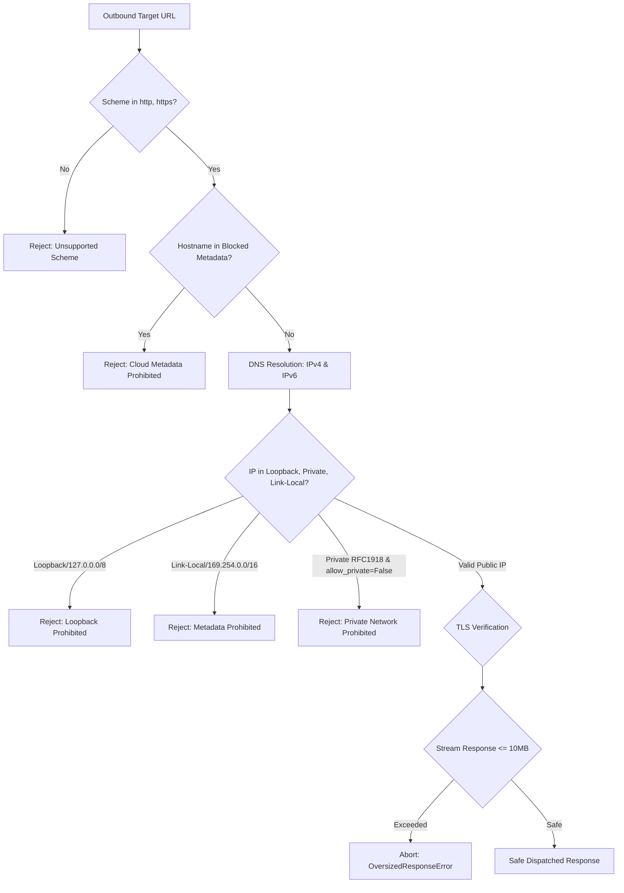

# VAPT Platform: API Security, Contract Governance & Outbound SSRF Protection Matrix

**Version:** 2026.2.0 (Prompt 24)  
**Standard:** OWASP API Security Top 10 (2023) / RFC 9457 (Problem Details) / ASVS v4.0.3  
**Status:** QUALIFIED & VERIFIED  

---

## 1. Executive Summary & Objective

Prompt 24 establishes comprehensive API contract governance, strict schema validation, predictable error behavior, outbound destination validation against Server-Side Request Forgery (SSRF), request payload limits, and automated drift detection between the backend FastAPI OpenAPI specification and the frontend TypeScript client.

---

## 2. API Contract & Error Model Standardization

### 2.1 Standardized Error Schema
All error responses conform to a unified schema (`APIErrorResponse`) while preserving the top-level `detail` field for backwards compatibility:

```json
{
  "error_code": "RESOURCE_NOT_FOUND",
  "message": "Project not found",
  "detail": "Project not found",
  "request_id": "c1f7a409-777f-4c12-8854-1b48325a7698",
  "timestamp": "2026-10-29T02:00:00Z",
  "details": [],
  "retryable": false
}
```

### 2.2 Programmatic Error Codes

| Error Code | HTTP Status | Description | Retryable |
| :--- | :--- | :--- | :--- |
| `UNAUTHENTICATED` | 401 | Missing, malformed, or expired Bearer JWT token | No |
| `PERMISSION_DENIED` | 403 | Insufficient system role or project membership role | No |
| `RESOURCE_NOT_FOUND` | 404 | Resource does not exist or unauthorized tenant access (fail closed) | No |
| `VALIDATION_ERROR` | 422 / 400 | Request body or query parameters violate schema constraints | No |
| `RESOURCE_CONFLICT` | 409 | Duplicate entity or state transition violation | No |
| `PAYLOAD_TOO_LARGE` | 413 | Request body exceeds configured size limit (2MB JSON / 10MB upload) | No |
| `RATE_LIMIT_EXCEEDED` | 429 | Sensitive endpoint sliding window threshold exceeded | Yes (`Retry-After`) |
| `DESTINATION_RESTRICTED` | 400 | Outbound URL violates SSRF or network security destination policy | No |
| `NETWORK_TIMEOUT` | 504 | Outbound destination connection or read timed out | Yes |
| `DATABASE_BUSY` | 503 | Transient SQLite locking or connection contention | Yes (`Retry-After: 1`) |
| `INTERNAL_ERROR` | 500 | Unhandled system exception (sanitized in production) | No |

---

## 3. Outbound SSRF & Network Security Boundaries

Outbound HTTP connections initiated by scanner adapters, webhook dispatchers, and integration feeds are governed by [`OutboundNetworkSecurityService`](file:///D:/alt/backend/app/services/network_security_service.py):



### Destination Security Invariants:
1. **Scheme Whitelist:** Only `http` and `https` permitted. `file://`, `gopher://`, `ftp://`, `data:` strictly rejected.
2. **No Embedded Credentials:** URLs containing `user:pass@host` are rejected.
3. **Loopback & Private Network Blocking:** Blocks `127.0.0.0/8`, `::1`, `10.0.0.0/8`, `172.16.0.0/12`, `192.168.0.0/16`, `fc00::/7` unless `allow_private_networks=True` is explicitly specified by policy.
4. **Cloud Metadata Shield:** Strictly blocks `169.254.169.254`, `metadata.google.internal`, `instance-data`, `100.100.100.200`.
5. **Mandatory TLS Validation:** `verify=True` strictly enforced; TLS verification cannot be disabled.
6. **Response Size Ceiling:** Outbound response bodies streamed with max 10MB cutoff to protect against memory exhaustion.
7. **Redirect Policy:** Max 3 redirects; destination policy re-evaluated on every redirect hop to defend against open redirect SSRF bypasses.

---

## 4. API Abuse & Rate Limiting Controls

The platform implements an in-memory sliding window rate limiter ([`RateLimitService`](file:///D:/alt/backend/app/services/rate_limit_service.py)):

| Bucket | Max Requests | Window (s) | Purpose |
| :--- | :--- | :--- | :--- |
| `AUTH_LOGIN` | 30 | 60 | Defends `/api/v1/auth/login` against brute-force password attacks |
| `JOB_CREATION` | 60 | 60 | Prevents scanner queue flooding |
| `RECOVERY_LIVE` | 50 | 60 | Protects live database disaster restoration |
| `REPORT_EXPORT` | 40 | 60 | Prevents CPU/memory exhaustion via concurrent PDF/CSV generation |
| `DISCOVERY_INGEST` | 100 | 60 | Regulates fixture and observation ingestion |
| `DEFAULT` | 500 | 60 | General API request ceiling |

---

## 5. Automated Contract Verification & Drift Detection

Automated contract verification is executed via [`scripts/verify_api_contracts.py`](file:///D:/alt/scripts/verify_api_contracts.py):
- Scans all 213 registered backend routes from the FastAPI OpenAPI 3.1 specification.
- Extracts all 177 frontend client callsites from `frontend/src/services/api.ts`.
- Matches routes accounting for parameterized templates (`:projectId` vs `{project_id}`).
- Verifies 100% synchronicity across 7 core domain enums (`SystemRole`, `ProjectRole`, `AssessmentStatus`, `FindingSeverity`, `FindingConfidence`, `ApprovalWorkflowType`, `GovernanceApprovalStatus`).
- Generates `api_contract_verification_report.json` with 0 drift.

---

## 6. Empirical Test Matrix

All 17 empirical scenarios in `backend/tests/test_prompt24_api_security_and_contracts.py` verified:

| Test ID | Scenario | Expected Outcome | Result |
| :--- | :--- | :--- | :--- |
| `test_01` | Validation failure on invalid body | HTTP 422 with `VALIDATION_ERROR` and details list | **PASSED** |
| `test_02` | Unauthenticated access | HTTP 401 with `UNAUTHENTICATED` error code | **PASSED** |
| `test_03` | Forbidden role access | HTTP 403 with `PERMISSION_DENIED` error code | **PASSED** |
| `test_04` | Non-existent resource | HTTP 404 with `RESOURCE_NOT_FOUND` error code | **PASSED** |
| `test_05` | Payload > 2MB limit on JSON route | HTTP 413 with `PAYLOAD_TOO_LARGE` error code | **PASSED** |
| `test_06` | Loopback address outbound request | Blocked with `DESTINATION_RESTRICTED` (HTTP 400) | **PASSED** |
| `test_07` | Cloud metadata outbound request | Blocked with `DESTINATION_RESTRICTED` (HTTP 400) | **PASSED** |
| `test_08` | Non-HTTP scheme (file://, gopher://) | Blocked with `DESTINATION_RESTRICTED` (HTTP 400) | **PASSED** |
| `test_09` | Embedded credentials in destination URL | Prohibited with `DESTINATION_RESTRICTED` | **PASSED** |
| `test_10` | Valid public HTTPS FQDN | Resolved and validated (HTTP 200) | **PASSED** |
| `test_11` | Mandatory TLS verification | `verify=True` strictly enforced on client | **PASSED** |
| `test_12` | Outbound response size ceiling | Raises `OversizedResponseError` when > 10MB | **PASSED** |
| `test_13` | Sliding window rate limiting engine | Quota enforcement and retry-after calculation | **PASSED** |
| `test_14` | Login brute-force abuse protection | HTTP 429 with `RATE_LIMIT_EXCEEDED` and `Retry-After` | **PASSED** |
| `test_15` | Correlation ID propagation | `X-Request-ID` preserved across headers and error model | **PASSED** |
| `test_16` | Automated contract verification tool | 177/177 routes and 7/7 enums verified with 0 drift | **PASSED** |
| `test_17` | Multi-tenant project isolation | Fails closed with 404 on unauthorized project access | **PASSED** |
