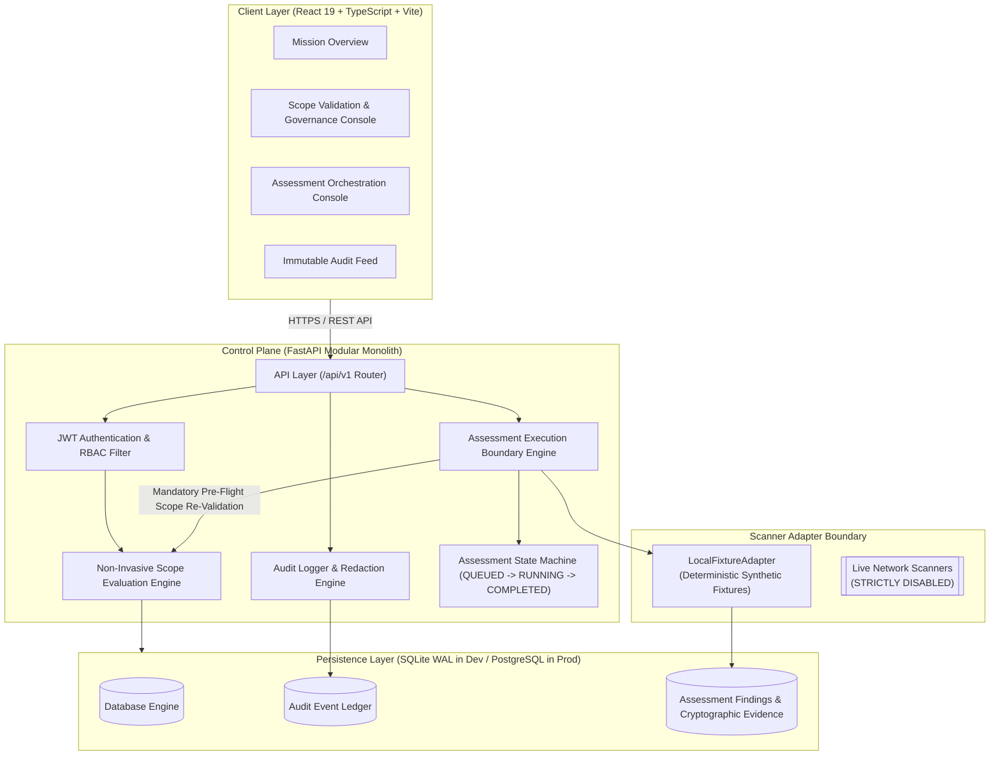
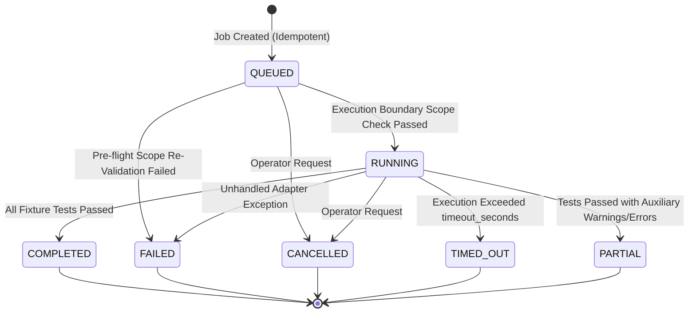
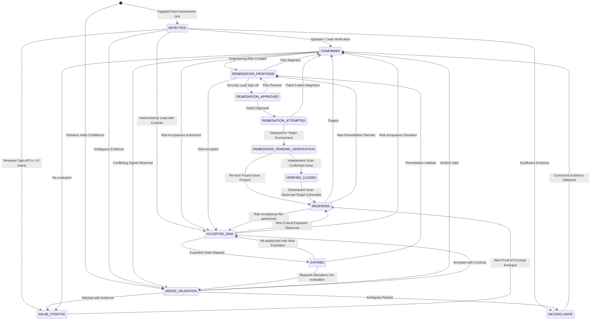

# VAPT Platform — Architecture & Design Document (Phase 1 & 2)

## 1. Executive Summary

The VAPT (Vulnerability Assessment and Penetration Testing) Platform is an enterprise cybersecurity intelligence and operational testing control plane. The system is engineered as a **Modular Monolith** for Phase 1 & 2, prioritizing high cohesion, strong tenant/project boundaries, non-invasive scope validation, verifiable proof-of-authorization, and a deterministic assessment orchestration pipeline.

Future live scanner workers, exploitation engines, and AI-driven analysis tools are strictly segregated behind an isolated execution boundary, remaining dormant until explicit authorization, resource limits, and worker sandboxing are verified.

---

## 2. System Architecture

---

## 3. Core Architectural Modules

| Module | Purpose | Phase Status |
| :--- | :--- | :--- |
| **1. Core & Lifecycle** | Configuration management (`pydantic-settings`), request context tracking, liveness (`/health`) and readiness (`/ready`) probes. | **Implemented & Verified** |
| **2. Auth & Identity** | Bcrypt password hashing (cost factor 12), short-lived JWT token issuance, RBAC (`ADMIN`, `SECURITY_LEAD`, `SECURITY_TESTER`, `AUDITOR`, `VIEWER`). | **Implemented & Verified** |
| **3. Organizations & Projects** | Multi-tenant project hierarchy, project roles (`LEAD`, `TESTER`), and project-level boundary isolation. | **Implemented & Verified** |
| **4. Scopes & Target Authorization** | Target registration (`PENDING`), explicit evidence-backed authorization (`AUTHORIZED`), scope exclusions, and fail-closed validation. | **Implemented & Verified** |
| **5. Audit Logging** | Immutable security event logging with automated credential scrubbing and strict failure-mode enforcement. | **Implemented & Verified** |
| **6. Assessment Orchestration & Evidence Pipeline** | Persistent job state machine, idempotency keys, deterministic local fixture adapter, finding persistence, and cryptographic SHA-256 evidence provenance. | **Implemented & Verified (Phase 2)** |
| **7. Finding Lifecycle & Deduplication** | 13-state finding lifecycle, deduplication, revalidation, and risk acceptance. | **Implemented & Verified (Phase 3)** |
| **8. Asset Inventory & Knowledge Graph** | Asset graph topology, multi-hop relationship modeling, and choke-point discovery. | **Implemented & Verified (Phase 4)** |
| **9. Contextual Risk Engine** | Transparent, deterministic risk scoring combining severity, exposure, and asset criticality. | *Target: Phase 5* |

---

## 4. Assessment State Machine & Execution Boundary

Assessment jobs follow a strict, deterministic finite state machine:

### Pre-Flight Execution Invariant
Before any adapter runs, the `AssessmentExecutionEngine`:
1. Re-evaluates `ScopeEngine.validate_target_in_scope()` against the database.
2. If authorization expired, was revoked, or an exclusion was added while the job was queued, the job transitions immediately to `FAILED` with an explicit reason, and an `ASSESSMENT_EXECUTION_DENIED` audit event is emitted.
3. Network scanning is strictly disabled. The adapter interface dispatches solely to approved adapters (default: `LocalFixtureAdapter`).

---

## 5. Audit Logging & Tamper-Evident Distinction

### Implemented Model: Structured Transactional Append-Only Ledger
The platform currently implements an **append-only relational audit ledger**:
- Immutable rows stored in `audit_events`.
- Transactional integrity tied to database transactions (`AUDIT_LOG_STRICT=True`).
- Client IP, actor ID, action, outcome, and timestamp recorded.
- Automated recursive scrubbing of all credentials and sensitive keys.

### Architectural Boundary: Cryptographic Tamper-Evidence
An append-only ledger differs from a cryptographically tamper-evident or tamper-proof system:
- In the current Phase 1/2 model, an attacker with direct, administrative SQL database access could theoretically alter historical rows.
- Future phases (Phase 8) will introduce **Merkle trees and cryptographic hash-chaining** (`previous_record_hash`) anchored to external, independent timestamping authorities to establish verifiable mathematical tamper-evidence.

---

## 6. Finding Validation & 13-State Lifecycle Pipeline

### State Machine Architecture
Findings adhere to a strict, finite 13-state lifecycle model governing discovery, validation, triage, remediation, independent verification, and closure. Direct jumps across boundaries (e.g., `DETECTED` straight to `VERIFIED_CLOSED`) are strictly forbidden.

### Finding Deduplication & Correlation
The platform implements deterministic SHA-256 fingerprinting based on normalized target value, normalized vulnerability identifier (e.g., `CVE-2026-1049` or `CWE-89`), and sanitized title.
1. **Recurring Observations**: When subsequent assessment executions encounter an existing finding, `occurrence_count` increments and `last_observed_at` updates without creating duplicate canonical records.
2. **Automated Reopening**: If a vulnerability is re-observed on a target that was previously marked `VERIFIED_CLOSED` or `REMEDIATED_PENDING_VERIFICATION`, the state machine automatically transitions the finding to `REOPENED` and generates an audit record.
3. **Contradictory Evidence Preservation**: If scanner observations diverge in severity or confidence across jobs (e.g., Scanner A reports `CRITICAL` / `CERTAIN` while Scanner B reports `LOW` / `TENTATIVE`), the engine flags `has_contradictions = True` and appends detailed contradiction provenance without overwriting historical evidence.

### Risk Acceptance & False Positive Governance
- **`ACCEPTED_RISK`**: Requires `ProjectRole.LEAD` or `SystemRole.ADMIN`, a mandatory future expiration date (<= 365 days), documented compensating controls, and comprehensive business rationale. Overdue accepted risks are automatically transitioned to `EXPIRED` during scheduled or automated sweeps.
- **`FALSE_POSITIVE`**: Requires `ProjectRole.LEAD` or `SystemRole.ADMIN` with mandatory justification notes (>= 10 characters) explaining why the vulnerability does not exist or constitutes expected behavior.

---

## 7. Persistent Asset Inventory & Conservative Reconciliation

### Separation of Authoritative State and Supporting Observations
The platform strictly decouples current authoritative asset state (`assets`) from raw, time-stamped scanner outputs (`asset_observations`):
- **`Asset`**: Represents the current reconciled identity of an infrastructure component, including its normalized `canonical_identifier`, `asset_type`, `criticality`, `status`, merged `attributes`, and ambiguity flags.
- **`AssetObservation`**: Immutable append-only log capturing each scanner's raw attributes, observation timestamp, adapter version, cryptographic evidence hash, confidence rating, and assessment job reference. Conflicting observations never silently overwrite previous records; attribute changes are tracked chronologically in `_attribute_history`.

### Type-Specific Canonical Normalization Rules
1. **Web Apps & API Endpoints**: Normalizes URL scheme (`http`/`https`), strips default ports (80/443), strips trailing slashes, downcases hostname, strictly validates hostname against CWE-1288 leading-zero ambiguity, and distinguishes URLs with API paths (`API_ENDPOINT`) from root web hosts (`WEB_APP`).
2. **Services**: Formats scheme and port consistently (e.g., `tcp://host:port`), stripping protocol-specific trailing syntax, and verifies host does not contain ambiguous leading zeros.
3. **IP Addresses**: Strictly rejects ambiguous IPv4 octets containing leading zeros (e.g. `0177.0.0.1` or `192.168.001.050`) per CWE-1288 standards-safe normalization to eliminate decimal vs. octal socket discrepancy vulnerabilities (CVE-2021-29921). Formats IPv6 addresses using standard compressed notation (`ipaddress.ip_address.compressed`).
4. **CIDR Blocks**: Rejects ambiguous octets with leading zeros (e.g. `192.168.001.0/24`) and normalizes network prefix and base address via `ipaddress.ip_network`.
5. **Domains & Hostnames**: Normalizes to lowercase, strips trailing FQDN root dots, validates characters against `^[a-zA-Z0-9*_\-.]+$` to reject control characters, shell metacharacters, or HTML injection, and distinguishes dotted domains from single-label hostnames.
6. **Deterministic Evidence Hashing**: When `evidence_hash` is not supplied, `record_observation` computes a canonical SHA-256 digest over key-sorted JSON serialization (`sort_keys=True, separators=(',', ':')`) for deterministic cryptographic provenance. Note that this hash verifies integrity and chronological provenance across executions, but does not substitute for external digital signatures for third-party identity proof.

### Ambiguity Tracking & Resolution Governance
If a target exhibits conflicting identity signals (e.g. dynamic IP reallocations, shared virtual hostnames, or unverified aliases), the entity is flagged with `is_ambiguous = True` and an explicit `ambiguity_reason`. Resolving ambiguity requires operator review with mandatory audit-logged `resolution_notes`, moving previous reasons into immutable `_resolution_history`.

---

## 8. Universal Security Knowledge Graph

### Relational Graph Architecture
Rather than introducing external, non-portable graph database engines, the Universal Security Knowledge Graph is engineered on relational database primitives (`graph_nodes`, `graph_relationships`) optimized for SQLite in local development and PostgreSQL in production:
- **`GraphNode`**: Represents any security entity within a project context (`ASSET`, `SERVICE`, `APPLICATION`, `IDENTITY`, `ROLE`, `PERMISSION`, `VULNERABILITY`, `FINDING`, `EVIDENCE`, `SECURITY_CONTROL`, `DEPENDENCY`, `REMEDIATION`, `ASSESSMENT`). Unique constraint on `(project_id, category, entity_id)` guarantees idempotent creation. For synthetic or logical entities where `entity_id` is None, `get_or_create_node` queries by `(project_id, category, label, entity_id is None)` to prevent duplicate orphan nodes.
- **`GraphRelationship`**: Directed typed edges (`RUNS`, `DEPENDS_ON`, `AUTHENTICATES_TO`, `CAN_ACCESS`, `EXPOSES`, `AFFECTED_BY`, `MITIGATES`, `OBSERVED_AT`, `VERIFIED_BY`, `BELONGS_TO`, `ASSOCIATED_WITH`). Self-referential edges (`source_node_id == target_node_id`) are strictly prohibited and rejected.

### Verification States & Epistemic Confidence
Each graph relationship maintains an explicit verification state and confidence score ($0.0 \le c \le 1.0$):
- **`VERIFIED`**: Confirmed via direct assessment observation or signed proof.
- **`INFERRED`**: Deduced via heuristic correlation, partial assessment outcomes, or dependency analysis.
- **`HYPOTHETICAL`**: Modeled what-if attack vector or simulated condition.
- **`STALE`**: Historical observation whose validity window has elapsed.
- **`SUPERSEDED`**: Replaced by subsequent higher-fidelity observations.

### Cycle-Safe Bounded Traversal Algorithm
Neighborhood graph queries (`GET /graph/nodes/{node_id}/neighborhood`) execute a bounded Breadth-First Search (BFS):
1. Traversal maintains a `visited_nodes` registry preventing infinite loops on cyclic topologies ($A \to B \to C \to A$).
2. Traversal strictly enforces `max_depth` (default 2, cap 4), `max_nodes` (cap 200), and `max_edges` (cap 300).
3. If query limits are reached, traversal halts gracefully and returns `truncated = True`, preventing denial-of-service on densely connected graphs.
4. Traversal response returns both `relationships` (rich metadata containing relationship_type, status, confidence, provenance, evidence_reference, observed_at, properties) and `edges` (graph layout connectors) to ensure seamless API and frontend visualization schema parity.

### Strict Project Isolation
Every graph query and relationship creation validates that both `source_node` and `target_node` reside within the authorized `project_id`. Cross-project relationship injection is rejected with fail-closed errors.

### Assessment Integration
When an assessment job finishes execution, the pipeline runs graph integration **after** the state machine finalizes the execution status:
1. Reconciles the target asset in inventory.
2. If `job.status == FAILED`: records the assessment job node with `status: "FAILED"`, but does **not** record a successful observation on the asset and does **not** establish false verified edges.
3. If `job.status == PARTIAL`: records an observation with `validation_status: "PARTIAL"`, and marks generated relationships with `status: RelationshipStatus.INFERRED`.
4. If `job.status == COMPLETED`: appends an immutable `AssetObservation` (`validation_status: "VERIFIED"`), links canonical findings to the asset (`finding.asset_id = asset.id`), and generates corresponding graph nodes and verified edges (`OBSERVED_AT`, `AFFECTED_BY`, `VERIFIED_BY`, `ASSOCIATED_WITH`).

