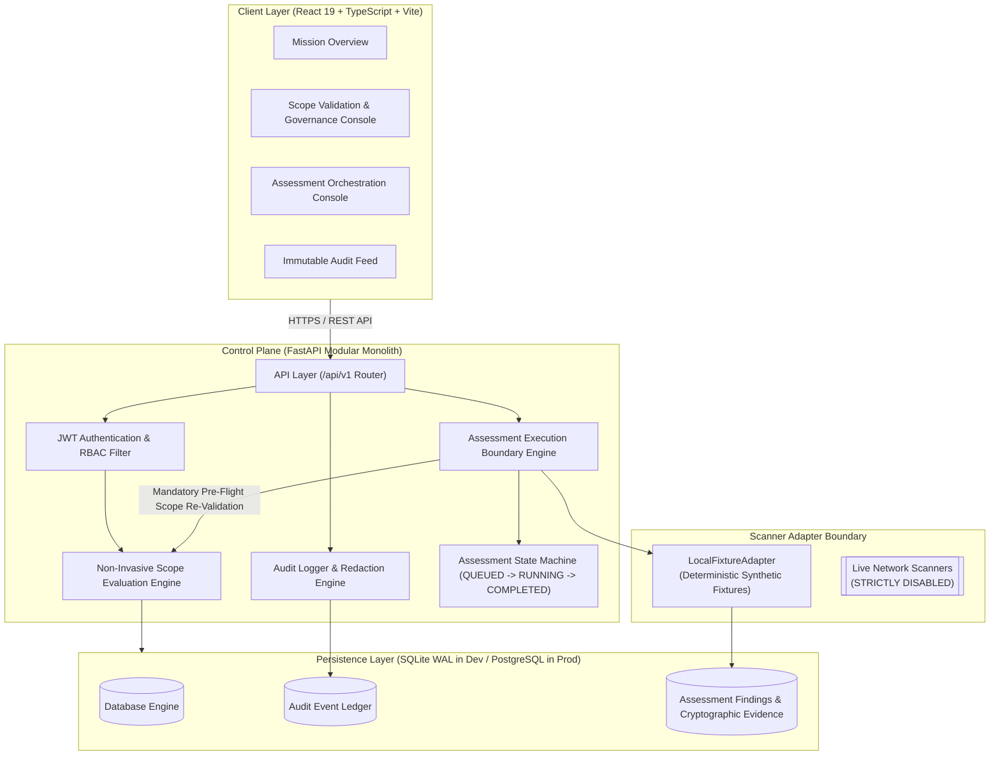
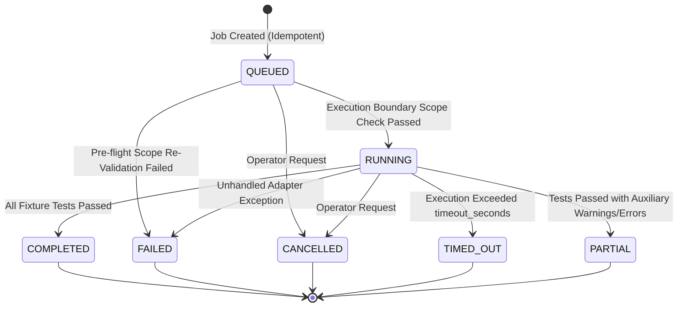
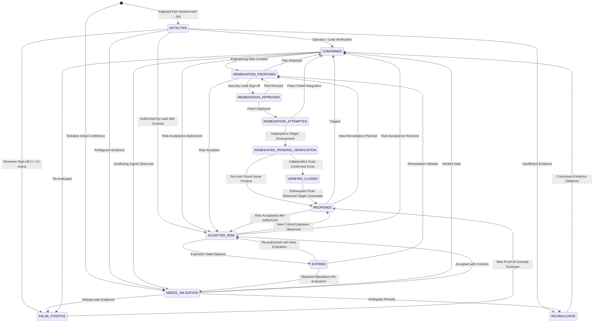
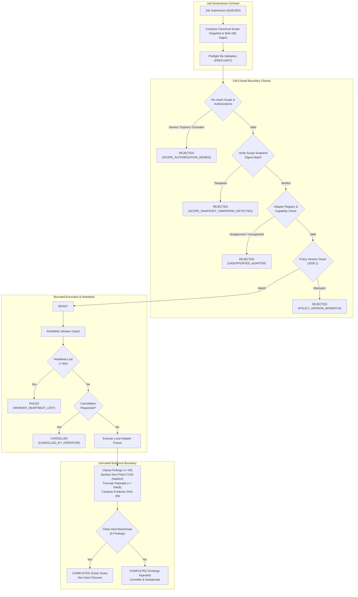
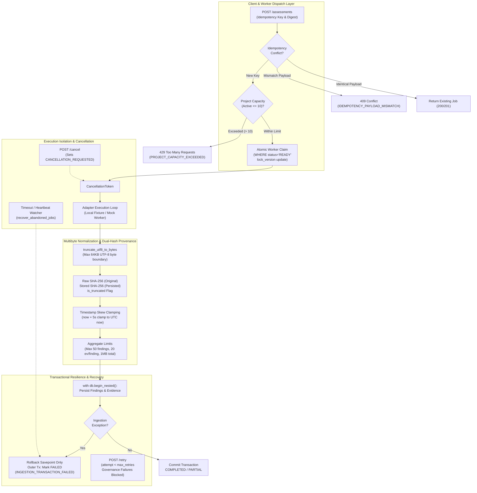

# VAPT Platform — Architecture & Design Document (Phase 1 & 2)

## 1. Executive Summary

The VAPT (Vulnerability Assessment and Penetration Testing) Platform is an enterprise cybersecurity intelligence and operational testing control plane. The system is engineered as a **Modular Monolith** for Phase 1 & 2, prioritizing high cohesion, strong tenant/project boundaries, non-invasive scope validation, verifiable proof-of-authorization, and a deterministic assessment orchestration pipeline.

Future live scanner workers, exploitation engines, and AI-driven analysis tools are strictly segregated behind an isolated execution boundary, remaining dormant until explicit authorization, resource limits, and worker sandboxing are verified.

---

## 2. System Architecture



---

## 3. Core Architectural Modules

| Module | Purpose | Phase Status |
| :--- | :--- | :--- |
| **1. Core & Lifecycle** | Configuration management (`pydantic-settings`), request context tracking, liveness (`/health`) and readiness (`/ready`) probes. | **Implemented & Verified** |
| **2. Auth & Identity** | Bcrypt password hashing (cost factor 12), short-lived JWT token issuance, RBAC (`ADMIN`, `SECURITY_LEAD`, `SECURITY_TESTER`, `AUDITOR`, `VIEWER`). | **Implemented & Verified** |
| **3. Organizations & Projects** | Multi-tenant project hierarchy, project roles (`LEAD`, `TESTER`), and project-level boundary isolation. | **Implemented & Verified** |
| **4. Scopes & Target Authorization** | Target registration (`PENDING`), explicit evidence-backed authorization (`AUTHORIZED`), scope exclusions, and fail-closed validation. | **Implemented & Verified** |
| **5. Audit Logging** | Immutable security event logging with automated credential scrubbing and strict failure-mode enforcement. | **Implemented & Verified** |
| **6. Assessment Orchestration & Evidence Pipeline** | Persistent job state machine, idempotency keys, deterministic local fixture adapter, finding persistence, and cryptographic SHA-256 evidence provenance. | **Implemented & Verified (Phase 2)** |
| **7. Finding Lifecycle & Deduplication** | 13-state finding lifecycle, deduplication, revalidation, and risk acceptance. | **Implemented & Verified (Phase 3)** |
| **8. Asset Inventory & Knowledge Graph** | Asset graph topology, multi-hop relationship modeling, and choke-point discovery. | **Implemented & Verified (Phase 4)** |
| **9. Contextual Risk Engine** | Transparent, deterministic risk scoring combining severity, exposure, and asset criticality. | *Target: Phase 5* |

---

## 4. Assessment State Machine & Execution Boundary

Assessment jobs follow a strict, deterministic finite state machine:



### Pre-Flight Execution Invariant
Before any adapter runs, the `AssessmentExecutionEngine`:
1. Re-evaluates `ScopeEngine.validate_target_in_scope()` against the database.
2. If authorization expired, was revoked, or an exclusion was added while the job was queued, the job transitions immediately to `FAILED` with an explicit reason, and an `ASSESSMENT_EXECUTION_DENIED` audit event is emitted.
3. Network scanning is strictly disabled. The adapter interface dispatches solely to approved adapters (default: `LocalFixtureAdapter`).

---

## 5. Audit Logging & Tamper-Evident Distinction

### Implemented Model: Structured Transactional Append-Only Ledger
The platform currently implements an **append-only relational audit ledger**:
- Immutable rows stored in `audit_events`.
- Transactional integrity tied to database transactions (`AUDIT_LOG_STRICT=True`).
- Client IP, actor ID, action, outcome, and timestamp recorded.
- Automated recursive scrubbing of all credentials and sensitive keys.

### Architectural Boundary: Cryptographic Tamper-Evidence
An append-only ledger differs from a cryptographically tamper-evident or tamper-proof system:
- In the current Phase 1/2 model, an attacker with direct, administrative SQL database access could theoretically alter historical rows.
- Future phases (Phase 8) will introduce **Merkle trees and cryptographic hash-chaining** (`previous_record_hash`) anchored to external, independent timestamping authorities to establish verifiable mathematical tamper-evidence.

---

## 6. Finding Validation & 13-State Lifecycle Pipeline

### State Machine Architecture
Findings adhere to a strict, finite 13-state lifecycle model governing discovery, validation, triage, remediation, independent verification, and closure. Direct jumps across boundaries (e.g., `DETECTED` straight to `VERIFIED_CLOSED`) are strictly forbidden.



### Finding Deduplication & Correlation
The platform implements deterministic SHA-256 fingerprinting based on normalized target value, normalized vulnerability identifier (e.g., `CVE-2026-1049` or `CWE-89`), and sanitized title.
1. **Recurring Observations**: When subsequent assessment executions encounter an existing finding, `occurrence_count` increments and `last_observed_at` updates without creating duplicate canonical records.
2. **Automated Reopening**: If a vulnerability is re-observed on a target that was previously marked `VERIFIED_CLOSED` or `REMEDIATED_PENDING_VERIFICATION`, the state machine automatically transitions the finding to `REOPENED` and generates an audit record.
3. **Contradictory Evidence Preservation**: If scanner observations diverge in severity or confidence across jobs (e.g., Scanner A reports `CRITICAL` / `CERTAIN` while Scanner B reports `LOW` / `TENTATIVE`), the engine flags `has_contradictions = True` and appends detailed contradiction provenance without overwriting historical evidence.

### Risk Acceptance & False Positive Governance
- **`ACCEPTED_RISK`**: Requires `ProjectRole.LEAD` or `SystemRole.ADMIN`, a mandatory future expiration date (<= 365 days), documented compensating controls, and comprehensive business rationale. Overdue accepted risks are automatically transitioned to `EXPIRED` during scheduled or automated sweeps.
- **`FALSE_POSITIVE`**: Requires `ProjectRole.LEAD` or `SystemRole.ADMIN` with mandatory justification notes (>= 10 characters) explaining why the vulnerability does not exist or constitutes expected behavior.

---

## 7. Persistent Asset Inventory & Conservative Reconciliation

### Separation of Authoritative State and Supporting Observations
The platform strictly decouples current authoritative asset state (`assets`) from raw, time-stamped scanner outputs (`asset_observations`):
- **`Asset`**: Represents the current reconciled identity of an infrastructure component, including its normalized `canonical_identifier`, `asset_type`, `criticality`, `status`, merged `attributes`, and ambiguity flags.
- **`AssetObservation`**: Immutable append-only log capturing each scanner's raw attributes, observation timestamp, adapter version, cryptographic evidence hash, confidence rating, and assessment job reference. Conflicting observations never silently overwrite previous records; attribute changes are tracked chronologically in `_attribute_history`.

### Type-Specific Canonical Normalization Rules
1. **Web Apps & API Endpoints**: Normalizes URL scheme (`http`/`https`), strips default ports (80/443), strips trailing slashes, downcases hostname, strictly validates hostname against CWE-1288 leading-zero ambiguity, and distinguishes URLs with API paths (`API_ENDPOINT`) from root web hosts (`WEB_APP`).
2. **Services**: Formats scheme and port consistently (e.g., `tcp://host:port`), stripping protocol-specific trailing syntax, and verifies host does not contain ambiguous leading zeros.
3. **IP Addresses**: Strictly rejects ambiguous IPv4 octets containing leading zeros (e.g. `0177.0.0.1` or `192.168.001.050`) per CWE-1288 standards-safe normalization to eliminate decimal vs. octal socket discrepancy vulnerabilities (CVE-2021-29921). Formats IPv6 addresses using standard compressed notation (`ipaddress.ip_address.compressed`).
4. **CIDR Blocks**: Rejects ambiguous octets with leading zeros (e.g. `192.168.001.0/24`) and normalizes network prefix and base address via `ipaddress.ip_network`.
5. **Domains & Hostnames**: Normalizes to lowercase, strips trailing FQDN root dots, validates characters against `^[a-zA-Z0-9*_\-.]+$` to reject control characters, shell metacharacters, or HTML injection, and distinguishes dotted domains from single-label hostnames.
6. **Deterministic Evidence Hashing**: When `evidence_hash` is not supplied, `record_observation` computes a canonical SHA-256 digest over key-sorted JSON serialization (`sort_keys=True, separators=(',', ':')`) for deterministic cryptographic provenance. Note that this hash verifies integrity and chronological provenance across executions, but does not substitute for external digital signatures for third-party identity proof.

### Ambiguity Tracking & Resolution Governance
If a target exhibits conflicting identity signals (e.g. dynamic IP reallocations, shared virtual hostnames, or unverified aliases), the entity is flagged with `is_ambiguous = True` and an explicit `ambiguity_reason`. Resolving ambiguity requires operator review with mandatory audit-logged `resolution_notes`, moving previous reasons into immutable `_resolution_history`.

---

## 8. Universal Security Knowledge Graph

### Relational Graph Architecture
Rather than introducing external, non-portable graph database engines, the Universal Security Knowledge Graph is engineered on relational database primitives (`graph_nodes`, `graph_relationships`) optimized for SQLite in local development and PostgreSQL in production:
- **`GraphNode`**: Represents any security entity within a project context (`ASSET`, `SERVICE`, `APPLICATION`, `IDENTITY`, `ROLE`, `PERMISSION`, `VULNERABILITY`, `FINDING`, `EVIDENCE`, `SECURITY_CONTROL`, `DEPENDENCY`, `REMEDIATION`, `ASSESSMENT`). Unique constraint on `(project_id, category, entity_id)` guarantees idempotent creation. For synthetic or logical entities where `entity_id` is None, `get_or_create_node` queries by `(project_id, category, label, entity_id is None)` to prevent duplicate orphan nodes.
- **`GraphRelationship`**: Directed typed edges (`RUNS`, `DEPENDS_ON`, `AUTHENTICATES_TO`, `CAN_ACCESS`, `EXPOSES`, `AFFECTED_BY`, `MITIGATES`, `OBSERVED_AT`, `VERIFIED_BY`, `BELONGS_TO`, `ASSOCIATED_WITH`). Self-referential edges (`source_node_id == target_node_id`) are strictly prohibited and rejected.

### Verification States & Epistemic Confidence
Each graph relationship maintains an explicit verification state and confidence score ($0.0 \le c \le 1.0$):
- **`VERIFIED`**: Confirmed via direct assessment observation or signed proof.
- **`INFERRED`**: Deduced via heuristic correlation, partial assessment outcomes, or dependency analysis.
- **`HYPOTHETICAL`**: Modeled what-if attack vector or simulated condition.
- **`STALE`**: Historical observation whose validity window has elapsed.
- **`SUPERSEDED`**: Replaced by subsequent higher-fidelity observations.

### Cycle-Safe Bounded Traversal Algorithm
Neighborhood graph queries (`GET /graph/nodes/{node_id}/neighborhood`) execute a bounded Breadth-First Search (BFS):
1. Traversal maintains a `visited_nodes` registry preventing infinite loops on cyclic topologies ($A \to B \to C \to A$).
2. Traversal strictly enforces `max_depth` (default 2, cap 4), `max_nodes` (cap 200), and `max_edges` (cap 300).
3. If query limits are reached, traversal halts gracefully and returns `truncated = True`, preventing denial-of-service on densely connected graphs.
4. Traversal response returns both `relationships` (rich metadata containing relationship_type, status, confidence, provenance, evidence_reference, observed_at, properties) and `edges` (graph layout connectors) to ensure seamless API and frontend visualization schema parity.

### Strict Project Isolation
Every graph query and relationship creation validates that both `source_node` and `target_node` reside within the authorized `project_id`. Cross-project relationship injection is rejected with fail-closed errors.

### Assessment Integration
When an assessment job finishes execution, the pipeline runs graph integration **after** the state machine finalizes the execution status:
1. Reconciles the target asset in inventory.
2. If `job.status == FAILED`: records the assessment job node with `status: "FAILED"`, but does **not** record a successful observation on the asset and does **not** establish false verified edges.
3. If `job.status == PARTIAL`: records an observation with `validation_status: "PARTIAL"`, and marks generated relationships with `status: RelationshipStatus.INFERRED`.
4. If `job.status == COMPLETED`: appends an immutable `AssetObservation` (`validation_status: "VERIFIED"`), links canonical findings to the asset (`finding.asset_id = asset.id`), and generates corresponding graph nodes and verified edges (`OBSERVED_AT`, `AFFECTED_BY`, `VERIFIED_BY`, `ASSOCIATED_WITH`).

---

## 9. Contextual Risk Intelligence & Remediation Prioritization (Phase 5)

### 9.1 Explainable Contextual Risk Engine (Version: `v1.0.0`)
The platform calculates a deterministic, explainable Contextual Risk Score $S \in [0, 100]$ as an operational prioritization index (rather than an unvalidated probability of compromise):

$$S = \text{round}\left(\min\left(100.0, \max\left(0.0, \text{BaseScore} \times \text{ConfidenceWeight} \times M_{\text{crit}} \times M_{\text{exp}} \times M_{\text{fresh}} \times M_{\text{mit}}\right)\right), 1\right)$$

#### Factor Decomposition
1. **Base Severity Score ($\text{BaseScore}$)**:
   - Anchored to categorical vendor/scanner severity: `CRITICAL` (90.0), `HIGH` (70.0), `MEDIUM` (45.0), `LOW` (20.0), `INFO` (5.0).
   - If a valid CVSS score ($0.0 \le \text{CVSS} \le 10.0$) is present, scales within the severity band ($\text{CVSS} \times 10.0$). The original finding severity is never overwritten.
2. **Finding Confidence Weight ($\text{ConfidenceWeight}$)**:
   - `CERTAIN`: 1.00 | `FIRM`: 0.85 | `TENTATIVE`: 0.65.
3. **Asset Criticality Multiplier ($M_{\text{crit}}$)**:
   - `CRITICAL`: 1.35 | `HIGH`: 1.15 | `MEDIUM`: 1.00 | `LOW`: 0.85 | `INFO`: 0.70. Default 1.00 if unlinked (explicitly flagged in `missing_factors`).
4. **Network Exposure & Reachability Multiplier ($M_{\text{exp}}$)**:
   - Internet-Facing / Exposed (`WEB_APP`, `API_ENDPOINT`, or graph `EXPOSES` edge): 1.25.
   - Standard Internal Network Service (`SERVICE`, `HOST`, IP): 1.00.
   - Isolated Backend / Datastore (`DATA_STORE`, `SOFTWARE_COMPONENT`, `SECURITY_CONTROL`): 0.85. Default 1.00 if exposure is unknown.
5. **Evidence Freshness Decay ($M_{\text{fresh}}$)**:
   - $\le 7$ days: 1.00 | $8–30$ days: 0.90 | $31–90$ days: 0.80 | $> 90$ days (stale): 0.70.
6. **Lifecycle & Compensating Controls Multiplier ($M_{\text{mit}}$)**:
   - `VERIFIED_CLOSED` / `FALSE_POSITIVE`: 0.00 (risk neutralized).
   - `ACCEPTED_RISK` (with active compensating controls): 0.40.
   - `REMEDIATED_PENDING_VERIFICATION`: 0.50 | `REMEDIATION_ATTEMPTED`: 0.75 | `REMEDIATION_APPROVED`: 0.90.
   - `REOPENED`: 1.10 (elevated urgency due to recurring vulnerability).
   - `CONFIRMED`: 1.05 | `DETECTED` / `NEEDS_VALIDATION`: 1.00.

#### Priority Mapping
- **CRITICAL**: $S \ge 80.0$
- **HIGH**: $60.0 \le S < 80.0$
- **MEDIUM**: $40.0 \le S < 60.0$
- **LOW**: $15.0 \le S < 40.0$
- **INFORMATIONAL**: $S < 15.0$

### 9.2 Reproducibility & Frozen Input Snapshots
Each persisted `RiskAssessment` records:
- A frozen JSON `input_snapshot` of every variable used in the calculation.
- An explicit list of `contributing_factors` explaining the principal drivers of the score.
- An explicit list of `missing_factors` highlighting epistemic uncertainty (e.g. unlinked asset criticality, missing CVSS).
- Recalculation is idempotent when inputs are unchanged; recalculations with new evidence supersede previous assessments (`is_superseded = True`, `superseded_at`), preserving an immutable historical audit trail.

### 9.3 Evidence-Aware Attack Path Analysis
The Knowledge Graph engine includes a bounded, read-only path analysis service (`AttackPathAnalysisService`) that connects security entities exclusively through persisted graph relationships:
- **`VERIFIED` Path**: Every relationship along the path has status `VERIFIED` AND confidence $\ge 0.7$.
- **`MIXED_EVIDENCE` Path**: Path contains both `VERIFIED` and `INFERRED` relationships without stale/superseded edges.
- **`STALE` Path**: Path contains one or more `STALE` or `SUPERSEDED` relationships; explicitly flagged with detailed missing evidence explaining expired edges.
- **`HYPOTHETICAL` Path**: Path contains `HYPOTHETICAL` relationships or uncorroborated edges requiring empirical confirmation.
- **Cycle Safety & Bounded Depth**: DFS search enforces depth bounds ($\le 4$) and candidate path caps ($\le 10$), maintaining path visited sets to cut cycles.
- **Epistemic Disclaimer**: Graph adjacency represents potential exposure and relational topology, NOT confirmed breach or automated exploitability.

### 9.4 Non-Executing Remediation Decision Support
The remediation service (`RemediationPrioritizationService`) maps confirmed findings to defensive corrective actions, operational impact assessments, rollback procedures, and independent verification criteria:
- **Strict Non-Execution Guarantee**: Phase 5 operates exclusively in an advisory capacity. It never executes shell commands, alters firewall rules, modifies code repositories, or restarts services.
- **Decoupled Verification**: A finding is never marked remediated simply because a recommendation was approved. The existing finding lifecycle requires independent scan verification (`REMEDIATED_PENDING_VERIFICATION` $\to$ `VERIFIED_CLOSED`).
- **Governance & RBAC**: Reviewing and approving remediation playbooks (`APPROVED`, `DEFERRED`, `REJECTED`) is restricted to Project LEAD and System ADMIN roles, with mandatory justification logged to the immutable audit ledger.

---

## 10. Phase 5.1 Security Audit, Model Hardening & API Scoping

### 10.1 Input Sanitization & Precedence Guarantees
- **Non-Finite Value Rejection**: Scanner outputs containing `NaN`, `+inf`, `-inf`, or scores outside $[0.0, 10.0]$ are intercepted before score calculation. The engine falls back to the categorical severity base score and logs an explicit uncertainty entry in `missing_factors`.
- **CVSS vs. Categorical Severity Precedence**: When CVSS quantitatively conflicts with triage severity (e.g. CVSS 9.8 marked `LOW`, or CVSS 1.2 marked `CRITICAL`), categorical bounds govern the floor/ceiling of the base score (`CRITICAL`: [80, 100], `HIGH`: [60, 89], `MEDIUM`: [35, 65], `LOW`: [10, 39], `INFO`: [0, 15]), and a discrepancy notice is logged in `contributing_factors`.
- **Temporal & Timezone Safety**: All calculations enforce UTC-aware comparison. Future-dated timestamps beyond clock skew are clamped to fresh observations (0 days) with explicit notices rather than causing negative duration errors.

### 10.2 Lifecycle & Historical Traceability
- **Preservation on Neutralization**: When a finding transitions to `FALSE_POSITIVE` or `VERIFIED_CLOSED`, current operational risk score drops to 0.0, but the previous active assessment is preserved in `risk_assessments` as superseded (`is_superseded = True`, `superseded_at`), maintaining complete historical scoring telemetry and verification provenance (`verified_by_id`, `verification_notes`, `false_positive_reason`).
- **Residual Risk Tracking for Risk Acceptance**: `ACCEPTED_RISK` findings do not zero out; they receive a 0.40 residual multiplier, and the approver ID, expiration date, and compensating controls are embedded into `input_snapshot` and `contributing_factors`.
- **Formula Version Upgrades**: If `active_assessment.scoring_version != SCORING_VERSION`, the engine bypasses cache reuse and forces a recalculation, ensuring formula changes take effect immediately across all findings.

### 10.3 API Dual Scoping & Boundary Clamping
- **Dual Parent-Child Constraints**: Every endpoint accepting both a `{project_id}` and a child resource ID (`{assessment_id}`, `{recommendation_id}`, `{finding_id}`, `{start_node_id}`) enforces database-level dual validation (`resource.project_id == project_id`). Mismatched cross-project queries fail-closed with 404 Not Found.
- **Pagination Protection**: All list endpoints enforce strict bounds (`limit: int = Query(50, ge=1, le=100)`, `offset: int = Query(0, ge=0)`). Requests exceeding limit bounds are rejected with 422 Unprocessable Entity.

---

## 11. Assessment Execution Boundary, Job Governance & Adapter Contracts (Phase 6A)



### 11.1 Immutable Execution Contract & Digest Verification
Every assessment job instantiated in Phase 6A establishes an immutable, typed governance contract:
- **Canonical Scope Snapshot**: Records normalized target, matched rule ID, target type, authorization evidence, and ROE expiration date serialized into canonical sorting-key JSON.
- **Cryptographic Digest**: Generates a SHA-256 digest of the canonical snapshot.
- **Preflight Tampering Detection**: Immediately prior to dispatch, the engine verifies that the digest matches the recorded snapshot. Discrepancies immediately transition the job to `REJECTED` with failure category `SCOPE_SNAPSHOT_TAMPERING_DETECTED`.

### 11.2 Bounded 11-State Finite State Machine
The state machine expands to 11 discrete, bounded states:
- `QUEUED`: Job created and persisted with immutable contract.
- `PREFLIGHT`: Worker boundary is verifying current authorization, snapshot integrity, and adapter capabilities.
- `READY`: All preflight checks passed; job is ready for atomic worker claim.
- `RUNNING`: Worker actively executing adapter fixture; records live heartbeats (`heartbeat_at`).
- `CANCELLATION_REQUESTED`: Operator requested cancellation; adapter gracefully aborts.
- `CANCELLED`: Terminal state confirming operational cancellation.
- `COMPLETED`: Terminal state confirming successful execution (both clean scans and scans with findings).
- `PARTIAL`: Terminal state indicating auxiliary module failures or non-fatal timeouts.
- `FAILED`: Terminal operational failure (e.g. lost worker heartbeat or unhandled exception).
- `REJECTED`: Terminal governance failure (preflight scope expiration, snapshot tampering, or unapproved adapter).
- `TIMED_OUT`: Terminal state indicating execution exceeded `timeout_seconds`.

Terminal states are strictly immutable; attempts to re-transition terminal jobs raise `InvalidStateTransitionException`.

### 11.3 Typed Scanner Adapter Protocol & Registry
All scanner adapters implement `BaseScannerAdapter`:
- `name: str`, `version: str`, `declared_capabilities: List[str]`, `supported_profiles: List[str]`, `permitted_check_categories: List[str]`
- Mandatory interface methods: `validate_config(config)`, `preflight_check(target, config)`, `execute(target, config, cancellation_token)`, `get_health()`.
- Central `AdapterRegistry` provides dynamic capability lookup and health inspection via `GET /projects/{project_id}/assessments/adapters`.

### 11.4 Untrusted Evidence Boundary Sanitization
Findings and evidence generated by adapters pass through server-side normalization:
- **Finite Float Enforcement**: CVSS scores containing `NaN`, `+inf`, or `-inf` are rejected or sanitized to `None`/0.0.
- **Payload Clamping & Truncation**: Evidence payloads are strictly bounded to 64KB (65,536 bytes) with deterministic truncation notices.
- **Finding Volume Clamping**: Single adapter runs are capped at 50 findings to prevent denial-of-service / memory exhaustion.
- **Evidence Provenance & SHA-256**: Every evidence artifact computes a cryptographic SHA-256 digest over the truncated payload.
- **Zero-Finding Clean Scans vs. Failures**: Hardened targets producing 0 findings (`HARDENED_HOST_BASELINE`) cleanly transition to `COMPLETED`, distinct from errors or unexecuted runs.
- **Lifecycle Decoupling**: Assessment ingestion never automatically closes existing vulnerability findings. Verification and remediation closure remain governed by the formal finding lifecycle.

---

## 12. Execution Isolation, Concurrency Hardening, Evidence Integrity & Worker Recovery (Phase 6B)



### 12.1 Trust Boundary & Execution Isolation Architecture
A foundational requirement of the VAPT control plane is maintaining rigorous execution isolation and defending against malformed, malicious, or resource-exhaustive adapter output.

| Execution Mode | Isolation Mechanism | Fault Domain | Deployment Context |
| :--- | :--- | :--- | :--- |
| **In-Process Fixture Adapter** *(Current)* | Python class execution inside FastAPI process. Controlled by deterministic synthetic profiles. | Shared process memory; crash or unhandled exception impacts the request worker. Defensive guarantees enforced by server-side parameter binding, output truncation, and timeout wrappers. | Native Windows 11 development, CI/CD automated test pipelines, deterministic unit & regression testing. |
| **Out-of-Process Worker** *(Phase 7 Architecture)* | Independent OS process executed via task queue (e.g. Celery / background worker). | Isolated process; worker memory crash does not terminate FastAPI control plane. Communication mediated via database state machine and message broker. | Dedicated worker pools, multi-node scaling, long-running assessment workflows. |
| **Sandboxed Scanner Engine** *(Future Production)* | Hardened container runtime (e.g. gVisor, rootless OCI containers, microVMs) with dropped capabilities, read-only root filesystems, and strict network egress filters. | Sandboxed kernel/user boundary; prevents host compromise, arbitrary network scanning, or memory corruption. | Live security scanning against explicitly authorized scope targets in staging/production environments. |

#### Windows Native Development Boundary & Mitigations
Under native Windows 11 without container virtualization (WSL/Docker), Linux isolation features (cgroups v2, namespaces, seccomp-bpf, chroot) are unavailable. The platform establishes strict application-level defense-in-depth mitigations:
1. **Server-Side Identity Binding**: The engine completely ignores any client- or adapter-supplied tenant/target/project identifiers. All findings, evidence, and audit logs are bound strictly to the server-authenticated `job.project_id`, `job.id`, and `job.target_input`.
2. **Deterministic Synthetic Fixtures Only**: No raw sockets, ICMP probes, port sweeps, or exploit code are executed. The `LocalFixtureAdapter` returns synthetic vulnerability models.
3. **Bounded Memory & Payload Caps**: Strict byte-level truncation prevents buffer overflows, out-of-memory denial-of-service, or database bloat.
4. **Non-Elevated Privilege**: Application execution is designed to run under standard user rights without Windows administrator privileges.

### 12.2 Concurrency & Idempotency Hardening
- **Atomic Worker Claiming**: Worker claiming transitions `QUEUED -> PREFLIGHT` and `PREFLIGHT/READY -> RUNNING` using atomic conditional SQL updates (`WHERE id = :job_id AND status = :expected_status`). If another worker concurrently claimed the job, `rows_affected == 0`, and the claiming attempt fails cleanly without race conditions.
- **Canonical Idempotency Request Digest**: Every job creation request validates the `Idempotency-Key` header:
  - Generates a SHA-256 digest of canonical request parameters: `(project_id, target_input, adapter_name, adapter_version, config)`.
  - Reusing the key with the **identical** payload returns the existing job (`HTTP 200/201`).
  - Reusing the key with a **conflicting** payload immediately returns `HTTP 409 Conflict` (`IDEMPOTENCY_PAYLOAD_MISMATCH`), preventing client payload drift and ambiguous execution contracts.
- **Stale Worker Completion Discard**: The execution engine snapshots `execution_attempt = job.attempt_count`. If a worker reports completion for an older attempt or after the job has already transitioned to a terminal state (`CANCELLED`, `TIMED_OUT`, `FAILED`), the completion payload is safely discarded and terminal state integrity is preserved.
- **Transactional Savepoints**: Evidence ingestion is wrapped in SQLAlchemy savepoints (`with db.begin_nested():`). If finding correlation or database constraint validation fails, only the savepoint rolls back. The outer transaction remains healthy, transitioning the job to `FAILED` with category `INGESTION_TRANSACTION_FAILED` and persisting the failure audit event without `ObjectDeletedError`.
- **Terminal State Protection**: Heartbeat updates (`record_heartbeat`) on jobs in terminal states (`COMPLETED`, `CANCELLED`, `FAILED`, `REJECTED`, `TIMED_OUT`) are strictly no-ops, returning `False` and preventing state resurrection.

### 12.3 Cancellation & Timeout Semantics
- **Three-Stage Cancellation Flow**:
  1. *Pre-Claim Cancellation*: If cancelled while `QUEUED`, `PREFLIGHT`, or `READY`, the job transitions immediately to `CANCELLED` (`CANCELLED_BY_OPERATOR`).
  2. *Cooperative Active Cancellation*: If cancelled while `RUNNING`, the status transitions to `CANCELLATION_REQUESTED`. The adapter checks `cancellation_token.is_cancelled()` in its execution loop, cleanly halts execution, and transitions to `CANCELLED`.
  3. *Post-Completion Rejection*: Attempting to cancel a job already in a terminal state returns `HTTP 400 Bad Request`.
- **Active Worker Timeout**: `AssessmentStateMachine.check_timeout()` evaluates `started_at + timeout_seconds`. Jobs exceeding their runtime limit transition to `TIMED_OUT` with failure category `EXECUTION_TIMEOUT`.
- **Heartbeat Expiration**: Workers report heartbeats via `record_heartbeat()`. If no heartbeat is received within `max_stale_seconds` (default 60s), the job transitions to `FAILED` with category `WORKER_HEARTBEAT_LOST`.

### 12.4 Evidence Provenance & Multibyte UTF-8 Normalization
- **Multibyte-Safe Byte Truncation**: Strings truncated purely by character count can expand up to 4x in bytes under UTF-8 encoding. `truncate_utf8_to_bytes(text, max_bytes=65536)` encodes to UTF-8, slices up to 65,536 bytes, and strips trailing incomplete multibyte byte sequences with `'ignore'`, guaranteeing valid UTF-8 output without split characters or `UnicodeDecodeError`.
- **Dual-Hash Provenance Tracking**:
  - `raw_sha256_hash`: SHA-256 digest computed across the untruncated, raw evidence payload emitted by the adapter.
  - `sha256_hash`: SHA-256 digest computed across the sanitized, persisted payload stored in the database.
  - `is_truncated: bool`: Explicit provenance boolean indicating whether storage truncation occurred.
- **Timestamp Normalization & Clamping**:
  - Naive timestamps are normalized to UTC timezone.
  - Timestamps ahead of current UTC time by more than 5 seconds (clock skew buffer) are clamped to current UTC time, preventing future-dated evidence tampering.
- **Aggregate Output Volume Clamping**:
  - Max **50 findings** per assessment job.
  - Max **20 evidence items** per individual finding.
  - Max **1MB (1,048,576 bytes)** total aggregate evidence payload across all findings in a single job.

### 12.5 Workload Bounding & Worker Recovery
- **Project Capacity Governance**: Active and queued jobs are bounded to a maximum of **10 concurrent jobs** per project (`QUEUED`, `PREFLIGHT`, `READY`, `RUNNING`). The 11th concurrent job is rejected with `HTTP 429 Too Many Requests` (`PROJECT_CAPACITY_EXCEEDED`).
- **Operational Retry Governance**:
  - `POST /projects/{project_id}/assessments/{job_id}/retry`: Permitted for Lead and Tester roles.
  - Retries operational failures (`FAILED`, `TIMED_OUT`, `PARTIAL`) if `attempt_count < max_retries` (default max 3).
  - Strictly rejects retrying non-retryable governance failures (`SCOPE_AUTHORIZATION_DENIED`, `SCOPE_SNAPSHOT_TAMPERING_DETECTED`, `ADAPTER_UNAPPROVED`, `SCOPE_TARGET_EXCLUDED`).
  - Increments `attempt_count`, resets execution timestamps, and re-queues the job with monotonic tracking.
- **Monotonic Progress Tracking**: `AssessmentStateMachine.update_progress(job, progress_pct)` clamps values strictly to `[0, 100]` and rejects decreasing progress updates.
- **Abandoned Job Recovery Sweep**:
  - `AssessmentExecutionEngine.recover_abandoned_jobs(db, max_stale_seconds=120)`: Sweeps orphaned active jobs where worker heartbeats or activity ceased for $> 120$s.
  - Transitions orphaned jobs to `FAILED` with category `ABANDONED_EXECUTION_RECOVERED`.
  - Exposed via role-gated endpoint `POST /projects/{project_id}/assessments/recover-stale`.

### 12.6 PostgreSQL Production Concurrency & Migration Plan
While local development uses SQLite in WAL mode with busy-handler timeouts, high-throughput production deployments target PostgreSQL. The execution architecture is intentionally designed for zero-schema-friction PostgreSQL migration:

1. **Row-Level Worker Claiming via `SKIP LOCKED`**:
   - SQLite serializes writes at database file level using WAL locks.
   - In PostgreSQL, worker claiming replaces conditional table updates with non-blocking row-level locks:
     ```sql
     SELECT id FROM assessment_jobs
     WHERE status = 'READY'
     ORDER BY queued_at ASC
     LIMIT 1
     FOR UPDATE SKIP LOCKED;
     ```
     This allows hundreds of distributed worker processes to claim queued jobs concurrently without lock contention or table serialization.
2. **Partial Unique Indexes for Idempotency**:
   - In PostgreSQL, idempotency key uniqueness per project is enforced at the database level using a partial index:
     ```sql
     CREATE UNIQUE INDEX uq_assessment_jobs_idempotency_key
     ON assessment_jobs (project_id, idempotency_key)
     WHERE idempotency_key IS NOT NULL;
     ```
   - In SQLite, the application layer enforces idempotency queries while Alembic migrations maintain cross-dialect standard index definitions (`index=True`).
3. **Alembic Cross-Dialect Compatibility**:
   - Alembic migration `e8a9b0c1d2e3` utilizes generic SQLAlchemy types (`String(64)`, `Integer`, `Boolean`) with explicit server defaults.
   - Migration `f9a0b1c2d3e4` establishes database-enforced unique constraints (`uq_assessment_jobs_project_idempotency_key`) and worker claim tracking (`claimed_by`).
   - Downward and upward migrations tested cleanly across SQLite and PostgreSQL dialect targets.

---

## 14. Isolated Worker Process & IPC Execution Boundary (Phase 7A)

### 14.1 Out-of-Process Execution Architecture
In Phase 7A, scanner adapter execution is extracted out of the core FastAPI server into dedicated, supervised OS worker processes:
- **Process Isolation**: Workers are spawned via `subprocess.Popen` with `shell=False` strictly.
- **Dedicated Fault Domain**: Worker hangs, segmentation faults, unhandled exceptions, or out-of-memory events are contained within the worker process boundary without affecting the server or neighboring assessments.
- **Execution Tracking**: The operating system process identifier is recorded in `assessment_jobs.worker_pid` via Alembic migration `a1b2c3d4e5f6`.

### 14.2 Sanitized Child Environment & Secret Stripping
To enforce the principle of least privilege, child worker processes do NOT inherit the full parent server environment:
- **Secret Stripping**: `SECRET_KEY`, `DATABASE_URL`, `JWT_SECRET`, authentication tokens, and server credentials are systematically excluded from the child environment via `build_sanitized_env()`.
- **Safe Environment Allowlist**: Child processes receive only essential operating system environment variables (`SYSTEMROOT`, `WINDIR`, `PATH`, `TEMP`, `TMP`, `PYTHONPATH`, `SYSTEMDRIVE`, `LOCALAPPDATA`, `COMSPEC`, `PATHEXT`, `HOMEDRIVE`, `HOMEPATH`, `USERPROFILE`, `NUMBER_OF_PROCESSORS`, `PROCESSOR_ARCHITECTURE`).

### 14.3 Versioned JSON IPC Protocol (v1.0.0)
Communication between the server control plane and the isolated worker process occurs exclusively over standard I/O streams using typed Pydantic contracts:
- **`WorkerIPCRequest`**: Versioned (`"1.0.0"`), typed dispatch payload containing `job_id`, `project_id`, `worker_id`, `attempt_count`, `target_input`, `adapter_name`, `adapter_version`, `policy_version`, `config`, `timeout_seconds`, and `auth_context`.
- **`WorkerIPCResponse`**: Versioned (`"1.0.0"`), typed execution payload returning `success`, `status_summary`, `failure_category`, `errors`, `findings`, `execution_duration_ms`, `is_simulated`, and `process_stats`.
- **Identity & Provenance Validation**: The control plane independently verifies that the response `job_id`, `project_id`, `worker_id`, and `attempt_count` match the server's dispatched request. Any mismatch fails closed with `IPC_IDENTITY_MISMATCH`.
- **Payload Clamping**: Worker output streams are strictly capped at 10MB (`WORKER_MAX_IPC_PAYLOAD_BYTES = 10485760`). Excessive streams trigger termination and fail closed with `WORKER_PAYLOAD_EXCEEDED`.

### 14.4 Windows Process Tree Supervision & Teardown
On Windows, child processes spawned by a worker do not automatically terminate if the parent process dies. Phase 7A guarantees complete process tree teardown:
- **Graceful + Forceful Termination**: If a worker exceeds its timeout deadline (`timeout_seconds`) or cancellation is requested, `terminate_process_tree(pid)` executes `taskkill /F /T /PID <pid>`, eliminating the parent worker and all descendant child processes.
- **Process Exit Verification**: The runner verifies that the process has fully exited and reaped before returning control to the caller. File handles (`stdin`, `stdout`, `stderr`) are safely closed in all code paths.

### 14.5 Canonical Windows Win32 Process-Liveness Verification
To avoid unreliable heuristic checks, process liveness on Windows is verified using canonical Win32 API calls (`ctypes.windll.kernel32.OpenProcess` with `PROCESS_QUERY_LIMITED_INFORMATION | SYNCHRONIZE` and `GetExitCodeProcess` checking against `STILL_ACTIVE = 259`). This accurately verifies that neither the worker nor its descendants remain active in the operating system.

### 14.6 Security Property Verification Matrix

| Property | Status | Evidence / Test |
| :--- | :--- | :--- |
| Subprocess Execution & PID Tracking | **Verified by automated test** | `test_subprocess_worker_execution_success` |
| Environment Secret Sanitization | **Verified by automated test** | `test_environment_sanitization_strips_secrets` |
| Worker Process Crash Fail-Closed (`WORKER_PROCESS_CRASHED`) | **Verified by automated test** | `test_subprocess_worker_crash_handling` |
| Worker Timeout & Forceful Termination (`WORKER_PROCESS_TIMEOUT`) | **Verified by automated test** | `test_subprocess_worker_timeout_enforcement` |
| Cooperative & Forceful Cancellation (`CANCELLED_BY_OPERATOR`) | **Verified by automated test** | `test_cooperative_and_forceful_cancellation` |
| Stream Payload Size Bounding (`WORKER_PAYLOAD_EXCEEDED`) | **Verified by automated test** | `test_worker_payload_exceeded_fails_closed` |
| IPC Identity & Provenance Verification (`IPC_IDENTITY_MISMATCH`) | **Verified by automated test** | `test_ipc_identity_mismatch_rejected` |
| Windows Descendant Process Tree Elimination | **Verified by automated test** | `test_descendant_process_tree_termination` |
| Live Network Probing & Exploit Execution | **Disabled / Strictly Prohibited** | Local deterministic fixtures only; real tools and active sockets disabled. |


### 13.1 Concurrency Audit & Defect Remediations
An independent security and concurrency audit was executed on Phase 6B, identifying critical race conditions and boundary risks that were remediated and verified in Phase 6B.1:

| Component | Demonstrated Risk / Defect | Remediation Applied in Phase 6B.1 | Verification |
| :--- | :--- | :--- | :--- |
| **Job Idempotency** | Application-only duplicate check was vulnerable to TOCTOU races under simultaneous requests; duplicate jobs could be created with the same idempotency key. | Added composite unique index `uq_assessment_jobs_project_idempotency_key` via migration `f9a0b1c2d3e4`. `create_assessment_job` catches database `IntegrityError`, rolls back, and returns the canonical job or raises `409 Conflict`. | `test_database_unique_constraint_enforces_single_canonical_job`, `test_concurrent_idempotency_payload_mismatch_rejected_with_409` |
| **Worker Mutual Exclusion** | `preflight_and_claim_job` did not track worker identity. If worker A claimed a job, worker B refreshing the running job believed it owned the job and executed the adapter concurrently. | Added `claimed_by: String(100)` column to `AssessmentJob`. Atomic conditional update records `claimed_by`. `execute_job` verifies `job.claimed_by == worker_id`; losing workers exit immediately without running the adapter. | `test_worker_claim_mutual_exclusion_and_ownership` |
| **Stale Attempt Overwrite** | Slow/hanging worker from execution attempt 1 could complete after the job was retried to attempt 2, corrupting findings and state. | Execution attempt snapshot check (`attempt_count == execution_attempt and claimed_by == worker_id`). Stale completions are safely discarded. Retry resets `claimed_by = None`. | `test_stale_attempt_discarded_after_job_retry` |
| **Cancellation Request Distinction** | `/cancel` on a running job immediately transitioned to `CANCELLED` while the worker thread was still executing in memory. | `/cancel` on running jobs sets `CANCELLATION_REQUESTED`. The adapter checks `cancellation_token`, cleanly terminates execution, and transitions to `CANCELLED`. Calling `/cancel` while `CANCELLATION_REQUESTED` is idempotent. | `test_cancellation_request_distinguished_from_confirmed_termination` |
| **Cross-Tenant Recovery** | `recover_abandoned_jobs` swept abandoned jobs across the entire database regardless of project boundary. | Added `project_id: Optional[str]` scoping to `recover_abandoned_jobs`. Project Leads only sweep jobs in their authorized project. | `test_abandoned_job_recovery_respects_project_isolation` |
| **Evidence Size Exhaustion** | Unbounded aggregate evidence size across many findings could lead to memory exhaustion or SQLite WAL bloat. | Enforced 1MB aggregate evidence payload cap across all findings in an assessment job (`MAX_JOB_EVIDENCE_TOTAL_BYTES = 1048576`). | `test_aggregate_evidence_size_exceeded_raises_validation_error` |

### 13.2 Evidence Provenance & Cryptographic Taxonomy
The platform maintains strict distinction between evidence states:
- **`raw_sha256_hash`**: The cryptographic SHA-256 digest computed across the exact original byte sequence emitted by the scanner adapter *before* any truncation or normalization.
- **`sha256_hash`**: The cryptographic SHA-256 digest computed across the persisted, normalized, and safely truncated byte sequence stored in the database.
- **`is_truncated: bool`**: Explicit boolean flag indicating whether the payload was truncated to the 64KB UTF-8 safety boundary.
- **Data Retention Reality**: When an evidence payload exceeds 64KB, the excess bytes are permanently discarded; only the truncated text is retained in storage. The `raw_sha256_hash` serves as an immutable integrity checksum for third-party audit verification, but does *not* imply that original raw bytes are stored or recoverable.

### 13.3 SQLite vs. PostgreSQL Concurrency Realities
- **SQLite Concurrency Model**: SQLite operates on a database-file level lock. Even in WAL mode, only one write transaction may proceed at any given moment. Under high-concurrency multi-threaded requests in Python, sharing database handles across threads without process-level mutexes can cause C-level connection locks (`sqlite3.OperationalError: database is locked`).
- **PostgreSQL Concurrency Model**: PostgreSQL provides true Multi-Version Concurrency Control (MVCC) with row-level locking. In production, worker job claiming must utilize `SELECT id FROM assessment_jobs WHERE status = 'READY' FOR UPDATE SKIP LOCKED` across independent worker processes.

### 13.4 Security Property Verification Matrix

| Property | Status | Evidence / Test |
| :--- | :--- | :--- |
| Database Unique Idempotency Constraint | **Verified by automated test** | `test_database_unique_constraint_enforces_single_canonical_job` |
| Idempotency Payload Conflict Rejection (409) | **Verified by automated test** | `test_concurrent_idempotency_payload_mismatch_rejected_with_409` |
| Cross-Project Idempotency Key Reuse | **Verified by automated test** | `test_idempotency_key_scoped_to_project_allows_cross_project_reuse` |
| Worker Claim Ownership & Mutual Exclusion | **Verified by automated test** | `test_worker_claim_mutual_exclusion_and_ownership` |
| Stale Worker Execution Attempt Discard | **Verified by automated test** | `test_stale_attempt_discarded_after_job_retry` |
| Cancellation Request vs Confirmed Termination | **Verified by automated test** | `test_cancellation_request_distinguished_from_confirmed_termination` |
| Project-Isolated Stale Job Recovery | **Verified by automated test** | `test_abandoned_job_recovery_respects_project_isolation` |
| Evidence Raw vs Persisted Hash Provenance | **Verified by automated test** | `test_evidence_hashing_exact_bytes_taxonomy` |
| Multibyte UTF-8 Boundary Truncation | **Verified by automated test** | `test_evidence_multibyte_utf8_truncation_boundary` |
| Aggregate 1MB Evidence Payload Cap | **Verified by automated test** | `test_aggregate_evidence_size_exceeded_raises_validation_error` |
| Max 50 Findings Clamping | **Verified by automated test** | `test_findings_per_job_clamped_to_50` |
| Cross-Project Resource Boundary (404) | **Verified by automated test** | `test_mismatched_parent_project_and_job_returns_404` |
| RBAC Role Enforcement on Retry & Cancel | **Verified by automated test** | `test_unauthorized_role_cannot_cancel_or_retry` |
| Non-Retryable Governance Failure Blocking | **Verified by automated test** | `test_non_retryable_governance_failure_blocked` |
| Max Retry Limit Enforcement | **Verified by automated test** | `test_retry_attempts_exceeded_blocked` |
| PostgreSQL `SKIP LOCKED` Distributed Worker Pools | **Inspected but not concurrency-tested** | Documented SQL migration query; not tested on PostgreSQL engine in Windows dev environment. |
| OS Process Hard Termination (SIGKILL / cgroups) | **Known limitation** | In-process execution cannot forcefully kill hung socket reads on native Windows. |

### 13.5 Final Pre-Scanner Readiness Decision
- **Status for In-Process Deterministic Fixtures**: **READY & VERIFIED**. The control plane, execution boundary, state machine, evidence normalization, retry governance, and audit logging are fully verified and hardened.
- **Status for Live Network Scanners / Shell Tools**: **NOT PERMITTED / BLOCKED**. Active network scanning, raw socket probing, exploit execution, credential attacks, and automated remediation remain **strictly disabled**. Real scanner adapters must not be enabled until an out-of-process, containerized worker architecture (with OS process isolation and dropped network capabilities) is implemented.


