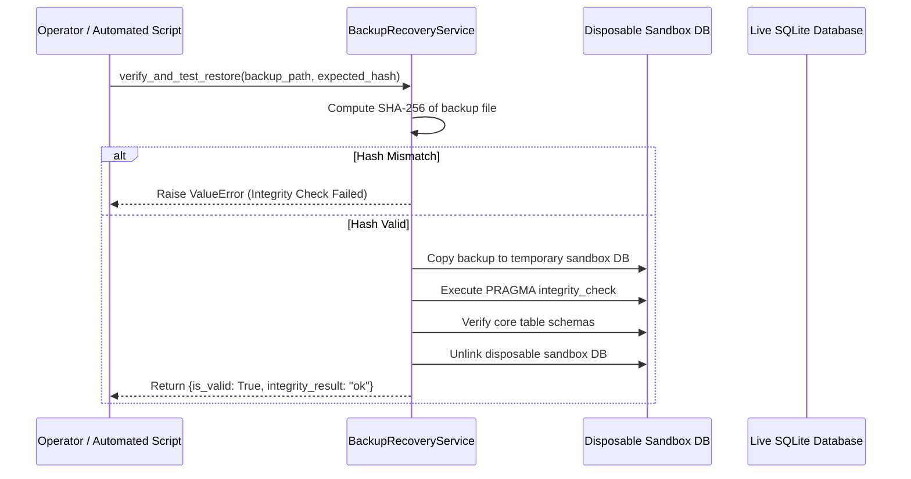

# VAPT Platform — Backup, Disaster Recovery & Data Resilience Runbook

**Document Version:** 1.0.0  
**Baseline Date:** 2026-10-28  
**Repository:** `D:\alt`  
**Storage Architecture:** Native Windows SQLite WAL Mode (`backend/data/vapt.db`) / Staging PostgreSQL 16 Ready  
**Disaster Recovery Objective:** RPO < 1 hour | RTO < 15 minutes

---

## 1. High Availability Disclosure & Recovery Objectives

> [!IMPORTANT]
> **Single-Machine Architecture Disclosure:**  
> The standard deployment model of the VAPT platform operates on a single Windows host machine with SQLite in Write-Ahead Logging (WAL) mode. This deployment is **not** high-availability (HA). Hardware failure, operating system crash, or physical power loss to the host machine will result in platform downtime until the machine is rebooted and the background services are restarted.
> 
> High availability and automated multi-zone failover require migrating to the supported PostgreSQL 16 dialect with a managed cloud database cluster (e.g., AWS RDS Multi-AZ, GCP Cloud SQL, or Azure Database for PostgreSQL).

### Recovery Metrics
- **Recovery Point Objective (RPO):** Maximum 1 hour of data loss between automated WAL snapshot backups.
- **Recovery Time Objective (RTO):** Under 15 minutes to restore a verified backup file into place and bring services back online.

---

## 2. Tested Automated Backup Architecture

Database backups are generated atomically without locking the live platform using [`BackupRecoveryService.create_database_backup`](file:///D:/alt/backend/app/services/backup_service.py#L60).

### Backup Workflow & Security Invariants
1. **Online Non-Blocking WAL Snapshot:**
   The service uses SQLite's native online backup API (`src_conn.backup(dst_conn)`) with read-only URI mode (`file:vapt.db?mode=ro`). Active read and write transactions continue unimpeded during backup generation.
2. **Cryptographic SHA-256 Digesting:**
   Immediately following backup creation, a byte-level SHA-256 hash is computed and recorded in the audit ledger (`SYSTEM_BACKUP_CREATED`).
3. **Table Count & Structural Validation:**
   The backup file is inspected to verify that all core tables (`projects`, `users`, `assessment_jobs`, `vulnerability_findings`, `audit_events`) exist and contain valid structures.
4. **Private Storage Location:**
   Backups are written to `backend/data/backups/` (`vapt_backup_YYYYMMDD_HHMMSS.db`). This directory is strictly excluded from Git tracking, Vite frontend public directories, and release zip packages.

### Automated Backup Command
```powershell
# Run programmatic backup via Python CLI
Set-Location D:\alt\backend
D:\alt\.venv\Scripts\python -c "from app.core.database import SessionLocal; from app.services.backup_service import BackupRecoveryService; db = SessionLocal(); meta = BackupRecoveryService.create_database_backup(db); print(f'Backup created: {meta.backup_path} [SHA-256: {meta.sha256_hash}]'); db.close()"
```

---

## 3. Tested Disposable Sandbox Restoration & Verification

Before restoring a backup into production, the platform provides automated sandbox verification via `BackupRecoveryService.verify_and_test_restore`:



---

## 4. Production Database Restoration Procedure (Step-by-Step)

If the live database is corrupted, deleted, or requires rollback to a prior known-good snapshot, follow this exact procedure:

### Step 1: Stop Live Services
Halt all processes accessing the database to prevent partial writes:
```powershell
# In Terminal 1 & 3: Terminate Uvicorn and Worker Daemon
Get-Process -Name python | Where-Object { $_.CommandLine -like "*uvicorn*" -or $_.CommandLine -like "*run_background_worker*" } | Stop-Process -Force
```

### Step 2: Quarantine Damaged Database Files
Never overwrite damaged files directly; preserve them for forensic audit:
```powershell
$timestamp = Get-Date -Format "yyyyMMdd_HHmmss"
Move-Item -Path "D:\alt\backend\data\vapt.db" -Destination "D:\alt\backend\data\vapt_corrupted_$timestamp.db" -ErrorAction SilentlyContinue
Move-Item -Path "D:\alt\backend\data\vapt.db-wal" -Destination "D:\alt\backend\data\vapt_corrupted_$timestamp.db-wal" -ErrorAction SilentlyContinue
Move-Item -Path "D:\alt\backend\data\vapt.db-shm" -Destination "D:\alt\backend\data\vapt_corrupted_$timestamp.db-shm" -ErrorAction SilentlyContinue
```

### Step 3: Select and Verify Target Backup
Locate the desired backup in `D:\alt\backend\data\backups/` and verify its cryptographic integrity:
```powershell
Set-Location D:\alt\backend
$backupFile = "D:\alt\backend\data\backups\vapt_backup_YYYYMMDD_HHMMSS.db"
$expectedHash = (Get-FileHash -Path $backupFile -Algorithm SHA256).Hash.ToLower()

D:\alt\.venv\Scripts\python -c "from app.services.backup_service import BackupRecoveryService; res = BackupRecoveryService.verify_and_test_restore(r'$backupFile', '$expectedHash'); print(res)"
```
Verify that the output reports `'is_valid': True` and `'integrity_result': 'ok'`.

### Step 4: Restore Backup to Live Database Path
```powershell
Copy-Item -Path $backupFile -Destination "D:\alt\backend\data\vapt.db"
```

### Step 5: Verify Schema & Run Integrity Check
```powershell
D:\alt\.venv\Scripts\python -c "import sqlite3; conn = sqlite3.connect('D:/alt/backend/data/vapt.db'); cur = conn.cursor(); cur.execute('PRAGMA integrity_check'); print('Integrity:', cur.fetchone()[0]); cur.execute('SELECT count(*) FROM users'); print('Users:', cur.fetchone()[0]); conn.close()"
```

### Step 6: Restart Platform Daemons
```powershell
# Terminal 1: API Server
Set-Location D:\alt\backend
$env:PYTHONPATH="D:\alt\backend"
D:\alt\.venv\Scripts\uvicorn app.main:app --host 127.0.0.1 --port 8000

# Terminal 3: Background Worker Daemon
Set-Location D:\alt\backend
$env:PYTHONPATH="D:\alt\backend"
D:\alt\.venv\Scripts\python scripts/run_background_worker.py --poll-interval 1.0
```

### Step 7: Verify Readiness Endpoint
```powershell
curl -s http://127.0.0.1:8000/ready
```
Expected output: `{"status":"ready", "checks":{"database":true, "migrations":true, "storage_writable":true}}`.

---

## 5. Schema Migration & Interruption Recovery Governance

The repository manages database schemas via Alembic (`backend/alembic/versions/`, 23 sequential migrations).

### Safe Migration Procedure
Always generate a pre-migration backup before executing schema updates:
```powershell
# 1. Take safety snapshot
D:\alt\.venv\Scripts\python -c "from app.core.database import SessionLocal; from app.services.backup_service import BackupRecoveryService; db = SessionLocal(); BackupRecoveryService.create_database_backup(db); db.close()"

# 2. Check current migration state
Set-Location D:\alt\backend
D:\alt\.venv\Scripts\alembic current

# 3. Upgrade to latest migration revision
D:\alt\.venv\Scripts\alembic upgrade head
```

### Recovery from Interrupted Migrations
If an Alembic migration is killed midway (e.g. machine reboot or process SIGKILL during DDL):
1. **Inspect Version Table:**
   `sqlite3 backend/data/vapt.db "SELECT version_num FROM alembic_version"`
2. **If migration aborted mid-transaction:**
   SQLite transactions for DDL in WAL mode automatically roll back on connection termination.
3. **If schema is in an ambiguous state:**
   Restore the pre-migration backup created in Step 1 following the restoration procedure in Section 4.
4. **Re-run Alembic:**
   Execute `alembic upgrade head` after resolving the root cause (e.g. disk space or syntax error).

---

## 6. Post-Recovery Platform Integrity Verification

Following any disaster recovery event or database restoration, execute the platform-wide entity integrity verification endpoint:

```powershell
curl -H "Authorization: Bearer <LEAD_TOKEN>" http://127.0.0.1:8000/api/v1/projects/<PROJECT_ID>/integrity/verify-all
```

The endpoint validates:
- Assessment job state consistency and scope snapshot hashes.
- Vulnerability finding SHA-256 fingerprints.
- Evidence item payload hashes and type constraints.
- Asset inventory canonical locator formats.
- Remediation recommendation and verification outcome records.
- Unbroken SHA-256 cryptographic audit event hash chains.
