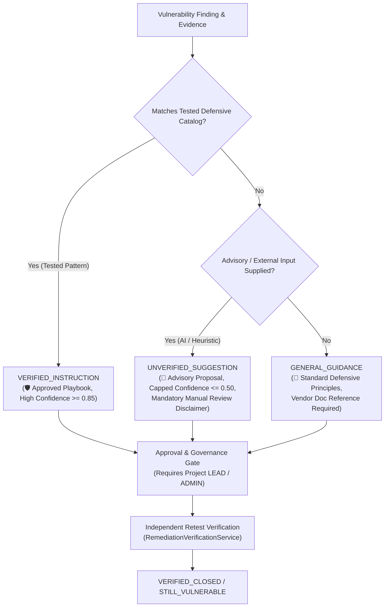

# Explainable Security Recommendations & Remediation Prioritization Matrix

## 1. Executive Summary & Core Objective
The **Explainable Security Recommendations & Remediation Prioritization** engine (Prompt 51) provides practical, evidence-backed defensive guidance that empowers security teams and software engineers to triage, prioritize, and resolve vulnerabilities without fabricating certainty or automatically executing risky actions.

Every recommendation strictly discloses its basis and uncertainty. AI-generated and heuristic suggestions remain purely advisory, cannot override deterministic security policies, cannot bypass required human lead approvals, and cannot execute unverified shell commands.

---

## 2. Multi-Dimensional Prioritization Taxonomy

Prioritization is decoupled across five distinct, orthogonal dimensions rather than collapsed into an ambiguous single score:

| Dimension | Values | Purpose & Calculation Basis |
| :--- | :--- | :--- |
| **Technical Severity** | `CRITICAL`, `HIGH`, `MEDIUM`, `LOW`, `INFO` | Intrinsic flaw severity derived from CVSS v3.1 base metrics and CWE classifications. |
| **Business Priority** | `P1_CRITICAL`, `P2_HIGH`, `P3_MEDIUM`, `P4_LOW` | Operational criticality combining technical severity with target asset criticality (`CRITICAL`..`INFO`), internet exposure, and environment tier (e.g. `PRODUCTION`). |
| **Remediation Urgency** | `IMMEDIATE`, `SCHEDULED_SPRINT`, `NEXT_CYCLE`, `BACKLOG` | Actionable deployment timeframe based on threat exposure, business priority, and operational window. |
| **Confidence Score** | Float `0.10` to `1.00` | Evidence grounding score reflecting whether raw cryptographically hashed payloads are verified, asset context is resolved, and tested templates exist. Capped at `<= 0.50` for unverified proposals. |
| **Estimated Effort** | `LOW (< 2h)`, `MEDIUM (1-2d)`, `HIGH (> 1w)` | Realistic development and operational effort required to refactor code, apply configuration hardening, or upgrade dependencies. |

---

## 3. Guidance Provenance & Certainty Taxonomy

To prevent synthetic certainty or confusing experimental proposals with validated fixes, every recommendation is explicitly tagged:

1. **`VERIFIED_INSTRUCTION`**:
   - Backed by an approved, tested defensive catalog template with deterministic verification criteria.
   - High baseline confidence ($\ge 0.85$).
   - Contains concrete configuration examples, known control mappings, and rollback procedures.

2. **`GENERAL_GUIDANCE`**:
   - Standard defensive architecture advice (e.g., manual triage, input sanitization principles) where a specific tested vendor playbook is unavailable.
   - Refers developers to authoritative vendor documentation and manual architecture audits.

3. **`UNVERIFIED_SUGGESTION`**:
   - Generated from external advisory inputs, heuristics, or AI assistance.
   - Capped at $\le 0.50$ confidence.
   - Mandatory warning: *"NOTICE: This recommendation is an UNVERIFIED SUGGESTION. It has NOT been verified against deterministic test profiles. Manual code and configuration review is strictly required before taking any action. Automated execution is prohibited."*

---

## 4. Safeguards, Safety Boundaries & Truthful Telemetry

In accordance with Prompt 51 acceptance criteria:

1. **No Hallucinated Vendor Commands**:
   If a finding targets an unsupported, proprietary, or custom component (e.g. proprietary microcontroller or custom protocol), the system never fabricates non-existent CLI flags, configuration keys, or packages. It safely recommends manual code triage and vendor documentation consultation.

2. **Rejection of Unverified Resolution Claims**:
   External or model inputs claiming that a vulnerability is *"already resolved"* or *"fixed in production"* are automatically rejected and sanitized. A finding's state can **only** advance to `VERIFIED_CLOSED` via `RemediationVerificationService.record_verification` backed by an objective re-test probe.

3. **Sanitization of Executable Payloads**:
   Advisory inputs containing shell injection patterns (`rm -rf`, `curl | sh`, `wget | bash`) are redacted into `[REDACTED_COMMAND]` or `[DISALLOWED_SHELL_COMMAND]`. Recommendations are purely advisory with zero shell execution hooks.

4. **Approval Gate & Separation of Duties**:
   Security-sensitive changes (`requires_approval = True`) strictly require approval by a Project `LEAD` or System `ADMIN`. Under project governance policies enforcing Separation of Duties, the approving reviewer cannot unilaterally authorize the change ticket without independent authorization.

---

## 5. Version Lineage & Immutability

Recommendations support multi-round regeneration without silently rewriting historical audit decisions:

- When an updated recommendation is generated with `force_regenerate=True`:
  - A new `RemediationRecommendation` record is created with `version = prior.version + 1` and `prior_version_id = prior.id`.
  - The prior version is marked `is_latest = False` and `superseded_at = utc_now()`.
  - Prior review notes, reviewer identity, and approval status remain immutably preserved in the database for compliance and audit reconstruction.
- Full version lineage can be retrieved via `GET /projects/{project_id}/remediations/{recommendation_id}/versions`.

---

## 6. Retesting & Independent Verification Linkage

When an independent verification re-test is performed via `RemediationVerificationService.record_verification`:
- The active latest recommendation is automatically updated with `rec.verification_id` and `rec.verified_outcome` (`VERIFIED_FIXED`, `STILL_VULNERABLE`, `PARTIALLY_REMEDIATED`, `INCONCLUSIVE`).
- The finding lifecycle transitions according to deterministic evidentiary outcomes, never by assumption.

---

## 7. Empirical Usefulness Metrics

Usefulness is evaluated strictly from real database review decisions, feedback submissions, and re-test outcomes—never fabricated:

$$
\text{Approval Rate} = \frac{\text{Approved Recommendations}}{\text{Total Reviewed Recommendations}}
$$

$$
\text{Actionable Ratio} = \frac{\text{Feedback Actionable Count}}{\text{Total Feedback Count}}
$$

$$
\text{Resolution Success Rate} = \frac{\text{Verified Fixed Outcomes}}{\text{Verified Fixed} + \text{Still Vulnerable} + \text{Partially Remediated}}
$$

Every metrics response returns an explicit notice:
> *"Recommendation usefulness metrics are measured strictly from actual historical review decisions, user feedback submissions, and independent re-test verification outcomes. Zero synthetic, simulated, or fabricated scores."*
