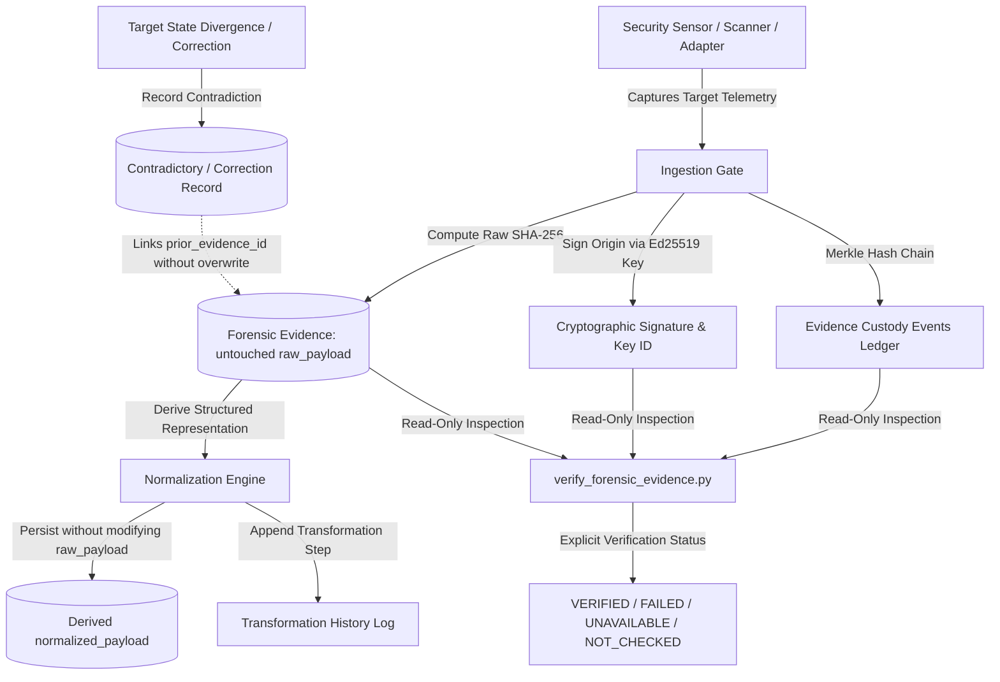

# Forensic Evidence Preservation, Chain of Custody and Investigation Integrity Matrix (Prompt 48)

**Platform:** VAPT Intelligence Platform  
**Target Root:** `D:\alt`  
**Standard:** ISO/IEC 27037 (Digital Evidence Handling), RFC 3161 (Trust Anchoring), NIST SP 800-86 (Forensic Techniques)  
**Status:** QUALIFIED

---

## 1. Architecture & Guarantees Overview

Prompt 48 strengthens the trustworthiness, reproducibility, and traceability of evidence collected by the VAPT System.
It eliminates the risk of silent evidence tampering, unverified claims, or loss of historical observations.

---

## 2. Evidence Lifecycle Model

The platform formally transitions evidence across seven discrete lifecycle states:

| Lifecycle State | Description | Invariants & Constraints |
| :--- | :--- | :--- |
| `COLLECTED` | Raw telemetry observed on the target by a sensor or adapter. | Timestamp and sensor identity established. |
| `INGESTED` | Persisted into `forensic_evidence_records`. | SHA-256 computed on raw payload; Ed25519 origin signature generated; initial `INGESTION` custody event recorded (`prev_custody_hash = 0*64`). |
| `NORMALIZED` | Structured tokens or fields parsed from raw payload. | `raw_payload` and `raw_digest_sha256` are strictly immutable; `normalized_payload` populated; transformation history appended; chained `NORMALIZATION` custody event logged. |
| `ANALYZED` | Correlated with vulnerability findings, assets, or attack paths. | Finding association recorded; analyst notes appended without payload modification. |
| `REPORTED` | Exported into verifiable executive reports, compliance summaries, or bundles. | Provenance references and bundle signatures generated; `EXPORT` custody event logged. |
| `ARCHIVED` | Sealed into long-term immutable storage for regulatory compliance. | Read-only access enforced; integrity digests verified. |
| `AUTHORIZED_DELETED` | Cryptographically tombstoned and marked deleted following retention expiration. | Active legal holds checked; deletion blocked if hold exists; tombstone hash recorded; `DELETION_AUTHORIZED` custody event appended. |

---

## 3. Cryptographic Proof of Origin vs. Payload Checksum

Prompt 48 explicitly enforces the distinction between a checksum and proof of origin:

| Property | Cryptographic Checksum (SHA-256) | Digital Origin Signature (Ed25519) |
| :--- | :--- | :--- |
| **Purpose** | Detects accidental data corruption or bit rot in storage. | Proves that an authorized, authentic sensor/analyst originated the evidence. |
| **Tamper Resistance** | Low (an attacker can modify bytes and recompute a matching checksum). | Absolute (requires possession of the sensor's private signing key). |
| **Key Identity** | None (unkeyed hash function). | Tied to authentic public key registry (`key_id`, e.g. `KEY-SENSOR-NMAP-01`). |
| **Non-Repudiation** | None. | Verifiable against authentic public key certificates. |

---

## 4. Verification Outcomes & Explicit Status Semantics

The platform strictly forbids reporting integrity as verified without executing the relevant check:

- `VERIFIED`: The raw payload matches `raw_digest_sha256`, the origin signature is verified by the public key for `signing_key_id`, and the custody hash chain is continuous and unbroken.
- `FAILED`: Any verification check fails (hash mismatch, forged/invalid signature, broken custody chain, or corrupted payload).
- `UNAVAILABLE`: The referenced artifact or raw payload is absent, unreadable, or missing.
- `NOT_CHECKED`: Freshly ingested or uninspected record. Integrity is never assumed.

---

## 5. Contradiction & History Preservation

When target behavior diverges (e.g., a port is closed, or a patch is applied) or two adapters disagree:
1. The original observation is **never overwritten or deleted**.
2. A new evidence record is created with `is_contradictory = True` and `contradiction_status = CONTRADICTORY` (or `SUPERSEDED` if formally replacing earlier findings).
3. The new record stores `prior_evidence_id = original_record.id`.
4. If marked superseding, the original record's `contradiction_status` is updated to `SUPERSEDED` and `superseded_by_id = new_record.id`, while preserving untouched its original `raw_payload`, `raw_digest_sha256`, and creation timestamps.

---

## 6. Read-Only Forensic Verification Tool

The platform provides `scripts/verify_forensic_evidence.py` for audit and inspection:
- **Zero-Modification Guarantee**: When run with `--json` or CLI table output, it executes with `persist=False`, guaranteeing zero mutations to database records, timestamps, or custody logs.
- **Verification Coverage**: Validates raw digest match, cryptographic origin signatures, and Merkle custody chain continuity.
- **Auditable Return Codes**: Exits 0 on clean verification, 1 on discrepancies or unverified records.
