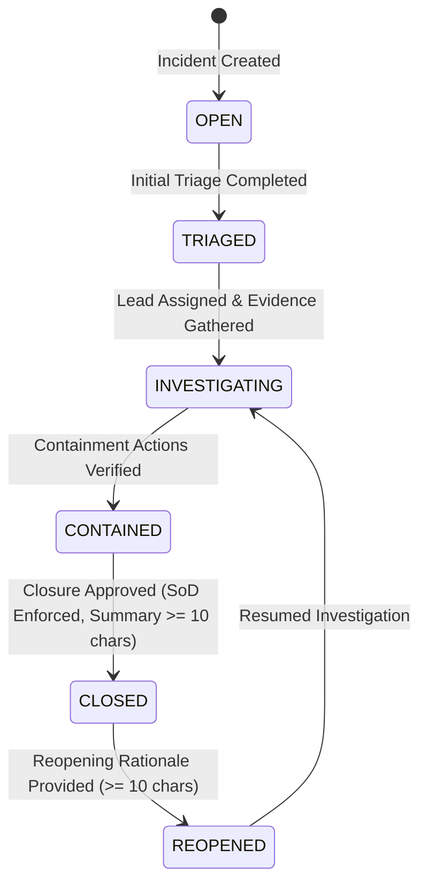

# INCIDENT INVESTIGATION AND CASE MANAGEMENT MATRIX

## Prompt 39 — Evidence-Preserving Security Incident Investigation and Case Management

### Architectural Principles and Controls

1. **Epistemic Defensibility (Correlation vs Causation):**
   - The platform strictly enforces explicit labeling of correlations: `CONFIRMED_CAUSATION`, `PROBABLE_CORRELATION`, `TEMPORAL_COINCIDENCE`, and `CONTRADICTORY_EVIDENCE`.
   - Temporal proximity (events occurring in the same time frame) is systematically classified as `TEMPORAL_COINCIDENCE` unless direct evidentiary linkages (e.g., process execution logs, memory dumps, network payload signatures) establish causation.

2. **Preservation of Contradictory Evidence:**
   - Discordant telemetry (e.g., network firewall logs proving payload neutralization, WAF drops, honeypot telemetry) is captured with SHA-256 evidence digests and marked with `is_contradictory=True`.
   - Investigators can formulate and link alternative explanations and hypotheses without suppression or alteration of primary evidence records.

3. **Separation of Duties (SoD) & Privileged Transition Governance:**
   - Case closure requires verified containment (`is_containment_verified=True`), a root cause hypothesis, and an exhaustive closure summary ($\ge 10$ characters).
   - The assigned lead investigator cannot approve their own case closure when Separation of Duties is enforced; an independent Security Lead must sign off on the closure.
   - Case reopening requires a documented justification ($\ge 10$ characters) and records an immutable audit transition.

4. **Immutable Evidence and Timeline Provenance:**
   - Attaching evidence computes a cryptographically verified SHA-256 hash.
   - All state mutations, asset links, finding associations, notes, and evidence attachments are recorded as immutable timeline events with provenance tracking (`actor_id`, `timestamp`, `details`).

---

### Capability Implementation Matrix

| Requirement | Implementation Detail | Backend Enforcement | Frontend Verification | Verification Test |
| :--- | :--- | :--- | :--- | :--- |
| **Case Model & Hierarchy** | `IncidentCase`, `IncidentCaseAsset`, `IncidentCaseFinding`, `IncidentCaseEvidence`, `IncidentCaseTransition`, `IncidentCaseNote` | `app/models/incident.py`, Alembic `d6e7f8a9b0c1` | `IncidentInvestigationView.tsx`, `IncidentCaseDetail` | `test_prompt39_incident_investigation_and_case_management.py::test_create_incident_case` |
| **Correlation vs Causation** | `CorrelationType` enum (`CONFIRMED_CAUSATION`, `PROBABLE_CORRELATION`, `TEMPORAL_COINCIDENCE`, `CONTRADICTORY_EVIDENCE`) with confidence score $\in [0.0, 1.0]$ | `IncidentService.link_finding_to_case()` | Visual badge rendering & correlation breakdown card | `test_link_finding_distinguishes_causation_from_correlation`, `test_get_case_correlations` |
| **Contradictory Evidence** | Evidence snapshot model with SHA-256 digest and `is_contradictory` flag; support for competing hypotheses | `IncidentService.attach_evidence_snapshot()`, `add_case_note()` | Evidence tab with contradictory indicator & alternative explanations panel | `test_attach_contradictory_evidence_preservation`, `test_add_case_note_and_alternative_hypothesis` |
| **Separation of Duties (SoD)** | Lead investigator cannot self-approve closure; requires independent Security Lead review | `IncidentService.transition_case_status()` | Modal validation and UI authorization blocking | `test_case_closure_requires_summary_and_enforces_sod` |
| **Controlled Reopening** | Minimum 10-char justification requirement; transition audit record creation | `IncidentService.transition_case_status()` | Reopen dialog with mandatory rationale input | `test_case_reopening_requires_rationale` |
| **Investigation Timeline** | Chronological aggregation of transitions, evidence snapshots, notes, and links with actor provenance | `IncidentService.get_case_timeline()` | Interactive timeline feed with actor and event badges | `test_case_timeline_provenance` |
| **Tenant & RBAC Isolation** | Multi-tenant project boundary enforcement and permission checks (`INCIDENT_VIEW`, `INCIDENT_MANAGE`) | `app/api/v1/endpoints/incident.py` | Role-based component rendering & API error trapping | `test_unauthorized_user_cannot_manage_cases` |

---

### State Transition Diagram

