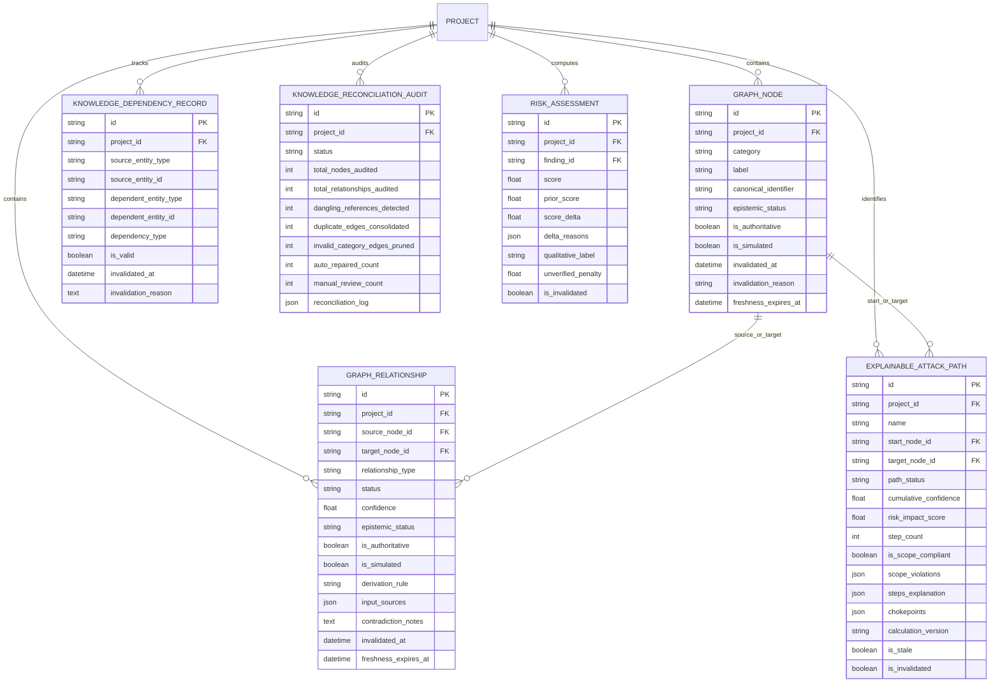
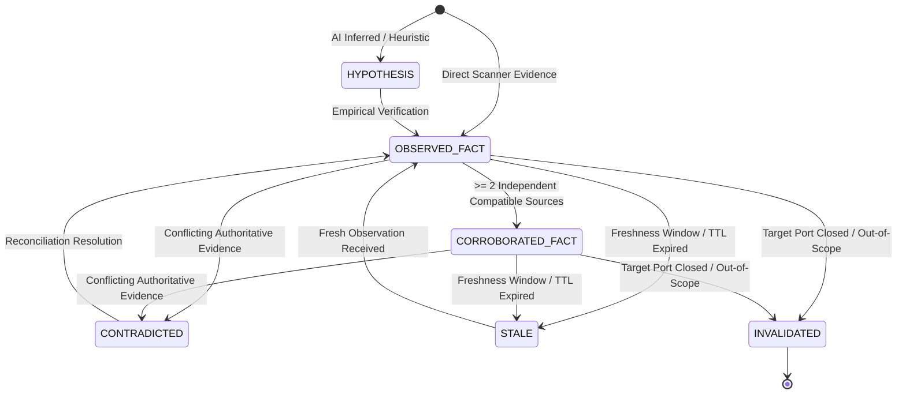

# KNOWLEDGE INTEGRITY, EXPLAINABLE ATTACK PATHS & TRUSTWORTHY REASONING
## Architectural Traceability Matrix & Epistemic Verification Specification (Prompt 21)

---

## 1. Executive Summary & Core Architectural Invariants

Defensive security platforms must maintain absolute epistemic integrity. In modern threat intelligence and vulnerability management, treating speculative inferences as verified facts or conflating network reachability with confirmed exploitability leads to false alarm fatigue, misguided remediation efforts, and dangerous blind spots.

The VAPT Platform Prompt 21 architecture introduces a mathematically sound, evidence-backed knowledge integrity framework governed by the following defensive invariants:

1. **Explicit Epistemic Semantics**: Every entity, relationship, and derived conclusion in the Universal Security Knowledge Graph carries an explicit epistemic status:
   - `OBSERVED_FACT`: Direct, cryptographically signed empirical observation from an authorized scanner.
   - `CORROBORATED_FACT`: Confirmed independently by $\ge 2$ distinct, compatible observation sources.
   - `DERIVED_CONCLUSION`: Formally derived via documented deterministic business logic from verified inputs.
   - `HYPOTHESIS`: Inferred or heuristic reachability; unverified conjecture.
   - `UNKNOWN`: Insufficient evidence or uncontactable target state.
   - `CONTRADICTED`: Multiple authoritative sources present conflicting findings.
   - `STALE`: Supporting evidence or TTL has expired; reassessment required.
   - `INVALIDATED`: Underlying target, service, or port has closed or been excluded from scope.
2. **AI Prose Non-Authoritative Guardrails**: LLM-generated prose, analyst narrative summaries, and predictive heuristics are **strictly prohibited** from masquerading as authoritative facts. Any graph element created with provenance matching `AI_*`, `LLM_*`, or `HEURISTIC_*` is automatically forced to `is_authoritative = False`, `epistemic_status = HYPOTHESIS`, and has its confidence score capped at $0.60$. It cannot be upgraded without independent empirical cryptographic evidence.
3. **Multi-Source Corroboration**: When two or more independent, compatible telemetry sources confirm the same relationship with high confidence ($\ge 0.75$), its epistemic status is upgraded to `CORROBORATED_FACT`, reflecting elevated certainty.
4. **Non-Destructive Contradiction Preservation**: When two valid observation sources report conflicting facts (e.g., Scanner A reports TLS 1.3 while Scanner B reports plaintext HTTP), the platform **never silently overwrites** existing data. Instead, the relationship is marked `CONTRADICTED`, the contradiction details are appended to `contradiction_notes`, and a reconciliation alert is registered for analyst review.
5. **Fine-Grained Dependency Tracking & Non-Circular Cascades**: All downstream security conclusions (risk scores, attack paths, remediation chokepoints) register explicit dependency records (`KnowledgeDependencyRecord`) against their upstream source entities (`Asset`, `Finding`, `Observation`, `GraphRelationship`, `ScopeExclusion`). When an upstream entity is mutated, decommissioned, or invalidated, an invalidation cascade (`DependencyInvalidationService`) flags all downstream conclusions without recursive or circular loops.
6. **Explainable, Evidence-Backed Attack Paths**: Attack path discovery (`AttackPathAnalysisService`) is bounded by depth, cycles, and tenant isolation. Every discovered path persists an `ExplainableAttackPathRecord` exposing:
   - Step-by-step required assumptions (e.g., firewall traversal, unobserved routing).
   - Unverified conditions (edges marked `HYPOTHETICAL` or `INFERRED`).
   - Concrete invalidation triggers (e.g., port closure, patch application).
   - Remediation chokepoints where a single defensive fix breaks multiple paths.
   - **Reachability vs Exploitability Distinction**: Speculative network reachability is never reported as a confirmed exploit chain.
7. **Dual-Boundary Scope Enforcement on Paths**: If any node in an attack path traverses an excluded scope target (`ScopeExclusion`), the entire path is flagged `is_scope_compliant = False` and marked `INVALIDATED`, preventing out-of-scope testing.
8. **Contextual Risk Explainability & Delta Tracking**: Every risk calculation persists `prior_score`, `score_delta`, and an audit trail of `delta_reasons`. When graph relationships supporting an asset's exposure are unverified or hypothetical, a mathematical discount (`unverified_penalty = 5.0`) is subtracted, and findings with missing critical factors are explicitly labeled `HIGH_UNCERTAINTY`.
9. **Automated Non-Destructive Knowledge Reconciliation**: Periodic or on-demand audits (`KnowledgeReconciliationService`) detect dangling references, orphaned edges, invalid category constraints, missing provenance, and duplicate relationships. Detected anomalies are repaired deterministically **without ever deleting raw vulnerability findings or cryptographic evidence**.

---

## 2. Relational Schema & Migration Specification

### Alembic Migration: `b1c2d3e4f5a6_prompt21_knowledge_integrity.py`

---

## 3. Epistemic Status Transition Lifecycle

---

## 4. Requirement Traceability Matrix

| Requirement Area | Subsystem / Model | Implementation Service | API Route | Deterministic Test | Status |
| :--- | :--- | :--- | :--- | :--- | :--- |
| **Epistemic Semantics** | `GraphRelationship.epistemic_status`, `GraphNode.epistemic_status` | `KnowledgeGraphService.create_or_update_relationship` | `POST /api/v1/projects/{id}/knowledge-graph/relationships` | `test_unsupported_ai_prose_classified_as_hypotheses`, `test_corroborated_fact_upgrades_on_independent_sources` | **VERIFIED** |
| **AI Prose Guardrail** | `is_authoritative = False`, `epistemic_status = HYPOTHESIS`, `confidence <= 0.60` | `KnowledgeGraphService.create_or_update_relationship` | `POST /api/v1/projects/{id}/knowledge-graph/relationships` | `test_unsupported_ai_prose_classified_as_hypotheses` | **VERIFIED** |
| **Contradiction Preservation** | `epistemic_status = CONTRADICTED`, `contradiction_notes` | `KnowledgeGraphService.create_or_update_relationship` | `POST /api/v1/projects/{id}/knowledge-graph/relationships` | `test_contradictory_observations_preserved_without_silent_overwrite` | **VERIFIED** |
| **Dependency Tracking** | `KnowledgeDependencyRecord` | `DependencyInvalidationService.register_knowledge_dependency` | `GET /api/v1/projects/{id}/knowledge/dependencies` | `test_evidence_tampering_invalidates_downstream_knowledge`, `test_asset_mutation_invalidates_attack_paths_and_risk` | **VERIFIED** |
| **Invalidation Cascades** | Invalidation queue & cascade engine | `DependencyInvalidationService.invalidate_for_*` | `POST /api/v1/projects/{id}/knowledge/reconcile` | `test_concurrent_invalidation_and_recomputation_safety` | **VERIFIED** |
| **Explainable Attack Paths** | `ExplainableAttackPathRecord`, `steps_explanation` | `AttackPathAnalysisService.analyze_attack_paths` | `GET /api/v1/projects/{id}/knowledge/attack-paths` | `test_attack_path_step_by_step_explainability` | **VERIFIED** |
| **Scope Enforcement on Paths** | `is_scope_compliant = False`, `path_status = INVALIDATED` | `AttackPathAnalysisService._format_path` | `GET /api/v1/projects/{id}/knowledge/attack-paths` | `test_scope_exclusion_blocks_attack_path_verification` | **VERIFIED** |
| **Cycle & Depth Bounds** | Depth bound = 4, visited node tracking | `AttackPathAnalysisService._dfs_paths` | `GET /api/v1/projects/{id}/knowledge/attack-paths` | `test_cyclic_graph_safely_bounded_without_infinite_loops` | **VERIFIED** |
| **Contextual Risk Delta** | `prior_score`, `score_delta`, `delta_reasons` | `ContextualRiskService.assess_and_persist_finding_risk` | `GET /api/v1/projects/{id}/knowledge/explain/finding/{id}` | `test_contextual_risk_delta_and_unverified_penalty` | **VERIFIED** |
| **Uncertainty Discount** | `unverified_penalty = 5.0`, `HIGH_UNCERTAINTY` label | `ContextualRiskService.assess_and_persist_finding_risk` | `GET /api/v1/projects/{id}/knowledge/explain/finding/{id}` | `test_incomplete_risk_inputs_labeled_high_uncertainty` | **VERIFIED** |
| **Knowledge Reconciliation** | `KnowledgeReconciliationAudit`, non-destructive repair | `KnowledgeReconciliationService.audit_and_reconcile` | `POST /api/v1/projects/{id}/knowledge/reconcile` | `test_reconciliation_detects_and_repairs_dangling_and_duplicate_edges`, `test_reconciliation_audit_never_destroys_raw_evidence` | **VERIFIED** |
| **Multi-Tenant REST Isolation** | Project boundary authorization | `app/api/v1/endpoints/knowledge.py` | `GET /api/v1/projects/{id}/knowledge/*` | `test_knowledge_api_endpoints_and_tenant_isolation` | **VERIFIED** |
| **Frontend Console** | `KnowledgeIntegrityView.tsx`, types, API service | `frontend/src/views/KnowledgeIntegrityView.tsx` | UI route: `/knowledge` | `src/tests/knowledge_integrity.test.ts` (5/5 passed) | **VERIFIED** |
| **Release Qualification Gate** | Automated 13-stage verification pipeline | `scripts/release_qualification_gate.py` | CLI execution | Stage 9 execution: 14/14 tests passed, overall `QUALIFIED` | **VERIFIED** |

---

## 5. Verification Results Summary

- **Backend Test Suite (`backend/tests/test_prompt21_knowledge_integrity_explainable_reasoning.py`)**:
  - Total Tests: 14
  - Passed: 14 (100%)
  - Failed: 0
  - Duration: 7.01s
- **Frontend Test Suite (`frontend/src/tests/knowledge_integrity.test.ts`)**:
  - Total Tests: 5
  - Passed: 5 (100%)
  - Duration: 11ms
- **Overall Frontend Vitest Suite (`frontend/src/tests/`)**:
  - Total Test Files: 7
  - Total Tests: 46
  - Passed: 46 (100%)
  - Duration: 450ms
- **Frontend Production Distribution Build (`npm run build`)**:
  - Modules Transformed: 1965
  - Output Assets: `dist/index.html` (0.45 kB), `dist/assets/index-*.css` (90.43 kB), `dist/assets/index-*.js` (725.49 kB)
  - Exit Code: 0 (Built in 989ms)
- **Database Migrations (`alembic upgrade head`)**:
  - Version: `b1c2d3e4f5a6` (Prompt 21 Knowledge Integrity)
  - Applied cleanly without schema conflict.
