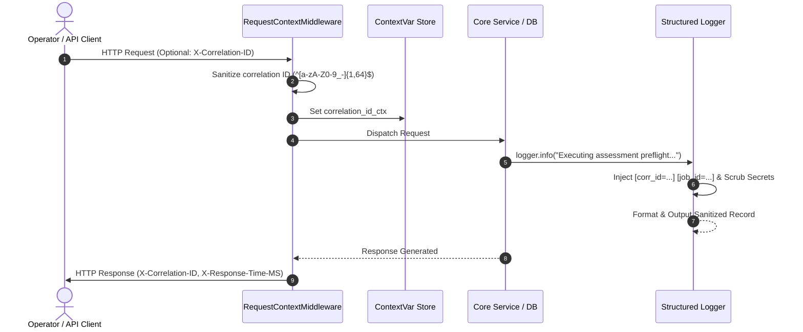
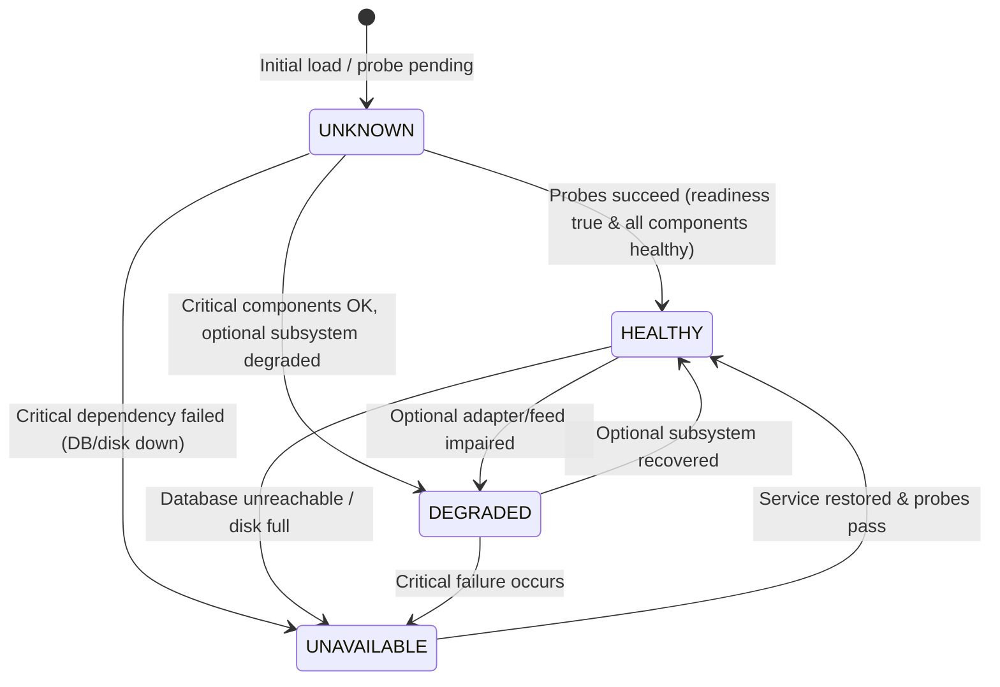

# VAPT SYSTEM — OPERATIONAL OBSERVABILITY & PRODUCTION READINESS RUNBOOK
**Architecture Standard & Production Hardening Guide (Prompt 17)**

---

## 1. Executive Summary

This runbook establishes the production operational baseline, layered health probing hierarchy, structured logging correlation standards, thread-safe metrics collection, and failure recovery protocols for the Vulnerability Assessment and Penetration Testing (VAPT) Platform control plane.

The platform enforces a **defensive-first, fail-closed, observable architecture**:
- **Layered Probes**: Differentiates process liveness from operational readiness and deep dependency health.
- **Traceability**: End-to-end request tracing via `X-Correlation-ID` with zero CRLF log injection.
- **Data Protection**: Automatic redaction of credentials, bearer tokens, API keys, and PEM private keys in telemetry.
- **Bounded Observability**: In-memory thread-safe metrics with strictly bounded label cardinality preventing memory exhaustion.
- **Resilience**: Graceful handling of transient database contention, fenced worker recovery, and multi-state UI diagnostics.

---

## 2. Layered Health Probes Hierarchy

The control plane implements three distinct probe tiers, designed specifically for container orchestrators (Kubernetes, AWS ECS, Google Cloud Run) and site reliability engineers.

| Endpoint | Probe Type | Downstream Calls | Response Codes | Primary Consumer |
| :--- | :--- | :--- | :--- | :--- |
| `GET /health/live` (and `/health`) | **Liveness** | **None** (Process loop only) | `200 OK` | Kubelet Liveness, Container Supervisor |
| `GET /health/ready` (and `/ready`) | **Readiness** | Critical only (DB ping, schema tables, disk writability) | `200 OK` or `503 Service Unavailable` | Kubelet Readiness, ALB/NLB Target Groups |
| `GET /api/v1/health/dependencies` | **Deep Dependency Health** | Critical + Optional (Adapters, Threat Feeds, Notifications) | `200 OK` (Healthy/Degraded) or `503 Service Unavailable` | SRE Monitoring, Prometheus Probers, Operator Dashboards |

### 2.1 Liveness Probe (`GET /health/live`)
- **Latency**: `< 5ms`.
- **Behavior**: Evaluates only that the Python FastAPI process and asyncio event loop are responsive.
- **Architectural Invariant**: Never makes downstream database queries or storage I/O. Prevents cascading container restarts during temporary database connection spikes.

### 2.2 Readiness Probe (`GET /health/ready`)
- **Latency**: `< 25ms`.
- **Validation**:
  1. Primary Database connection (`SELECT 1`).
  2. Essential schema initialization (`SELECT count(*) FROM users`).
  3. Storage volume writability (`./data/_readiness_test.tmp` write and unlink).
- **Behavior**: If all critical dependencies succeed, returns `200 OK` with `status: "ready"`. If any critical check fails, returns `503 Service Unavailable` with `status: "not_ready"` and detailed check booleans.

### 2.3 Deep Dependency Health (`GET /api/v1/health/dependencies`)
- **Latency**: Bounded timeout (maximum 2.0 seconds per check).
- **Classification**:
  - **Critical Dependencies**: Primary Database, Local Data Storage.
  - **Optional Subsystems**: Scanner Adapters Framework, Notification Dispatcher, Vulnerability Threat Intelligence Feeds.
- **Degraded Operation Protocol**:
  - If any critical dependency fails $\rightarrow$ returns HTTP `503 Service Unavailable`, `status="unhealthy"`, `critical_healthy=false`.
  - If all critical dependencies succeed, but an optional subsystem is impaired $\rightarrow$ returns HTTP `200 OK` (or `207 Multi-Status`), `status="degraded"`, `critical_healthy=true`. Core vulnerability scanning and attack path generation continue safely.
- **Safety Invariant**: Strictly non-mutating (does not initiate scan jobs, trigger schema modifications, or execute rollback procedures). Zero disclosure of internal paths, database passwords, or secret tokens.

---

## 3. Structured Logging, Correlation & Redaction

### 3.1 Request Correlation Propagation
All requests entering the platform are assigned or validated against an `X-Correlation-ID` header (with backward-compatible fallback to `X-Request-ID`):

- **Header Sanitization**: Incoming correlation IDs are validated against `^[a-zA-Z0-9_\-]{1,64}$`. Any invalid format, control characters, or missing header triggers automated generation of a trusted UUIDv4.
- **Telemetry Injection**: Responses always return `X-Correlation-ID` and `X-Response-Time-MS` (millisecond execution duration).

### 3.2 Automated Sensitive Data Redaction
The `SensitiveDataRedactor` filter intercepts all emitted log records and redacts credentials before stream output:
- **Bearer Tokens**: `Bearer [A-Za-z0-9_\-\.]+` $\rightarrow$ `Bearer [REDACTED]`
- **Key-Value Credentials**: `"password": "..."`, `"token": "..."`, `"api_key": "..."`, `"client_secret": "..."` $\rightarrow$ `"[REDACTED]"`
- **Cryptographic Keys**: `-----BEGIN [A-Z ]+PRIVATE KEY-----...-----END [A-Z ]+PRIVATE KEY-----` $\rightarrow$ `[REDACTED_PRIVATE_KEY]`
- **CRLF Injection Defense**: Sanitizes carriage returns (`\r`) and newlines (`\n`) to prevent log forging and header splitting attacks.

---

## 4. In-Memory Operational Metrics & Prometheus Telemetry

### 4.1 In-Memory Collector Architecture
The platform features an in-memory, thread-safe metrics collector (`app.services.metrics_service`):
- Protected by mutual exclusion locks (`threading.Lock`).
- Implements counters, gauges, and histograms.
- Renders standard Prometheus text exposition format (v0.0.4) and structured JSON.

### 4.2 Bounded Label Cardinality Standards
To guarantee protection against unbounded memory consumption and scraper degradation, the metrics collector enforces **strict label normalization**:
1. **Endpoint Groups**: Raw URLs with variable UUIDs or path segments are strictly mapped to bounded prefixes:
   - `/api/v1/assessments/*` $\rightarrow$ `/api/v1/assessments`
   - `/api/v1/findings/*` $\rightarrow$ `/api/v1/findings`
   - `/api/v1/projects/*` $\rightarrow$ `/api/v1/projects`
   - `/health*` $\rightarrow$ `/health`
   - Unrecognized paths $\rightarrow$ `other`
2. **Status Classes**: Status codes are mapped strictly to `1xx`, `2xx`, `3xx`, `4xx`, `5xx`.
3. **Cardinality Hard Cap**: Raw target domains, finding titles, user emails, and arbitrary UUIDs are **strictly forbidden** in metric labels.

### 4.3 Exported Metric Telemetry
- `api_requests_total{method="...", endpoint_group="...", status_class="..."}`: Request counter.
- `api_request_duration_ms_bucket{endpoint_group="...", le="..."}`: Request latency histogram (buckets: 5ms to 10000ms).
- `worker_lease_expirations_total{worker_type="..."}`: Concurrency lease timeouts.
- `db_contention_events_total{operation="..."}`: Database locks and busy contention events.
- `evidence_verification_failures_total{verifier="..."}`: Cryptographic Merkle digest verification failures.
- `recovery_events_total{trigger="...", status="..."}`: Automated and manual recovery actions.
- `jobs_by_status_total{status="..."}`: Assessment job states (`queued`, `running`, `completed`, `failed`, `cancelled`).
- `stuck_jobs_detected_total{recovery_action="..."}`: Self-diagnostic orphaned job detections.
- `process_uptime_seconds`: Process uptime gauge.

### 4.4 Scraper Access & Security
- **Endpoints**: `GET /metrics` and `GET /api/v1/metrics`.
- **Formats**: Default outputs Prometheus text format (`text/plain; version=0.0.4; charset=utf-8`). If `Accept: application/json` is specified, returns JSON telemetry.
- **Authorization**:
  - In `development`: Open scraping permitted for local development.
  - In `production`: Requires `X-Operator-Token` header (matching `OPERATOR_METRICS_TOKEN`) or valid JWT Bearer authentication with `Role.ADMIN` or `Role.LEAD`.

---

## 5. Database & Storage Diagnostics

Low-level database and persistence health is monitored via `DatabaseDiagnosticsService`:
1. **SQLite Concurrency Diagnostics**:
   - `journal_mode`: Must be `wal` (or `memory` in ephemeral tests).
   - `busy_timeout`: Verified $\ge 5000\text{ ms}$ (production default is $30000\text{ ms}$).
   - `synchronous`: Verified as `NORMAL` or `FULL`.
   - `foreign_keys`: Must be enabled (`1`).
2. **Storage Capacity & Health**:
   - Monitored via `shutil.disk_usage`.
   - Flags low-disk warning if free capacity is below $10.0\%$.
3. **Schema Invariant Verification**:
   - Verifies existence of core tables: `users`, `projects`, `assessment_jobs`, `vulnerability_findings`, `assets`, `audit_events`.
   - Inspects Alembic migration revisions.
4. **Backup Freshness**:
   - Inspects backup directory (`./data/backups`) and `BackupAuditRecord`.
   - Tracks age in hours of the newest verified backup.

---

## 6. Operator Diagnostics UI Contract

In `SystemHealthView.tsx`, operational health is rendered deterministically across **four distinct states**:

| State | Badge Color | Meaning | Operator Action |
| :--- | :--- | :--- | :--- |
| **`HEALTHY`** | Emerald (Green) | All critical and optional subsystems operational. | Normal operation. |
| **`DEGRADED`** | Amber (Yellow/Orange) | Core DB and storage healthy; optional subsystem (threat intelligence feed or notification dispatcher) offline. | Review degraded subsystem card; assessment engine remains operational. |
| **`UNAVAILABLE`** | Rose (Red) | Critical dependency failed (`status="not_ready"`). | Immediate SRE intervention required; check DB connectivity and disk space. |
| **`UNKNOWN`** | Slate (Gray) | Health probes not yet executed or awaiting backend diagnostic response. | Run health probes manually or verify control plane connectivity. |

**Critical Invariant**: An unknown or unverified state is **never** displayed as healthy.

---

## 7. Incident Handling & Recovery Runbooks

### 7.1 Database Interruption or Lock Contention
- **Symptom**: HTTP 503 response with `retryable: true` and `Retry-After: 1`.
- **Cause**: SQLite busy timeout or concurrent transaction write serialization.
- **Resolution**:
  1. Requests can be safely retried by clients; idempotency keys prevent duplicate execution.
  2. Inspect `db_contention_events_total` metric.
  3. Verify WAL mode: `sqlite3 ./data/vapt.db "PRAGMA journal_mode;"` should return `wal`.

### 7.2 Orphaned Assessment or Worker Crash
- **Symptom**: Job remains in `RUNNING` state without active PID or heartbeat.
- **Automated Mitigation**: Background diagnostics detects lease expiration and transitions workflow to `SUSPENDED` with partial evidence preserved.
- **Operator Action**:
  1. Navigate to Diagnostics $\rightarrow$ Recover Stuck Jobs.
  2. Execute recovery action `RECOVER_STUCK_JOB`. Concurrency slot is released and job can be safely retried.

### 7.3 Tampered Backup Detection
- **Symptom**: `BackupService.verify_backup()` reports hash mismatch.
- **Telemetry**: Increments `evidence_verification_failures_total`.
- **Resolution**:
  1. Quarantine tampered backup file.
  2. Restore from preceding verified snapshot.
  3. Inspect audit ledger for unauthorized filesystem modifications.
