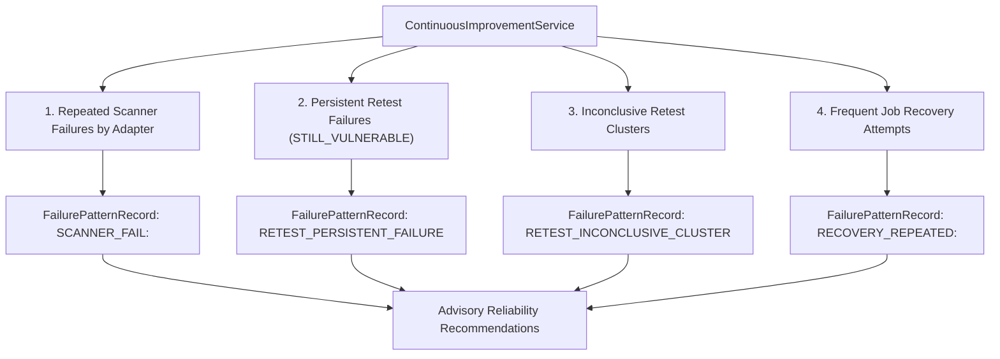

# Operational Reliability & Continuous Improvement

## 1. Overview & Architectural Principles

The **Continuous Improvement Engine** (`ContinuousImprovementService`) aggregates empirical failure patterns across assessment runs, independent retest verifications, notification dispatches, and recovery actions.

Rather than treating operational failures as isolated transient anomalies, the engine tracks recurring failure signatures in `FailurePatternRecord` and generates actionable, non-intrusive reliability recommendations for security engineers and operators.

### Absolute Safety Guardrails:
1. **Zero Policy Erosion:** The system is strictly forbidden from loosening target scope rules, increasing allowed IP ranges, lowering confidence thresholds, or relaxing authorization gates as an automated "learning" response.
2. **Separation of Recommendation from Execution:** Recommendations remain strictly advisory. Automated execution of structural changes requires human review and explicit authorization.
3. **Provable Telemetry:** Pattern counts, affected targets, and error digests are derived exclusively from persisted database records.

---

## 2. Repeated Failure Pattern Detection

The engine continuously evaluates four critical failure vectors:



### 2.1. Repeated Scanner Failures by Adapter
- **Trigger:** Multiple assessment jobs using the same adapter fail across targets.
- **Pattern Key:** `SCANNER_FAIL:<adapter_name>`
- **Advisory Output:** Recommends reviewing worker socket timeouts, target firewall rate-limiting policies, or network routing rules before re-running scans.

### 2.2. Persistent Retest Failures (`STILL_VULNERABLE`)
- **Trigger:** Independent remediation verification probes repeatedly confirm that an identified flaw remains active despite claimed fixes.
- **Pattern Key:** `RETEST_PERSISTENT_FAILURE`
- **Advisory Output:** Signals to engineering leads that developer patches or WAF rules deployed to production are ineffective, advising an architecture code review.

### 2.3. Inconclusive Retest Clusters
- **Trigger:** Retest probes fail to connect to the target or time out during verification.
- **Pattern Key:** `RETEST_INCONCLUSIVE_CLUSTER`
- **Advisory Output:** Flags that verification probes cannot reach the staging/test environment, recommending scope verification and network path inspection.

### 2.4. Frequent Job Recovery Attempts
- **Trigger:** Recovery actions (such as `RECOVER_STUCK_JOB`) are repeatedly triggered for a project.
- **Pattern Key:** `RECOVERY_REPEATED:<action_type>`
- **Advisory Output:** Alerts operators to host-level process instability, memory pressure, or network socket leaks affecting worker runners.

---

## 3. Reliability Tracking & Failure Pattern Schema

Persistent failure patterns are recorded in `failure_pattern_records`:

| Field | Type | Description |
|---|---|---|
| `id` | `String(36)` | Unique pattern UUID. |
| `project_id` | `String(36)` | Tenant project reference. |
| `pattern_key` | `String(100)` | Deterministic pattern identifier (e.g. `SCANNER_FAIL:web_adapter`). |
| `category` | `String(50)` | Vector category (`SCANNER_ADAPTER`, `REMEDIATION`, `VERIFICATION`, `SELF_HEALING`). |
| `occurrence_count`| `Integer` | Total empirical occurrences. |
| `first_observed_at`| `DateTime` | Timestamp of initial detection. |
| `last_observed_at` | `DateTime` | Timestamp of latest recurrence. |
| `affected_targets`| `JSON` | List of target URLs/IPs affected. |
| `sample_error_message` | `Text` | Representative error excerpt. |
| `advisory_recommendation` | `Text` | Safe, non-intrusive operator guidance. |

---

## 4. Querying Failure Patterns & Continuous Improvement

### Via REST API:
```http
GET /api/v1/diagnostics/{project_id}/patterns
Authorization: Bearer <member_token>
```

**Response Format:**
```json
{
  "project_id": "proj-123",
  "patterns_updated": 2,
  "total_patterns": 2,
  "patterns": [
    {
      "id": "pat-e5f6-...",
      "pattern_key": "SCANNER_FAIL:web_adapter",
      "category": "SCANNER_ADAPTER",
      "occurrence_count": 4,
      "first_observed_at": "2026-10-28T10:00:00Z",
      "last_observed_at": "2026-10-28T14:30:00Z",
      "affected_targets": ["https://portal.acme.local", "https://api.acme.local"],
      "sample_error_message": "4 job failure(s) recorded.",
      "advisory_recommendation": "Adapter 'web_adapter' encountered 4 failure(s) across 2 target(s). Recommendation: Inspect target firewall/rate limits; verify worker socket network routes."
    }
  ]
}
```
