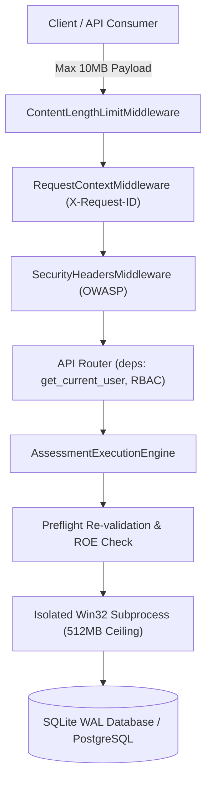

# VAPT Platform — Production Readiness & Operational Hardening

**Document Version:** 1.0.0  
**Baseline Date:** 2026-10-28  
**Repository:** `D:\alt`  
**Deployment Model:** Single-Machine Native Windows Host (SQLite WAL Mode) / Staging PostgreSQL 16 Ready  
**Operational Status:** **HARDENED & OPERATIONAL** (Note: Single-machine architecture is *not* highly available; see Disaster Recovery)

---

## 1. Executive Summary & Production Readiness Gate

This document defines the production readiness baseline, resource governance, failure recovery mechanisms, and operational invariants for the VAPT Platform.

---

## 2. Job Lifecycle State Machine & Permitted Transitions

Assessment jobs enforce strict, validated state transitions managed by [`AssessmentStateMachine`](file:///D:/alt/backend/app/services/assessment_state_machine.py). Jobs cannot jump arbitrary states, and terminal states are immutable.

| State | Classification | Description | Permitted Next States |
|:---|:---:|:---|:---|
| `QUEUED` | Initial | Job registered and placed in global FIFO queue. | `PREFLIGHT`, `CANCELLED` |
| `PREFLIGHT` | Transient | Worker claimed job; re-validating scope, ROE, adapter, and policy digest. | `READY`, `REJECTED`, `FAILED`, `CANCELLED` |
| `READY` | Transient | Preflight passed; ready for subprocess worker spawning. | `RUNNING`, `FAILED`, `CANCELLED` |
| `RUNNING` | Active | Target probe executing under bounded Win32 Job Object containment. | `COMPLETED`, `PARTIAL`, `FAILED`, `TIMED_OUT`, `CANCELLATION_REQUESTED` |
| `CANCELLATION_REQUESTED` | Transient | Operator issued cancellation while probe is running; awaiting safe cleanup. | `CANCELLED`, `FAILED` |
| `COMPLETED` | **Terminal** | Assessment finished cleanly; findings, assets, and graph populated. | *None (Immutable)* |
| `PARTIAL` | **Terminal** | Probe finished with warnings or non-fatal module failures; partial evidence preserved. | *None (Immutable)* |
| `FAILED` | **Terminal** | Probe or ingestion suffered fatal failure; failure category and audit recorded. | `QUEUED` *(via explicit `retry_job` only)* |
| `TIMED_OUT` | **Terminal** | Probe exceeded `timeout_seconds`; subprocess terminated and resources cleaned up. | `QUEUED` *(via explicit `retry_job` only)* |
| `REJECTED` | **Terminal** | Scope authorization revoked, ROE expired, or snapshot tampered; fail-closed. | *None (Immutable Governance Rejection)* |
| `CANCELLED` | **Terminal** | Operator cancelled job; execution aborted and resources freed. | *None (Immutable)* |

---

## 3. Concurrency Protection & Multi-Worker Coordination

1. **SQLite Native Concurrency:**
   - Atomic conditional update pattern: `UPDATE assessment_jobs SET status = 'PREFLIGHT', claimed_by = :worker_id WHERE id = :job_id AND status = 'QUEUED'`.
   - SQLite WAL mode ensures non-blocking concurrent readers during write transactions.
   - Transaction retries with bounded exponential backoff and random jitter (`with_transaction_retry` in `app/core/transaction.py`) resolve transient `database is locked` conflicts.
2. **PostgreSQL Multi-Worker Concurrency (Staging Mode):**
   - Implements `SELECT ... FOR UPDATE SKIP LOCKED` in `AssessmentExecutionEngine.claim_next_available_job`.
   - Prevents worker contention, stampedes, and lock convoying across concurrent worker processes.
3. **Idempotent Job Submission:**
   - Unique composite database index: `Index("uq_assessment_jobs_project_idempotency_key", "project_id", "idempotency_key", unique=True)`.
   - Re-submitting an identical job returns the canonical existing job record without re-enqueuing.

---

## 4. Failure Modes, Worker Crash Recovery & Safe Retries

### 4.1 Worker Process Termination & Abandonment Recovery
If a background worker process crashes, is killed by an Out-Of-Memory (OOM) killer, or suffers machine power loss during execution:
- Every active worker updates `AssessmentJob.heartbeat_at` periodically during execution.
- The background daemon runs [`recover_stale_workers`](file:///D:/alt/backend/app/services/assessment_engine.py#L982) every 60 seconds (with a 120-second heartbeat timeout threshold).
- **If `attempt_count < max_retries`:**
  - The job is safely re-queued: `status = QUEUED`, `claimed_by = None`, `worker_pid = None`.
  - `retry_count` and `attempt_count` are incremented.
  - Bounded exponential backoff with full jitter is computed: `AssessmentExecutionEngine.calculate_backoff_delay(attempt)`.
  - Next retry schedule is recorded in `summary_stats["next_retry_at"]`.
  - Audit event `ASSESSMENT_STALE_WORKER_RECOVERED` is cryptographically appended.
- **If `attempt_count >= max_retries`:**
  - The job fails closed: `status = FAILED`, `failure_category = WORKER_HEARTBEAT_TIMEOUT`.
  - Audit event `ASSESSMENT_STALE_WORKER_FAILED` is recorded.
- **Non-Retryable Failures:**
  - Governance rejections (`SCOPE_AUTHORIZATION_DENIED`, `SCOPE_SNAPSHOT_TAMPERING_DETECTED`, `POLICY_VERSION_MISMATCH`, `UNSUPPORTED_ADAPTER`) can **never** be retried automatically.

### 4.2 Bounded Exponential Backoff & Jitter Algorithm
Retry delays prevent retry storms against degraded targets:
$$\text{delay} = \text{random.uniform}\left(0.5 \times \min(M, B \times 2^{A-1}),\; \min(M, B \times 2^{A-1})\right)$$
where $B = 2.0\text{s}$ (base delay), $M = 60.0\text{s}$ (maximum ceiling), and $A$ is the retry attempt index.

---

## 5. Resource Exhaustion Controls & Guardrails

| Boundary | Control Mechanism | Limit | Failure Response |
|:---|:---|:---:|:---|
| **Subprocess Memory** | Win32 Job Object `JobObjectExtendedLimitInformation` | **512 MB** | Process terminated; job fails with `WORKER_PROCESS_KILLED_OOM` |
| **Request Payload** | `ContentLengthLimitMiddleware` | **10 MB** | HTTP 413 Payload Too Large |
| **IPC Transfer** | `SubprocessWorkerRunner` pipe clamp | **10 MB** | IPC pipe truncated; job fails with `IPC_PAYLOAD_LIMIT_EXCEEDED` |
| **Findings Ingestion** | Ingestion pipeline finding clamp | **50 findings** | Surplus findings dropped with warning; prevents DB flood |
| **Evidence Payload** | Evidence byte clamp | **1 MB** | Evidence marked `is_truncated = True`; raw SHA-256 preserved |
| **Scanner Sockets** | Socket read/connect timeout | **30 s** | Request aborted; job transitions to `PARTIAL` or `FAILED` |
| **Graph Traversal** | Recursive cycle-safe depth bound | **Depth 5** | Traversal terminates; avoids infinite graph traversal loops |

---

## 6. Operational Logging, Error Sanitization & Diagnostics

1. **Request Tracing:**
   Every HTTP request receives a unique `X-Request-ID` UUID returned in response headers and logged with method, path, HTTP status, and duration in milliseconds.
2. **Sensitive Data Redaction:**
   - URLs logged in access logs exclude query parameters and request bodies.
   - Audit event serialization masks sensitive keys (`password`, `token`, `secret`, `authorization`, `cookie`, `key`).
3. **Health & Readiness Diagnostic Sanitization:**
   - `/health`: Simple liveness probe (HTTP 200 OK).
   - `/ready`: Deep diagnostic probe testing DB connection, schema tables, and disk writability.
   - Invariant: Error details in `/ready` return generic state indicators (`unreachable`, `unwritable`) and **never** disclose database connection strings, credentials, or file paths.
4. **Unhandled Exception Masking:**
   - In `ENVIRONMENT = production`, unhandled exceptions are caught by `global_unhandled_exception_handler`.
   - Full stack trace is logged internally with `req_id`.
   - Client receives generic HTTP 500: `{"detail": "An internal error occurred. Please contact the administrator.", "request_id": "<req_id>"}`. Zero Python tracebacks or internal file paths are exposed.
