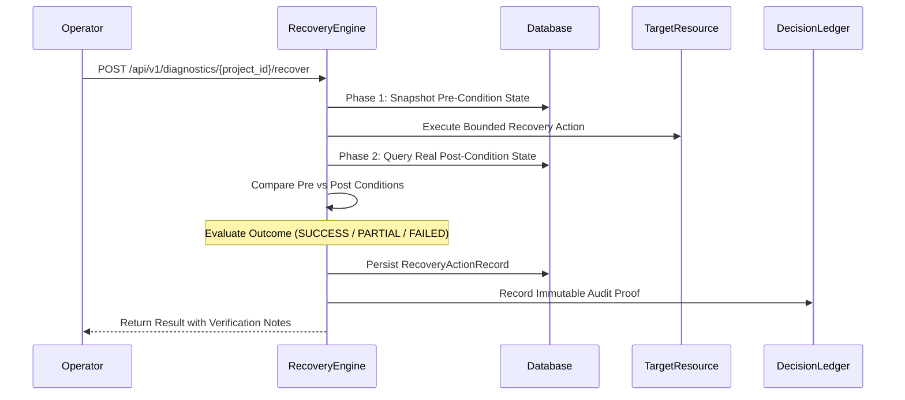

# Controlled Recovery Actions & Self-Healing Governance

## 1. Overview & Core Philosophy

The VAPT Platform's **Recovery Engine** (`RecoveryEngineService`) executes safe, idempotent, and policy-governed self-healing operations to restore platform health after transient disruptions, hung worker processes, or operational failures.

### The 8 Non-Negotiable Recovery Principles:
1. **Mandatory Authorization:** Recovery actions mutate state and strictly require `ProjectRole.LEAD` or `SystemRole.ADMIN`. Regular members (`VIEWER`, `SECURITY_TESTER`) are denied with HTTP 403.
2. **Preflight State Validation:** The system verifies the entity's current state before attempting any transition.
3. **Fail-Closed Scope & Tenant Boundaries:** Recovery actions cannot scan or probe unauthorized targets; out-of-scope requests are immediately aborted.
4. **Idempotency:** Re-executing an action against an already recovered entity produces an `INCONCLUSIVE` or no-op outcome rather than creating duplicated jobs or corrupting data.
5. **Bounded Resource Limits:** Retries adhere to hard limits (e.g., max 3 notification attempts, concurrency caps, daily execution budgets).
6. **Immutable Decision Ledger Audit:** Every recovery execution logs pre-conditions, post-conditions, actor ID, and outcomes in `SecurityDecisionLedgerRecord`.
7. **Zero Primary Evidence Tampering:** Recovery operations never delete or alter historical vulnerability findings, raw evidence payloads, or audit trails.
8. **Honest Outcome Reporting:** Operations distinguish complete success (`SUCCESS`), partial resolution (`PARTIAL_SUCCESS`), failure (`FAILED`), and unverified states (`INCONCLUSIVE`).

---

## 2. Two-Phase Recovery Verification Flow

A recovery action is not considered successful simply because an API returned HTTP 200. The engine enforces two-phase verification:



---

## 3. Supported Recovery Actions

| Action Key | Target Entity | Trigger Condition | Execution Logic | Verification Check |
|---|---|---|---|---|
| `RECOVER_STUCK_JOB` | `ASSESSMENT_JOB` | Job in `RUNNING` > 15m or `QUEUED` > 30m | Transitions job to `CANCELLED` and sets diagnostic error message. | Confirms job is in terminal state; project concurrency slot freed. |
| `RETRY_ASSESSMENT` | `ASSESSMENT_JOB` | Transient scanner failure | Preflight validates target in `ScopeTarget`. Queues fresh `AssessmentJob`. | Confirms new job ID exists in `QUEUED` status under budget. |
| `REQUEUE_NOTIFICATION`| `NOTIFICATION` | Failed delivery attempt | Verifies `retry_count < 3`. Resets status to `PENDING` and increments attempt. | Confirms notification status reset to `PENDING` with retry increment. |
| `RECALCULATE_RISK_SCORES`| `PROJECT` | Stale or missing risk models | Re-runs `ContextualRiskService` across project findings with model `v2.0.0`. | Confirms all findings have updated risk records and scores. |
| `REBUILD_KNOWLEDGE_GRAPH`| `PROJECT` | Orphaned nodes or stale edges | Reconciles graph topology and relationships from authoritative asset inventory. | Confirms node and relationship counts match asset registry. |
| `TRIGGER_BACKUP` | `PROJECT` | Overdue database backup | Executes online non-blocking backup with SHA-256 digest and test sandbox restore. | Confirms sandbox restore returns `is_valid == True`. |
| `RETEST_REMEDIATION` | `FINDING` | Closed finding lacking verification proof | Preflight verifies target scope. Enqueues independent retest probe job. | Confirms retest job queued for verification engine. |
| `RESUME_MONITORING` | `PROJECT` | Monitoring paused after consecutive failures | Clears `consecutive_failures` counter in `AutonomousPolicyRecord`. | Confirms policy failure count reset to 0; scheduler resumes. |

---

## 4. API Reference

### Execute Recovery Action
```http
POST /api/v1/diagnostics/{project_id}/recover
Authorization: Bearer <lead_or_admin_token>
Content-Type: application/json

{
  "action_type": "RECOVER_STUCK_JOB",
  "target_entity_type": "ASSESSMENT_JOB",
  "target_entity_id": "job-7b89-...",
  "target_resource": "https://portal.acme.local",
  "reason": "Scanner process timed out on network socket read"
}
```

**Response Format:**
```json
{
  "recovery_id": "rec-c4d5-...",
  "project_id": "proj-123",
  "action_type": "RECOVER_STUCK_JOB",
  "outcome": "SUCCESS",
  "pre_condition": {
    "job_id": "job-7b89-...",
    "status": "RUNNING",
    "started_at": "2026-10-28T14:00:00Z"
  },
  "post_condition": {
    "job_id": "job-7b89-...",
    "status": "CANCELLED",
    "completed_at": "2026-10-28T14:22:00Z"
  },
  "verification_notes": "Job transitioned from active to CANCELLED; concurrency slot released.",
  "ledger_record_id": "ledg-89ab-..."
}
```
