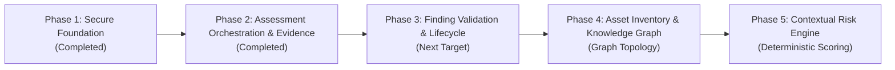

# VAPT Platform — Multi-Year Implementation Roadmap

## Overview

This roadmap defines the multi-year trajectory for the VAPT Platform, transitioning from the Phase 1 Secure Foundation into an autonomous, intelligence-driven cybersecurity ecosystem.

---

## Phase 1: Secure Foundation
- **Status:** **Completed & Verified**
- **Milestones:**
  - [x] Environment inspection on native Windows runtime.
  - [x] FastAPI control plane with versioned `/api/v1` routes and request context middleware.
  - [x] SQLite WAL mode in development with strict foreign keys; portable SQLAlchemy 2.0 schema for PostgreSQL production.
  - [x] Alembic database migration pipeline.
  - [x] Argon2/Bcrypt identity system, JWT bearer tokens, and RBAC.
  - [x] Organizations, Projects, and server-side project isolation.
  - [x] Target Scope registration vs Proof of Authorization decoupled life-cycle (`PENDING`, `AUTHORIZED`, `REVOKED`, `EXPIRED`).
  - [x] Scope Exclusions engine with absolute precedence.
  - [x] Non-invasive, in-memory Scope Validation Console.
  - [x] Immutable Audit Ledger with recursive credential sanitization.
  - [x] React 19 + TypeScript + Vite + Tailwind CSS dashboard with zero fake metrics.
  - [x] Full automated test suite (backend pytest + frontend vitest).

---

## Phase 2: Assessment Orchestration & Evidence Pipeline
- **Status:** **Completed & Verified**
- **Milestones:**
  - [x] Persistent assessment job state machine (`QUEUED`, `RUNNING`, `COMPLETED`, `FAILED`, `CANCELLED`, `TIMED_OUT`, `PARTIAL`).
  - [x] Strict legal state transitions and transition validation tests.
  - [x] Idempotency keys preventing duplicate jobs on network replay.
  - [x] Execution boundary re-validating target authorization and scope before dispatch.
  - [x] Pluggable Scanner Adapter interface (`BaseScannerAdapter`).
  - [x] Deterministic `LocalFixtureAdapter` with profiles (`WEB_APPLICATION_BASELINE`, `TLS_CONFIGURATION_CHECK`, `HARDENED_HOST_BASELINE`, `SIMULATED_CRITICAL_EXPOSURE`, `PARTIAL_FAILURE_PROFILE`).
  - [x] Finding and cryptographic SHA-256 evidence provenance persistence.
  - [x] Job cancellation and execution timeout handling.
  - [x] Resource limits: max findings per job (50) and max evidence size (64KB).
  - [x] Live React assessment orchestration console with job history, findings inspection, and cryptographic evidence drawer.
  - [x] 28 backend unit/integration tests and 4 frontend tests passed.

---

## Phase 3: Finding Validation & Lifecycle (Next Target)
- **Target Horizon:** Next Milestone
- **Key Deliverables:**
  - [ ] 13-state finding lifecycle domain service (`DETECTED`, `NEEDS_VALIDATION`, `CONFIRMED`, `FALSE_POSITIVE`, `INCONCLUSIVE`, `REMEDIATION_PROPOSED`, `REMEDIATION_APPROVED`, `REMEDIATION_ATTEMPTED`, `REMEDIATED_PENDING_VERIFICATION`, `VERIFIED_CLOSED`, `REOPENED`, `ACCEPTED_RISK`, `EXPIRED`).
  - [ ] Finding deduplication engine preserving contradictory evidence.
  - [ ] Reviewer sign-off provenance and reason tracking for false-positive dispositions.
  - [ ] Stale observation handling and automated revalidation policies.

---

## Phase 4: Asset Inventory & Universal Security Knowledge Graph
- **Target Horizon:** Months 6 - 9
- **Key Deliverables:**
  - [ ] Normalized asset records and time-stamped asset observations.
  - [ ] PostgreSQL-compatible relational graph tables.
  - [ ] Multi-hop relationship modeling (`RUNS`, `DEPENDS_ON`, `AUTHENTICATES_TO`, `CAN_ACCESS`, `EXPOSES`, `AFFECTED_BY`, `MITIGATES`).
  - [ ] Asset identity reconciliation with ambiguity flags.

---

## Phase 5: Contextual Risk Engine
- **Target Horizon:** Months 9 - 12
- **Key Deliverables:**
  - [ ] Deterministic, versioned, explainable contextual risk engine.
  - [ ] Multi-dimensional scoring (severity, exploitability evidence, exposure, business criticality, attack-path contribution, controls).
  - [ ] Explicit uncertainty indicators without collapsing missing data to zero.
