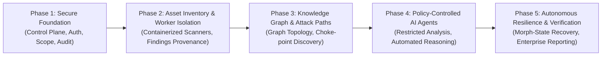

# VAPT Platform — Multi-Year Implementation Roadmap

## Overview

This roadmap defines the multi-year trajectory for the VAPT Platform, transitioning from the Phase 1 Secure Foundation into an autonomous, intelligence-driven cybersecurity ecosystem.

---

## Phase 1: Secure Foundation (Completed Deliverable)
- **Status:** **Completed & Verified**
- **Milestones:**
  - [x] Environment inspection on native Windows runtime.
  - [x] FastAPI control plane with versioned `/api/v1` routes and request context middleware.
  - [x] SQLite WAL mode in development with strict foreign keys; portable SQLAlchemy 2.0 schema for PostgreSQL production.
  - [x] Alembic database migration pipeline.
  - [x] Argon2/Bcrypt identity system, JWT bearer tokens, and RBAC (`ADMIN`, `SECURITY_LEAD`, `SECURITY_TESTER`, `AUDITOR`, `VIEWER`).
  - [x] Organizations, Projects, and server-side project isolation.
  - [x] Target Scope registration vs Proof of Authorization decoupled life-cycle (`PENDING`, `AUTHORIZED`, `REVOKED`, `EXPIRED`).
  - [x] Scope Exclusions engine with absolute precedence.
  - [x] Non-invasive, in-memory Scope Validation Console.
  - [x] Immutable Audit Ledger with recursive credential sanitization.
  - [x] React 19 + TypeScript + Vite + Tailwind CSS dashboard with zero fake metrics.
  - [x] Full automated test suite (backend pytest + frontend vitest).

---

## Phase 2: Asset Inventory & Isolated Scanner Workers
- **Target Horizon:** Months 3 - 6
- **Key Deliverables:**
  - [ ] **Asset Management System:** Active hosts, open ports, software services, TLS certificates, DNS records.
  - [ ] **Isolated Assessment Workers:** Celery / Redis or RabbitMQ task queue isolating scanner executions from the control plane.
  - [ ] **Scanner Adapters:** Native plugins for standard tools (Nmap network mapper, Nuclei template engine, testssl.sh, ZAP API scanner).
  - [ ] **Pre-Flight Worker Scope Verification:** Assessment workers independently re-validate target authorization and exclusion rules against the database before initiating raw network sockets.
  - [ ] **Vulnerability Findings Provenance:** Structured findings catalog with raw reproduction proof, HTTP requests/responses, and cryptographic evidence hashes.

---

## Phase 3: Security Knowledge Graph & Attack Path Modeling
- **Target Horizon:** Months 7 - 12
- **Key Deliverables:**
  - [ ] **Security Knowledge Graph:** Graph schema modeling relationships between assets, network enclaves, credentials, and known CVEs.
  - [ ] **Attack Path Analysis:** Choke-point detection and graph traversal algorithms identifying multi-hop privilege escalation paths.
  - [ ] **Risk Scoring Engine:** Context-aware scoring combining CVSS 4.0, asset criticality, network reachability, and active exploit intelligence (EPSS).

---

## Phase 4: Policy-Controlled AI Security Intelligence
- **Target Horizon:** Months 13 - 18
- **Key Deliverables:**
  - [ ] **Restricted AI Agents:** LLM orchestration strictly confined to read-only knowledge graph inspection and remediation drafting.
  - [ ] **Policy Execution Gatekeeper:** Hardcoded authorization checks preventing AI from running arbitrary shell scripts, mutating database configurations, or scanning unapproved targets.
  - [ ] **Contextual Exploitability Verification:** Automated generation of non-destructive verification scripts to filter out false positives.

---

## Phase 5: Autonomous Resilience, Morph-State & Reporting
- **Target Horizon:** Months 19 - 24+
- **Key Deliverables:**
  - [ ] **Morph-State Detection & Containment:** Detection of infrastructure state drifts during active testing, automated rollback, and system stabilization.
  - [ ] **Executive & Regulatory Reporting:** Automated generation of Board-ready executive summaries, PCI-DSS / SOC 2 compliance reports, and developer remediation blueprints.
  - [ ] **SIEM / SOAR Webhook Integrations:** Real-time alert streaming to Splunk, Microsoft Sentinel, Jira, and Slack.
