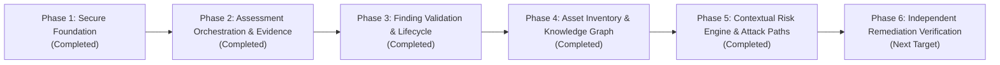

# VAPT Platform — Multi-Year Implementation Roadmap

## Overview

This roadmap defines the multi-year trajectory for the VAPT Platform, transitioning from the Phase 1 Secure Foundation into an autonomous, intelligence-driven cybersecurity ecosystem.

---

## Phase 1: Secure Foundation
- **Status:** **Completed & Verified**
- **Milestones:**
  - [x] Environment inspection on native Windows runtime.
  - [x] FastAPI control plane with versioned `/api/v1` routes and request context middleware.
  - [x] SQLite WAL mode in development with strict foreign keys; portable SQLAlchemy 2.0 schema for PostgreSQL production.
  - [x] Alembic database migration pipeline.
  - [x] Argon2/Bcrypt identity system, JWT bearer tokens, and RBAC.
  - [x] Organizations, Projects, and server-side project isolation.
  - [x] Target Scope registration vs Proof of Authorization decoupled life-cycle (`PENDING`, `AUTHORIZED`, `REVOKED`, `EXPIRED`).
  - [x] Scope Exclusions engine with absolute precedence.
  - [x] Non-invasive, in-memory Scope Validation Console.
  - [x] Immutable Audit Ledger with recursive credential sanitization.
  - [x] React 19 + TypeScript + Vite + Tailwind CSS dashboard with zero fake metrics.
  - [x] Full automated test suite (backend pytest + frontend vitest).

---

## Phase 2: Assessment Orchestration & Evidence Pipeline
- **Status:** **Completed & Verified**
- **Milestones:**
  - [x] Persistent assessment job state machine (`QUEUED`, `RUNNING`, `COMPLETED`, `FAILED`, `CANCELLED`, `TIMED_OUT`, `PARTIAL`).
  - [x] Strict legal state transitions and transition validation tests.
  - [x] Idempotency keys preventing duplicate jobs on network replay.
  - [x] Execution boundary re-validating target authorization and scope before dispatch.
  - [x] Pluggable Scanner Adapter interface (`BaseScannerAdapter`).
  - [x] Deterministic `LocalFixtureAdapter` with profiles (`WEB_APPLICATION_BASELINE`, `TLS_CONFIGURATION_CHECK`, `HARDENED_HOST_BASELINE`, `SIMULATED_CRITICAL_EXPOSURE`, `PARTIAL_FAILURE_PROFILE`).
  - [x] Finding and cryptographic SHA-256 evidence provenance persistence.
  - [x] Job cancellation and execution timeout handling.
  - [x] Resource limits: max findings per job (50) and max evidence size (64KB).
  - [x] Live React assessment orchestration console with job history, findings inspection, and cryptographic evidence drawer.
  - [x] 28 backend unit/integration tests and 4 frontend tests passed.

---

## Phase 3: Finding Validation & Lifecycle
- **Status:** **Completed & Verified**
- **Milestones:**
  - [x] 13-state finding lifecycle domain service (`DETECTED`, `NEEDS_VALIDATION`, `CONFIRMED`, `FALSE_POSITIVE`, `INCONCLUSIVE`, `REMEDIATION_PROPOSED`, `REMEDIATION_APPROVED`, `REMEDIATION_ATTEMPTED`, `REMEDIATED_PENDING_VERIFICATION`, `VERIFIED_CLOSED`, `REOPENED`, `ACCEPTED_RISK`, `EXPIRED`).
  - [x] Legal state transition matrix and validation with explicit rationale enforcement.
  - [x] Deterministic SHA-256 finding fingerprinting and deduplication correlation engine.
  - [x] Non-destructive contradictory evidence handling preserving divergent scanner observations and confidence.
  - [x] Automated reopening when closed or remediated findings are re-observed on target.
  - [x] Reviewer sign-off provenance for `FALSE_POSITIVE` dispositions (Project LEAD / System ADMIN + min 10 char rationale).
  - [x] Time-bounded `ACCEPTED_RISK` governance with mandatory future expiration date, compensating controls, and automated sweep transition to `EXPIRED`.
  - [x] Full audit trail (`FindingTransition` table + immutable audit ledger).
  - [x] Complete REST API endpoints (`/api/v1/projects/{id}/findings/*`) with rich filtering and stats.
  - [x] React 19 Finding Lifecycle console with transition modals, contradiction warning badges, and provenance timeline.
  - [x] 41 backend tests passed in 12s; 6 frontend tests passed; production build verified.

---

## Phase 4: Asset Inventory & Universal Security Knowledge Graph
- **Status:** **Completed & Verified**
- **Milestones:**
  - [x] Normalized typed asset entities and immutable time-stamped asset observations (`Asset` vs `AssetObservation`).
  - [x] Type-specific canonical identifier normalizer (Web Apps, APIs, IPv4/IPv6, CIDRs, Services, Domains).
  - [x] Conservative reconciliation tracking conflicting attributes in `_attribute_history` without overwriting data.
  - [x] Identity ambiguity tracking (`is_ambiguous`, `ambiguity_reason`) with audit-logged resolution governance.
  - [x] Universal Security Knowledge Graph on PostgreSQL-compatible relational primitives (`graph_nodes`, `graph_relationships`).
  - [x] Typed nodes across 13 security categories and 11 relationship types.
  - [x] Multi-state epistemic confidence and verification states (`VERIFIED`, `INFERRED`, `HYPOTHETICAL`, `STALE`, `SUPERSEDED`).
  - [x] Bounded, cycle-safe BFS neighborhood traversal with strict depth, node, and edge limits, plus truncation signaling.
  - [x] Strict project boundary isolation preventing cross-project graph connections.
  - [x] Automatic assessment-to-asset reconciliation, observation recording, and graph node/relationship generation.
  - [x] React 19 Asset Inventory view with filters, KPI counters, detail modal, ambiguity resolution, and fixture ingestion.
  - [x] React 19 Knowledge Graph visualizer with SVG layout, verification status styling, node inspector, and edge creator.
  - [x] 50 backend tests passed; 6 frontend tests passed; production build verified.

---

## Phase 5: Contextual Risk Intelligence, Attack Paths, and Remediation Prioritization
- **Status:** **Completed & Verified**
- **Milestones:**
  - [x] Dedicated, testable Contextual Risk Scoring Engine (`ContextualRiskService`, formula `v1.0.0`).
  - [x] Bounded 0–100 prioritization index based on severity, confidence, asset criticality, exposure, evidence freshness decay, and lifecycle mitigating controls.
  - [x] Preservation of original vendor severity and frozen input snapshots for historical reproducibility.
  - [x] Explicit missing factor and uncertainty tracking without invented data.
  - [x] Idempotent risk persistence and supersession tracking (`RiskAssessment` model & Alembic migration).
  - [x] Evidence-Aware Attack Path Analysis (`AttackPathAnalysisService`) traversing persisted graph edges.
  - [x] Epistemic path verification classification (`VERIFIED`, `MIXED_EVIDENCE`, `HYPOTHETICAL`).
  - [x] Cycle avoidance and hard depth bounds (max depth 4, max paths 10).
  - [x] Evidence-backed Remediation Prioritization (`RemediationPrioritizationService`) with defensive playbooks.
  - [x] Operational impact, rollback procedures, prerequisites, and independent verification criteria.
  - [x] Review & approval workflow requiring Project LEAD / System ADMIN roles.
  - [x] Strict non-executing decision support: no shell commands, firewall modifications, or automated patch execution.
  - [x] Complete REST API endpoints (`/api/v1/projects/{id}/risk/*`, `/graph/paths/*`, `/remediations/*`).
  - [x] React 19 Contextual Risk Dashboard with KPI summaries, factor decomposition drawer, attack path explorer, and remediation sign-off modal.
  - [x] 67 backend pytest tests passed; 6 frontend tests passed; production build verified.

---

## Phase 6: Independent Remediation Verification & Morph-State Simulation
- **Target Horizon:** Next Target
- **Key Deliverables:**
  - [ ] Independent post-remediation re-testing workflows.
  - [ ] Morph-State simulation engine in observe-only mode.
  - [ ] Digital twin snapshotting for what-if security analysis.
