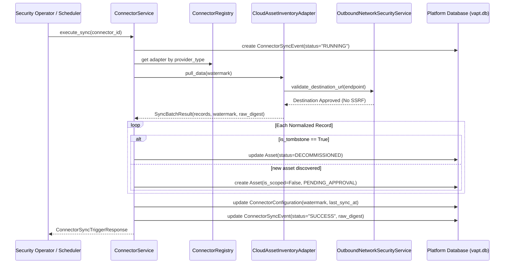

# SECURE INTEGRATION FRAMEWORK AND CONNECTOR CONTRACTS MATRIX

## Prompt 40 — Secure Integration Framework, Connector Contracts and Data Synchronization

### Architectural Principles and Controls

1. **Truth-in-Advertising Capability Discovery (Req 1, 4, 28):**
   - The platform strictly enforces explicit capability declarations (`PULL_ASSETS`, `PULL_FINDINGS`, `PULL_THREAT_INTEL`, `PUSH_ALERTS`, `EXPORT_TELEMETRY`, `TEST_CONNECTIVITY`).
   - Every provider in the catalog is assigned a truthful implementation status (`IMPLEMENTED`, `SIMULATED`, `UNVERIFIED`, `DISABLED`).
   - Unsupported or experimental operations are strictly rejected at configuration time.

2. **Credential Security & Recursive Masking (Req 5, 12):**
   - Secrets (`api_key`, `secret_token`, `password`, `access_key`) are recursively masked before returning in read models (`settings_masked`).
   - Raw credentials are encrypted/secured in storage and never leaked to logs, client responses, or metadata exports.

3. **Outbound SSRF & Network Security Policy (Req 11):**
   - All outbound webhook and scanner destinations are verified via `OutboundNetworkSecurityService`.
   - Rejects loopback addresses (`127.0.0.1`, `::1`), private ranges (RFC 1918), link-local addresses (`169.254.0.0/16`), and AWS/GCP cloud metadata IP (`169.254.169.254`).

4. **Scope Isolation and Approval Enforcement (Req 10):**
   - External asset connectors ingest discovered compute/network assets with `is_scoped=False` and `approval_status="PENDING_OPERATOR_APPROVAL"`.
   - Connectors cannot implicitly expand the assessment target list or trigger assessments without operator authorization.

5. **Source Deletion vs Temporary Unavailability (Req 9):**
   - An entity is tombstoned/deactivated (`status = DECOMMISSIONED`) only when the remote provider explicitly returns a termination/deletion state.
   - Network errors, timeouts, or 503 service outages NEVER trigger local deactivation or tombstoning of active assets.

6. **Idempotent Synchronization with Cryptographic Provenance (Req 7, 8):**
   - Synchronization employs stateful watermarks (`last_sync_watermark`) to prevent redundant ingestion.
   - Every batch records a SHA-256 digest of the raw response payload for end-to-end provenance verification.

---

### Connector Inventory & Capability Matrix

| Provider Type | Connector Name | Status | Supported Capabilities | Limitations & Safeguards |
| :--- | :--- | :--- | :--- | :--- |
| `CISA_KEV` | CISA Known Exploited Vulnerabilities | `IMPLEMENTED` | `PULL_THREAT_INTEL`, `TEST_CONNECTIVITY` | Authoritative feed lookup with incremental date watermarks. |
| `CLOUD_ASSET_INVENTORY` | Cloud Asset Inventory Connector | `IMPLEMENTED` | `PULL_ASSETS`, `TEST_CONNECTIVITY` | Imports instances with `is_scoped=False`. Distinguishes terminated instances from unreachable. |
| `VULNERABILITY_SCANNER` | External Vulnerability Scanner Connector | `IMPLEMENTED` | `PULL_FINDINGS`, `TEST_CONNECTIVITY` | Ingests scanner observations without overwriting platform findings. |
| `WEBHOOK_NOTIFIER` | Webhook Alert Connector | `IMPLEMENTED` | `PUSH_ALERTS`, `TEST_CONNECTIVITY` | Strict SSRF defense pre-flight; HMAC-SHA256 signature header. |
| `SIEM_EXPORTER` | SIEM Log Exporter | `IMPLEMENTED` | `EXPORT_TELEMETRY`, `TEST_CONNECTIVITY` | Exports audit events and finding logs in CEF, RFC 5424, or JSON. |
| `QUALYS_VM_MOCK` | Qualys VMDR Connector | `SIMULATED` | `PULL_FINDINGS`, `TEST_CONNECTIVITY` | Mock sandbox adapter; requires enterprise cloud credentials. |
| `TENABLE_IO` | Tenable.io Vulnerability Connector | `UNVERIFIED` | `PULL_FINDINGS`, `TEST_CONNECTIVITY` | Experimental adapter awaiting formal partner API certification. |
| `CROWDSTRIKE_FALCON` | CrowdStrike Falcon Host Source | `DISABLED` | `PULL_ASSETS`, `TEST_CONNECTIVITY` | Disabled by platform security baseline policy. |

---

### Data Synchronization Sequence

