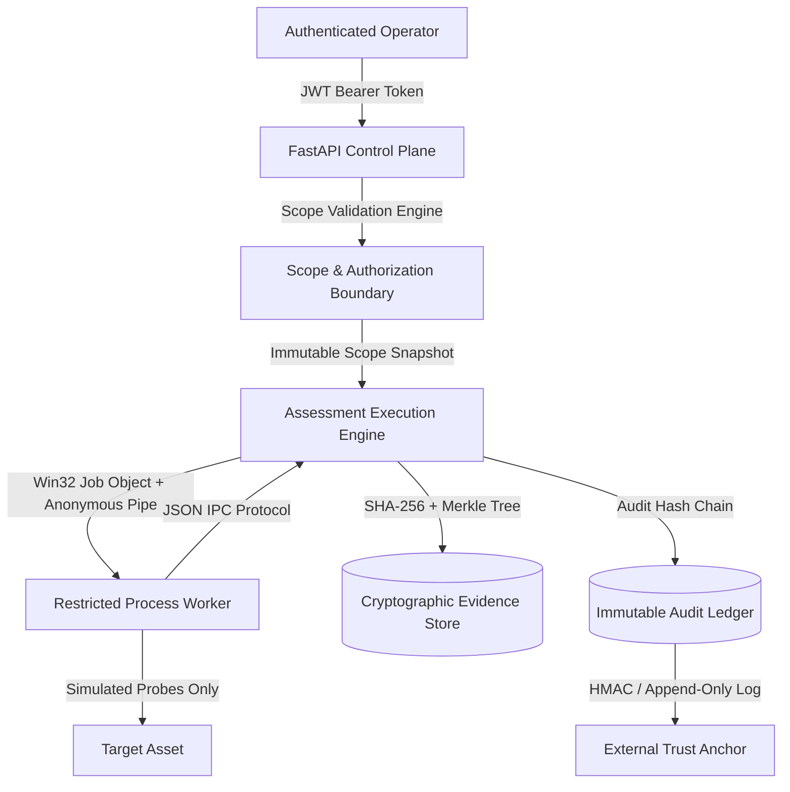

# VAPT Platform — Security Architecture & Threat Defense Model

**Classification:** Platform Security Specification  
**Architecture Model:** Zero-Trust Defensive Assessment & Evidence Governance  

---

## 1. System Trust Boundaries

---

## 2. Core Security Pillars

### 2.1 Role-Based Access Control & Tenant Isolation
- **Roles:**
  - `ORGANIZATION_ADMIN`: Organization lifecycle, user management.
  - `PROJECT_LEAD`: Scope definition, assessment authorization, project purges, risk acceptance.
  - `TESTER`: Job submission, simulation execution, finding triage.
  - `VIEWER`: Read-only reporting and audit inspection.
- **Tenant Isolation:** Every operational query enforces explicit `project_id` scoping in the SQLAlchemy AST. Outsiders receive HTTP 404 (preventing project ID enumeration).

### 2.2 Dual-Key Scope Governance & Snapshots
- Scopes are explicitly defined as IP addresses, CIDR ranges, or fully qualified domain names (FQDNs).
- **Dual-Key Authorization:** The operator submitting an assessment cannot self-authorize out-of-scope targets.
- **Immutable Scope Snapshot:** At job creation, a cryptographically hashed snapshot (`scope_snapshot_digest`) is recorded.
- **Preflight Boundary Check:** Immediately before worker process launch, `AssessmentExecutionEngine` re-validates the target against active database scope rules. If the target was revoked or excluded, the job fails closed to `REJECTED`.

### 2.3 Process Worker Sandboxing (Native Windows)
- **Subprocess Isolation:** Worker runs in a separate `python.exe` process with an empty environment stripping `SECRET_KEY` and `DATABASE_URL`.
- **Win32 Job Object Containment:**
  - Process assigned to a Windows Job Object with `JOB_OBJECT_LIMIT_KILL_ON_JOB_CLOSE`.
  - Memory ceiling enforced at 512MB (`WORKER_MEMORY_LIMIT_BYTES`).
  - Child process creation restricted; any spawned descendants are terminated when the job object closes.
- **IPC Sanitization:** Worker communicates over standard I/O streams using JSON-lines IPC. Payloads are clamped to 10MB; finding batches are clamped to 50 findings per job.

### 2.4 Cryptographic Evidence & Audit Integrity
- **Evidence Records:** Every raw evidence payload is digested with SHA-256. Altering a single byte in stored evidence invalidates verification.
- **Binary Merkle Proofs:** Evidence items form a binary Merkle tree. Third-party auditors can verify individual findings via inclusion proofs (`/evidence/{id}/proof`).
- **Audit Hash Chaining:** Every event in `audit_events` references the previous event's hash (`f"{prev_hash}:{project_id}:{action}:{actor_id}:{timestamp}:{details_sha256}"`), preventing retroactive insertion, deletion, or alteration of audit events.
- **Trust Anchoring:** Merkle roots can be anchored via symmetric software HMAC or an independent append-only file archive with rollback detection (`AppendOnlyArchiveTrustAnchor`).

### 2.5 AI Security Analyst Guardrails
- **Prompt Injection Defense:** Finding titles, descriptions, and outputs are scanned for injection patterns (e.g. `ignore previous instructions`, `system prompt:`, `eval(...)`). Untrusted findings are flagged and quarantined.
- **Grounded Citations:** AI advisory drafts must cite actual finding IDs present in the current project. Unsupported or hallucinated citations are rejected by the backend validator.
- **Advisory Status:** AI analyst outputs are strictly drafts (`DRAFT` status); they cannot alter finding lifecycle states without human operator review.
