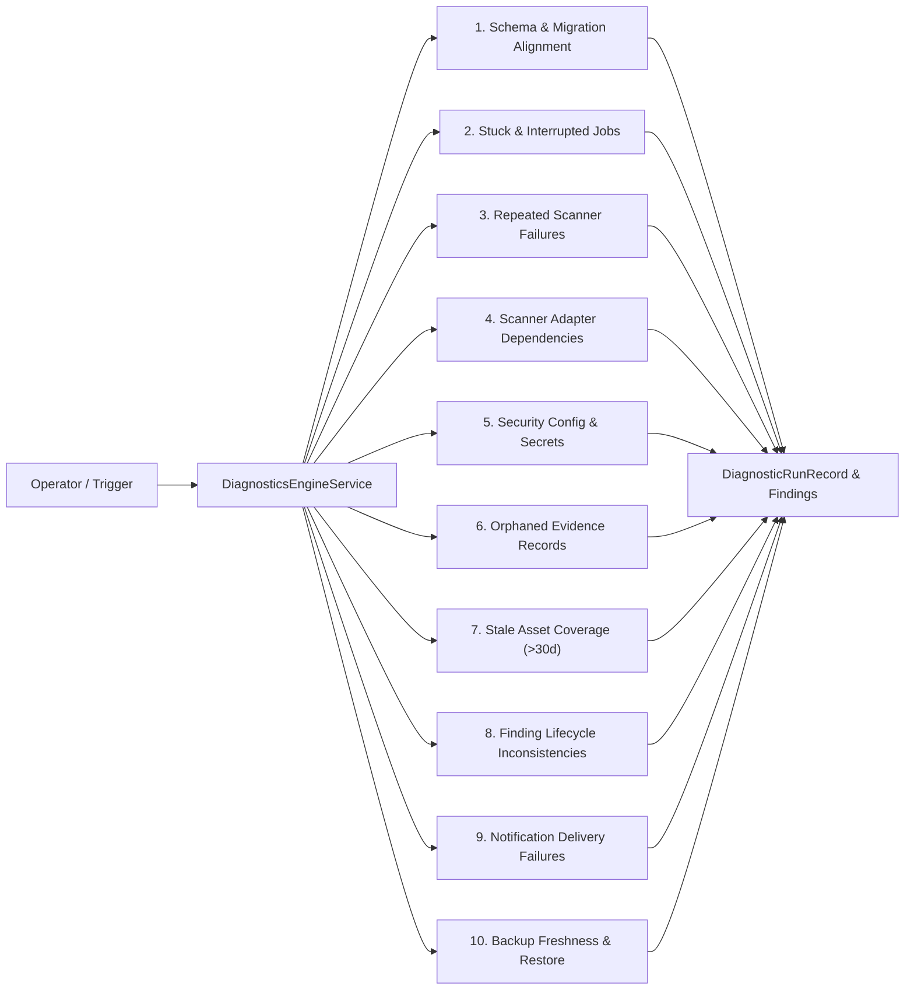

# Central System Health Engine & Safe Self-Diagnostics

## 1. Overview & Operational Principles

The VAPT Platform's **Self-Diagnostics Subsystem** provides continuous, empirical inspection across all platform components, background queues, and data stores.

Unlike traditional health checks that merely ping a process or return a static `{"status": "ok"}`, this architecture enforces:
1. **Meaningful Functional Verification:** Actively tests token signing, database query latency, worker queue progression, adapter imports, risk models, and restore integrity.
2. **Read-Only by Default:** Diagnostics inspect state and generate structured findings without mutating operational records or primary assessment evidence.
3. **Explicit Diagnostic Confidence:** Distinguishes verified defects (`CONFIRMED`) from potential risks (`SUSPECTED`) or unmeasurable indicators (`UNAVAILABLE`).
4. **Zero Secret Leakage:** Diagnostic payloads and error summaries are scrubbed by automated sanitizers to prevent token, password, or key exposure.

---

## 2. Central System Health Engine (12 Subsystems)

The `HealthEngineService` evaluates 12 core platform subsystems:

| # | Subsystem Key | Component Name | Verification Scope | Health Status Evaluated |
|---|---|---|---|---|
| 1 | `api_auth` | API & Authentication Services | JWT configuration, secret key strength ($\ge 16$ chars), registered user count, token validity. | `HEALTHY`, `DEGRADED`, `UNHEALTHY` |
| 2 | `database_migrations` | Database Connectivity & Migrations | Live query latency (ms), database engine dialect, Alembic revision vs target head (`a8b9c0d1e2f3`). | `HEALTHY`, `DEGRADED`, `UNHEALTHY` |
| 3 | `background_workers` | Background Workers & Job Queues | Active workers, running job count, queue delay, and stuck running jobs (> 15m). | `HEALTHY`, `DEGRADED`, `UNHEALTHY` |
| 4 | `scanner_adapters` | Scanner Adapters & Dependencies | Module imports for `live_network_adapter`, `passive_header_adapter`, `ssl_cipher_adapter`, `local_fixture_adapter`. | `HEALTHY`, `DEGRADED` |
| 5 | `asset_evidence` | Asset Inventory & Evidence Persistence | Asset count, finding count, cryptographic evidence association. | `HEALTHY`, `UNHEALTHY` |
| 6 | `risk_attack_paths` | Risk Intelligence & Attack Paths | Contextual risk engine model version (`v2.0.0`), attack-path traversability. | `HEALTHY`, `UNHEALTHY` |
| 7 | `remediation_verification` | Remediation & Independent Verification | Verification engine readiness, independent retest probe dispatch capability. | `HEALTHY`, `UNHEALTHY` |
| 8 | `monitoring_events` | Continuous Monitoring & Event Processing | Event scheduler, recurring assessment queue health. | `HEALTHY`, `DEGRADED` |
| 9 | `learning_governance` | Learning Pipeline & Model Governance | Supervised model evaluation state, prediction ledger integrity. | `HEALTHY`, `DEGRADED` |
| 10 | `notification_pipeline` | Notification & Escalation Pipeline | Accumulated failed deliveries, honest `NOT_CONFIGURED` status when providers lack credentials. | `HEALTHY`, `DEGRADED`, `NOT_CONFIGURED` |
| 11 | `backup_recovery` | Backup & Disaster Recovery Status | Backup directory existence, snapshot presence, sandbox restore check. | `HEALTHY`, `DEGRADED` |
| 12 | `frontend_connectivity` | Frontend Connectivity & CORS | CORS allowed origins, API prefix alignment (`/api/v1`). | `HEALTHY`, `DEGRADED` |

---

## 3. Safe Self-Diagnostics Checks

The `DiagnosticsEngineService` provides 10 bounded, read-only diagnostic checks:



### Diagnostic Findings Structure:
Each identified defect or anomaly is structured as a `DiagnosticFindingRecord`:
- `check_id`: e.g. `DIAG_STUCK_JOBS`, `DIAG_FINDING_INCONSISTENCY`
- `category`: `DATABASE`, `JOBS`, `ADAPTERS`, `CONFIG`, `EVIDENCE`, `ASSETS`, `FINDINGS`, `NOTIFICATIONS`, `BACKUP`, `SECURITY`
- `severity`: `CRITICAL`, `HIGH`, `MEDIUM`, `LOW`, `INFO`
- `confidence`: `CONFIRMED`, `SUSPECTED`, `UNAVAILABLE`
- `title` & `description`: Explanation of what was examined
- `observed_issue`: Exact empirical condition detected
- `affected_entities`: List of job IDs, finding fingerprints, or asset URIs
- `recommended_action`: Safe, non-disruptive remediation guidance
- `recovery_action_available`: Key of controlled recovery action if supported

---

## 4. API Endpoints

### 4.1. Central System Health Probe
```http
GET /api/v1/diagnostics/health
Authorization: Bearer <user_token>
```
Returns complete functional evaluation of all 12 subsystems without exposing credentials or internal paths.

### 4.2. Run Project Diagnostics
```http
POST /api/v1/diagnostics/{project_id}/run
Authorization: Bearer <member_token>
```
Executes read-only diagnostic suite for the project and persists results in `diagnostic_runs` and `diagnostic_findings`.

### 4.3. Query Diagnostic History
```http
GET /api/v1/diagnostics/{project_id}/recent?limit=10
Authorization: Bearer <member_token>
```
Returns past diagnostic runs with detailed finding items.
