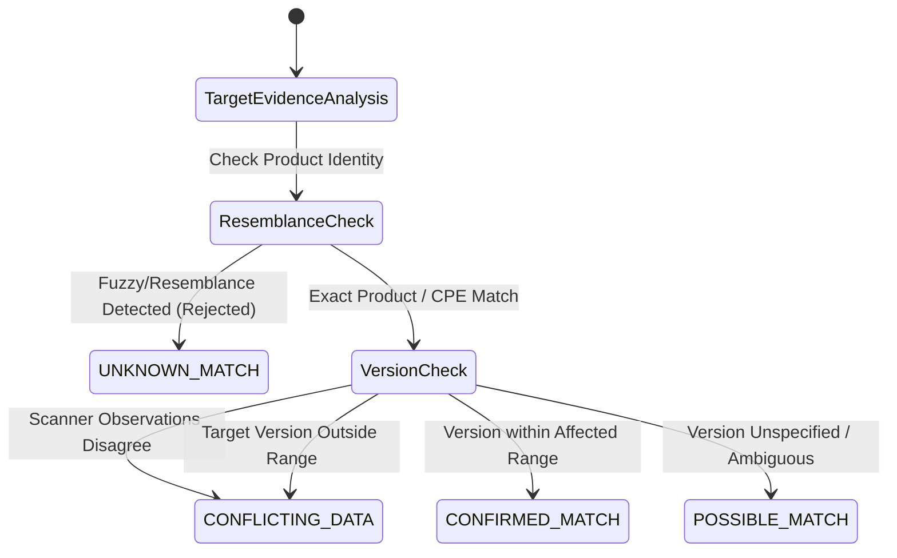

# Evidence-Grounded Threat Intelligence & Vulnerability Correlation Matrix (Prompt 35)

## 1. Overview & Architecture

Prompt 35 introduces an authoritative, explainable threat-intelligence layer that enriches discovered vulnerability findings with verified vulnerability intelligence, active exploitation context (CISA KEV), and exploitation probability metrics (EPSS), while strictly preserving finding severity and eliminating false inferences.

```
+-------------------------------------------------------------------------------------------------+
|                         VAPT THREAT INTELLIGENCE & CORRELATION ENGINE                           |
+-------------------------------------------------------------------------------------------------+
|                                                                                                 |
|   +--------------------------+        +---------------------------+        +----------------+   |
|   | Authoritative Feeds      |        | Validation & Ingestion    |        | Freshness      |   |
|   | - CISA KEV (Catalog)     |------->| - Max 10MB payload limit  |------->| - 7-day cutoff |   |
|   | - NVD CVE 2.0 API        |        | - SHA-256 Checksum        |        | - STALE badge  |   |
|   | - FIRST EPSS v2026       |        | - Idempotent upsert       |        | - SYNCED state |   |
|   +--------------------------+        +---------------------------+        +----------------+   |
|                 |                                   |                               |           |
|                 v                                   v                               v           |
|   +-----------------------------------------------------------------------------------------+   |
|   | Normalized Intelligence Model (threat_intelligence_records)                             |   |
|   | CVE ID, Vendor, Product, Affected Version Ranges, CVSS v3.1, EPSS Probability,          |   |
|   | Active KEV Exploitation Flag, Due Date, Required Action, Provenance URL, Checksum       |   |
|   +-----------------------------------------------------------------------------------------+   |
|                                                     |                                           |
|                 +-----------------------------------+-----------------------------------+       |
|                 |                                                                       |       |
|                 v                                                                       v       |
|   +--------------------------+                                            +-----------------+   |
|   | Evidence-Grounded Match  |                                            | Unaltered Base  |   |
|   | - CONFIRMED_MATCH        |                                            | Severity Policy |   |
|   | - POSSIBLE_MATCH         |                                            | - finding.sev   |   |
|   | - CONFLICTING_DATA       |                                            |   is NEVER      |   |
|   | - UNKNOWN_MATCH          |                                            |   mutated       |   |
|   +--------------------------+                                            +-----------------+   |
|                 |                                                                       |       |
|                 |   +---------------------------------------------------------------+   |       |
|                 +-->| Strict Resemblance Check (Requirement 7)                      |   |       |
|                     | Product substring/fuzzy similarity is strictly REJECTED.      |   |       |
|                     | Never infer asset is vulnerable on resemblance!              |   |       |
|                     +---------------------------------------------------------------+   |       |
|                                                     |                                   |       |
|                                                     v                                   v       |
|   +-----------------------------------------------------------------------------------------+   |
|   | Non-Destructive Threat Correlation Ledger (threat_correlations)                         |   |
|   | Enriched Risk Score = [Base (Unaltered) + KEV (+25) + EPSS (+15) + Context] * Mult      |   |
|   | Full step-by-step audit factor breakdown & empirical evidence grounding                 |   |
|   +-----------------------------------------------------------------------------------------+   |
+-------------------------------------------------------------------------------------------------+
```

---

## 2. Invariants & Defensive Principles

| Invariant | Specification | Guarantee & Defensive Guardrail |
| :--- | :--- | :--- |
| **Resemblance Rejection** | Requirement 7 | Never infer that an asset is vulnerable merely because a product name resembles an affected product (e.g. fuzzy string similarity or prefix/suffix variations like `openssl` vs `libssl-custom-wrapper`). Non-exact matches are classified as `UNKNOWN_MATCH` with zero confidence. |
| **Non-Destructive Severity** | Requirements 8 & 9 | The finding's authoritative severity (`finding.severity`, e.g. `HIGH`) is immutable and never silently overwritten. Contextual threat boosts produce an explainable `enriched_risk_score` in $[0.0, 100.0]$ stored separately in the correlation ledger. |
| **Grounded Version Boundaries** | Requirement 5 | Both product identity AND software version evidence must fall within authoritative affected version ranges (`versionStartIncluding`, `versionEndExcluding`). Unspecified versions result in `POSSIBLE_MATCH`. |
| **Contradictory Observation Handling** | Requirement 6 | Conflicting scanner reports or contradictory target evidence are explicitly tagged as `CONFLICTING_DATA` with a 0.40 confidence multiplier, preserving epistemic uncertainty. |
| **Feed Freshness & Offline Fallback** | Requirements 3 & 10 | Feeds with `last_synced_at` older than 7 days are automatically marked `STALE`. Full offline functionality is preserved via verified local fixtures. |
| **Payload Integrity & Safety** | Requirement 4 | Ingested payloads are strictly validated against JSON schemas, restricted to $\le 10$ MB, and cryptographically verified using SHA-256 digests. |

---

## 3. Match Classification State Machine



---

## 4. Non-Destructive Risk Enrichment Formula

The enriched risk score ($R_{\text{enriched}} \in [0.0, 100.0]$) provides an operational threat rating without modifying the authoritative `finding.severity`:

$$R_{\text{enriched}} = \min\Big(100.0, \max\big(0.0, (S_{\text{base}} + B_{\text{kev}} + B_{\text{epss}} + B_{\text{asset}} + B_{\text{exposure}}) \times M_{\text{match}}\big)\Big)$$

Where:
- $S_{\text{base}}$: Base score from finding severity (CRITICAL: 80, HIGH: 60, MEDIUM: 40, LOW: 20, INFO: 5) — **authoritative finding severity is never modified**.
- $B_{\text{kev}}$: $+25.0$ if listed in CISA Known Exploited Vulnerabilities catalog (`is_known_exploited = True`).
- $B_{\text{epss}}$: $\min(15.0, \text{epss\_score} \times 15.0)$ representing empirical exploitation probability.
- $B_{\text{asset}}$: Criticality boost (CRITICAL: $+15.0$, HIGH: $+10.0$, MEDIUM: $+5.0$, LOW: $0.0$).
- $B_{\text{exposure}}$: $+10.0$ if asset environment is PRODUCTION or target is internet-facing.
- $M_{\text{match}}$: Match classification scaling multiplier:
  - `CONFIRMED_MATCH`: $1.00$
  - `POSSIBLE_MATCH`: $0.70$
  - `CONFLICTING_DATA`: $0.40$
  - `UNKNOWN_MATCH`: $0.10$

---

## 5. API Endpoints Reference

| Method | Endpoint | Role | Description |
| :--- | :--- | :--- | :--- |
| `GET` | `/api/v1/threat-intel/feeds` | VIEWER | List threat feeds, URLs, records ingested, and freshness status |
| `POST` | `/api/v1/threat-intel/feeds/{feed_name}/sync` | TESTER, LEAD, ADMIN | Synchronize threat intelligence feed with SHA-256 integrity |
| `GET` | `/api/v1/threat-intel/records` | VIEWER | Paginated threat intelligence catalog filtered by CVE, vendor, product, KEV |
| `GET` | `/api/v1/threat-intel/cve/{cve_id}` | VIEWER | Retrieve normalized threat record for a specific CVE across all sources |
| `GET` | `/api/v1/projects/{project_id}/threat-intel/correlations` | VIEWER | List project findings correlated with active threat intelligence |
| `GET` | `/api/v1/projects/{project_id}/threat-intel/summary` | VIEWER | Operational KPIs: CVE count, KEV active count, freshness, match distribution |
| `POST` | `/api/v1/projects/{project_id}/threat-intel/correlate` | TESTER, LEAD | Trigger evidence-grounded correlation run across all project findings |
