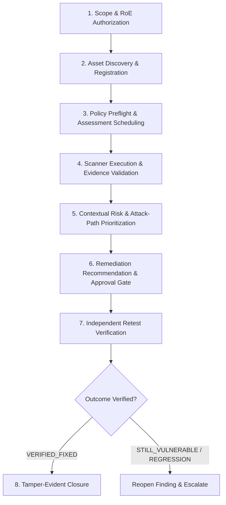

# Unified Autonomous Security Operations Lifecycle

## 1. Overview & Operational Vision

The VAPT Platform's **Unified Operations Lifecycle** establishes an end-to-end, policy-governed closed loop that connects target authorization, asset discovery, scanner execution, evidence collection, contextual risk scoring, remediation planning, independent retesting, and verified lifecycle closure.

Unlike disparate vulnerability management tools that rely on manual ticket transitions or unverified scans, this architecture enforces cryptographic evidence validation, policy-governed execution boundaries, tamper-evident audit trails via the Security Decision Ledger, and fail-closed tenant isolation at every boundary.

---

## 2. The 8-Stage Lifecycle Flow

### Stage 1: Scope & Rules of Engagement (RoE) Authorization
- **Requirement:** Every target (IP, CIDR, Domain, URL) must be registered in `ScopeTarget` with `AuthorizationStatus.AUTHORIZED`, linked to formal authorization evidence (e.g., RoE contract ID), signed by an authorized lead user, and dated.
- **Fail-Closed Rule:** The system rejects all scans, discovery jobs, and retests targeting unauthorized resources. Out-of-scope targets trigger an immediate denial log in the Security Decision Ledger.

### Stage 2: Asset Discovery & Inventory Registration
- **Requirement:** Discovered network endpoints, web services, host ports, and cloud assets are normalized into the `Asset` inventory.
- **Data Provenance:** Assets are linked to their parent organization and project, classified by criticality (`LOW`, `MEDIUM`, `HIGH`, `CRITICAL`), and tagged with first-seen and last-seen timestamps.

### Stage 3: Policy Preflight & Assessment Scheduling
- **Preflight Gate:** Before a job enters `QUEUED` or `RUNNING`, `PolicyEngineService.evaluate_action_permission` evaluates:
  1. Target authorization in scope (`ScopeEngine`).
  2. Emergency suspension status (global kill switch).
  3. Execution budget availability (daily assessment dollar budget).
  4. Concurrency limits per project.
  5. Scanner adapter permission under the project's autonomy intensity tier (`READ_ONLY`, `BALANCED`, `AGGRESSIVE`).
- **Enforcement:** Unauthorized requests are halted before background workers consume resources.

### Stage 4: Scanner Execution & Cryptographic Evidence Validation
- **Execution:** Background workers run authorized adapters (e.g., `web_adapter`, `network_adapter`, `cloud_adapter`, `ssl_adapter`).
- **Evidence Integrity:** Findings (`VulnerabilityFinding`) require raw cryptographic proof (`FindingEvidence`) with SHA-256 digests, HTTP response payloads, banner grabs, or port response telemetry.
- **Deduplication:** Normalization engines hash canonical finding fingerprints (`fp-<hash>`) to prevent duplicate findings across scans.

### Stage 5: Contextual Risk & Attack-Path Prioritization
- **Scoring Engine:** Findings are prioritized by `ContextualRiskService` using:
  - Technical severity (CVSS base metrics).
  - Asset criticality and data classification.
  - Exposure factor (internet-facing vs. internal isolated).
  - Graph topology and exploitability across graph attack paths.
- **Output:** Every finding is assigned an explainable risk score (0.0 to 10.0), confidence level, and priority tier (`LOW`, `MEDIUM`, `HIGH`, `CRITICAL`).

### Stage 6: Remediation Recommendations & Approval Gates
- **Remediation Engineering:** `RemediationRecommendation` records actionable remediation blueprints, including root cause, configuration changes, rollback procedures, and verification criteria.
- **Approval Gate:** Disruptive actions (e.g., service restart, firewall reconfiguration, cipher deprecation) require explicit human review by a Project Lead or Security Admin before deployment.

### Stage 7: Independent Retest Verification
- **Verification Mandate:** Remediation claims cannot close a finding without independent retest evidence.
- **Retest Engine:** Executes an isolated `RemediationVerification` probe using `VerificationMethod.RETEST_ASSESSMENT` or `VerificationMethod.MANUAL_AUDIT`.
- **Outcomes:**
  - `VERIFIED_FIXED`: Vulnerability no longer reproducible.
  - `STILL_VULNERABLE`: Flaw persists despite remediation claims.
  - `PARTIALLY_REMEDIATED`: Flaw mitigated but attack surface remains.
  - `INCONCLUSIVE`: Retest could not reach target or target timed out.

### Stage 8: Tamper-Evident Closure & Reopening
- **Closure:** If `VERIFIED_FIXED`, `UnifiedOperationsService.execute_lifecycle_transition` transitions the finding to `VERIFIED_CLOSED`. An immutable entry is written to `SecurityDecisionLedgerRecord` recording actor ID, policy version, and evidence hashes.
- **Reopen:** If future scans or continuous monitoring detect recurrence, the finding is transitioned to `REOPENED`, incrementing `recurrence_count`, recalculating risk, and dispatching alert notifications.

---

## 3. Subsystem Responsibilities

| Subsystem | Primary Python Class / Module | Core Responsibility |
|---|---|---|
| **Scope Engine** | `ScopeEngine` (`app.services.scope_engine`) | Enforces fail-closed target boundaries and RoE validity. |
| **Asset Inventory** | `AssetService` (`app.services.asset_service`) | Maintains asset topology, service classifications, and criticality. |
| **Policy Engine** | `PolicyEngineService` (`app.services.policy_engine`) | Enforces autonomy tiers, concurrency, budget, and kill-switch state. |
| **Scanner Framework** | `AssessmentEngine` (`app.services.assessment_engine`) | Executes adapters, parses telemetry, and captures raw evidence. |
| **Evidence Validation**| `EvidenceService` (`app.services.evidence_service`) | Verifies SHA-256 evidence integrity and deduplicates findings. |
| **Risk Intelligence** | `ContextualRiskService` (`app.services.contextual_risk_service`) | Multi-variable risk weighting, attack-path graph evaluation. |
| **Remediation & Retest**| `UnifiedOperationsService` / `VerificationEngine` | Manages approval workflows, launches retests, and validates fixes. |
| **Decision Ledger** | `DecisionLedgerService` (`app.services.decision_ledger_service`) | Append-only ledger recording every operational decision and transition. |
| **Notification Pipeline**| `NotificationService` (`app.services.notification_service`) | Deduplicated alert dispatch, escalation, and bounded delivery retries. |
| **SLO Reporting** | `OperationalMetricsService` (`app.services.operational_metrics_service`) | Mathematical measurement of SLOs, handling missing data vs zeros. |

---

## 4. State Transition Matrix

| Current State | Permitted Next States | Trigger Action | Prerequisite Gates |
|---|---|---|---|
| `DETECTED` | `CONFIRMED`, `FALSE_POSITIVE` | Scanner confirmation / Analyst review | Raw cryptographic evidence attached. |
| `CONFIRMED` | `IN_REMEDIATION`, `ACCEPTED_RISK` | Remediation plan created / Risk acceptance | Risk approval required for `ACCEPTED_RISK`. |
| `IN_REMEDIATION` | `RETEST_QUEUED` | Retest requested | Valid remediation recommendation on record. |
| `RETEST_QUEUED` | `VERIFIED_CLOSED`, `CONFIRMED` | Retest probe completed | `VERIFIED_FIXED` -> `VERIFIED_CLOSED`. If failed -> `CONFIRMED`. |
| `VERIFIED_CLOSED`| `REOPENED` | Regression detected in scan | Asset re-scanned, fingerprint match confirmed. |
| `REOPENED` | `IN_REMEDIATION` | Remediation re-engaged | Prioritized risk assessment updated. |

---

## 5. Security & Operational Guarantees

1. **No Silent State Changes:** All state transitions generate immutable records in `SecurityDecisionLedgerRecord`.
2. **Zero Unverified Closures:** System logic strictly forbids closing findings without an accompanying verified retest record.
3. **Emergency Stop Protection:** The global kill switch immediately blocks further scanner dispatch and remediation tasks.
4. **Tenant Isolation:** Multi-tenant boundaries are strictly verified on every API request and worker job execution.
